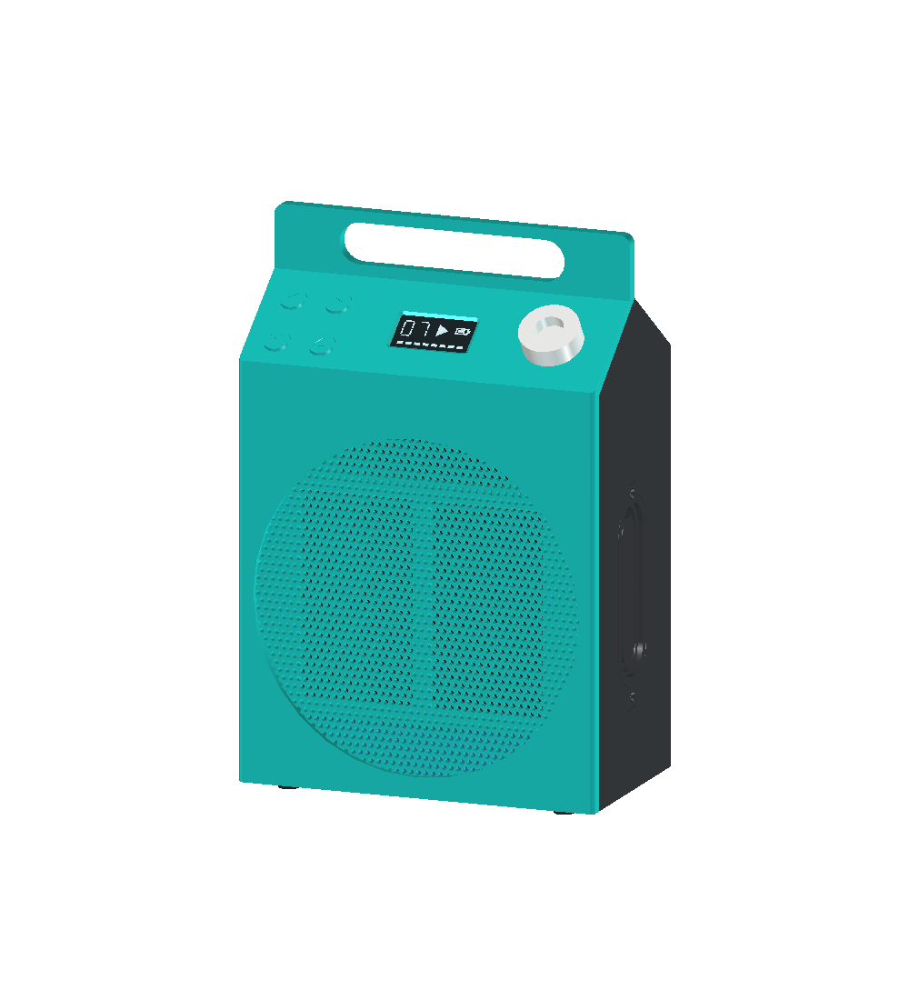
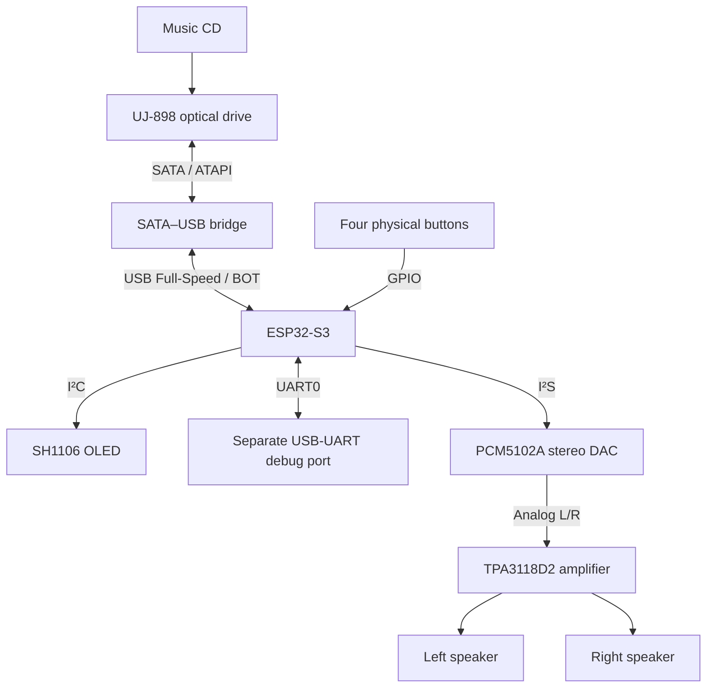
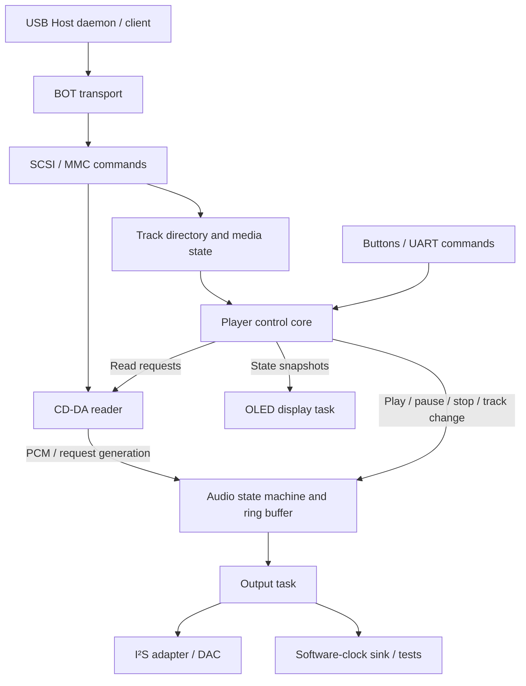

# Discora

**Bring optical discs back to life — as a standalone CD player.**

[简体中文](README.md) · [English](README.en.md)

Discora is an **open-source CD player and optical drive control project built around ESP32-S3**. It combines a salvaged optical drive, a USB bridge, a stereo DAC, an amplifier, and physical controls to play music CDs without a computer. The firmware runs on ESP-IDF / FreeRTOS; no Linux system, network service, or phone is needed during playback.

The project covers the entire path from disc to speakers: USB/SCSI/MMC communication, CD-DA extraction, buffering and playback control, I²S output, buttons and an OLED, and an editable FreeCAD enclosure. Its goal is to build a player from an affordable MCU and readily available modules, with a design people can understand, modify, and test reproducibly, while exploring the limits of standalone optical drive control.

[Features and controls](#features-and-controls) · [Hardware architecture](#hardware-architecture) · [Software architecture](#software-architecture) · [Enclosure and assembly](#enclosure-and-assembly) · [Getting started](#getting-started) · [Documentation](#documentation)

<p align="center">
  <a href="hardware/enclosure/README.md">
    
  </a>
</p>

*Enclosure CAD preview, not a photograph of an assembled device. See the [enclosure documentation](hardware/enclosure/README.md) for models, print files, and assembly drawings. Physical assembly and overall reliability still require validation.*

## Why Discora?

Many salvaged optical drives can still read discs, but normally need a computer to be useful. Discora aims to preserve the experience of inserting a disc, choosing a track, and listening directly, with a microcontroller handling drive commands and audio transfer.

The project is for people who want to build their own CD player and developers interested in USB Host, optical drive protocols, and embedded real-time audio. Firmware, hardware references, wiring diagrams, mechanical models, host-side tests, and experiment records are kept together so contributors can understand and improve one part of the system at a time.

The engineering focus is **stereo CD-DA playback**. CD-R/CD-RW writing is a later research direction and is not implemented. Further work depends on USB bridge compatibility, the drive's minimum write speed, and measured sustained throughput. DVD video decoding, network streaming, and production hardware are outside the initial scope.

## Features and controls

The following describes implemented functionality and optional configurations. Hardware evidence and its limits are covered under [Validation scope and limitations](#validation-scope-and-limitations).

### Disc reading and stereo output

- **Direct music CD reading:** `READ TOC` retrieves tracks and LBA boundaries; `READ CD` retrieves 2,352-byte CD-DA sectors. The player selects supported stereo audio tracks and skips data tracks, four-channel tracks, and tracks that are too short.
- **Stereo PCM pipeline:** 44.1 kHz, 16-bit, interleaved left/right PCM feeds an I²S DAC, whose analog L/R output connects to an amplifier or powered speakers.
- **Continuous playback and track selection:** playback runs from the selected track to the end of the disc. Manual previous/next selection wraps between the first and last eligible tracks. At natural disc end, the player selects the first eligible track and stays stopped; it does not automatically repeat the disc.
- **Buffering and rebuffering:** the PSRAM audio profile uses a 2 MiB software PCM queue with a three-second prefill. At the CD-DA data rate, the queue holds about 11.89 seconds of audio. Optional recovery pauses output after a software underrun and resumes once enough data is available. Track transitions and rebuffering can introduce silence.
- **Optional read-speed requests:** `SET CD SPEED` requests 2× or 4× reading for mechanical-noise and drive-behavior experiments. It is disabled by default. An accepted command does not establish the actual spindle speed.

### Four-button controls and OLED

| Action | Player behavior |
| --- | --- |
| Play/pause | Starts continuous playback from the selected track when stopped, pauses active playback, or resumes from the retained software position |
| Previous/next | Selects the adjacent eligible track, wrapping at the ends; changing tracks while paused keeps the player paused |
| Eject | Waits for the in-flight command to finish, stops audio output, invalidates the track directory, then requests ejection |
| Insert a disc or reconnect | Refreshes the track directory and stays stopped until an explicit playback action |
| Reach the natural end of the disc | Drains audio, closes the output, and selects the first eligible track without starting it |

Buttons use debouncing, one action per held press, and a release-before-use rule at startup. A SH1106 128×64 OLED shows the actual track number, Chinese playback status, track time, and progress. Progress follows software consumption rather than USB read-ahead and does not advance while paused or rebuffering. The display runs in a separate task; a missing screen or I²C failure does not block audio playback. Track-title decoding and scrolling are not implemented.

See [four-button controls](docs/playback-controls.md), [player commands](docs/cd-player.md), and [OLED behavior](docs/oled-display.md) for details.

### Experiments and diagnostics

- An independent I²S test-tone mode separates audio-output checks from optical-drive reading.
- A software-clock sink consumes real CD data to exercise reading, buffering, and player control without a DAC.
- UART commands and status reports expose read latency, buffer levels, underruns, I²S submissions, and errors.
- Optional USB phase diagnostics and bounded seek recovery preserve original failure counts. A disconnected device is not treated as an ordinary buffer underrun.
- Host-side protocol and state-machine tests, plus a serial bench tool, cover track and disc reads, control sequences, and controlled fault scenarios.

These tools distinguish data correctness, software state, and audible output. Software counters alone do not validate the analog signal. See [audio diagnostics](docs/audio-output.md) and the [bench tools](firmware/tools/README.md).

## Hardware architecture

### Signal and audio paths



ESP32-S3 handles USB Host, player control, and digital audio output. The bridge converts between SATA/ATAPI and USB; the MCU does not connect directly to SATA. The DAC converts I²S to line-level analog audio, and the amplifier drives passive speakers.

| Module | Reference hardware | Role and interfaces |
| --- | --- | --- |
| Controller | ESP32-S3 N16R8 development board | 16 MB Flash, 8 MB PSRAM; USB Host, I²S, I²C, GPIO, and UART |
| Optical drive | MATSHITA DVD-R UJ-898 | Slot-loading SATA/ATAPI drive for reading music CDs |
| USB bridge | SATA–USB adapter | Experimental device VID:PID `13fd:0840`; BOT and MMC command passthrough must be checked |
| DAC | PCM5102A module | I²S input and stereo analog output |
| Amplifier and speakers | TPA3118D2 and two speakers | Analog L/R input; enclosure based on an 80 × 45 × 42 mm envelope per driver |
| Display | SH1106 128×64 OLED | I²C track, state, time, and progress display |
| Controls | Four normally open momentary buttons | Play/pause, previous, next, and eject |

This is a reference experiment setup, not a universal compatibility list or finalized BOM. See the [hardware guide](docs/hardware.md) for module references and substitution requirements.

### Power and pin assignments

Drive-motor, controller, DAC, and amplifier supplies are evaluated separately, with appropriate common signal grounding. The drive needs an adequately rated 5V branch; GPIO pins or an unverified development-board USB supply must not carry the motor load. The native USB PHY serves the Host connection, while a separate UART0/USB-UART path handles flashing and logs.

The portable power plan uses a 3S battery pack and two fixed 5V buck converters, one for the controller and one for the drive. Their positive outputs are not connected in parallel. Battery charging, amplifier power, the DAC supply source, and USB backfeed protection still need system-level validation; this is not a completed power design. See the [power decision](docs/decisions/0018-dual-5v-buck.md) and [wiring guide](docs/wiring.md).

The four-button audio profile with OLED uses these pins:

| Interface | Pins |
| --- | --- |
| USB Host D− / D+ | GPIO19 / GPIO20; check the board schematic and native USB connector |
| I²S BCLK / LRCK / DATA | GPIO15 / GPIO16 / GPIO7 |
| Play/pause, previous, next, eject | GPIO1 / GPIO2 / GPIO42 / GPIO41; normally open buttons to GND |
| OLED SDA / SCL | GPIO10 / GPIO11, with 3.3V supply and pull-ups |
| UART0 TX / RX | GPIO43 / GPIO44, separate debug interface |

**GPIO7 is DAC DIN in the audio profile and cannot also be an eject button.** The default query build uses different pin assignments; check the selected profile before wiring. GPIO41/42 cannot be used by these buttons and external JTAG at the same time.

## Software architecture

The firmware is written in C on ESP-IDF / FreeRTOS and uses native USB Host, I²S, I²C, and GPIO APIs. Protocol logic, player state, and device I/O are separated so pure logic can be tested on a host computer without an optical drive.



I²S and the software-clock sink are alternative output paths selected by the build configuration.

| Layer | Responsibilities | Source entry points |
| --- | --- | --- |
| USB transport | Enumeration, interface selection, BOT transfers, timeout and disconnect cleanup; a single client sends device commands | [usb_probe.c](firmware/main/usb_probe.c), [transfer_wait.c](firmware/main/transfer_wait.c) |
| SCSI/MMC protocol | CBW/CSW construction and parsing, device identity, sense data, TOC, and read commands | [probe_protocol.c](firmware/main/probe_protocol.c) |
| CD player control | Track selection, read requests, pause/stop, continuous playback, disc-end handling, and stale-request rejection | [cd_player_core.c](firmware/main/cd_player_core.c), [cd_player.c](firmware/main/cd_player.c) |
| Audio pipeline | PCM ring buffer, prefill, underrun state, and I²S output | [audio_core.c](firmware/main/audio_core.c), [pcm_buffer.c](firmware/main/pcm_buffer.c), [audio_i2s.c](firmware/main/audio_i2s.c) |
| UI/control | Button gestures, eject intent, display snapshots, and SH1106 rendering | [button_core.c](firmware/main/button_core.c), [eject_button.c](firmware/main/eject_button.c), [oled_display.c](firmware/main/oled_display.c), [oled_panel.c](firmware/main/oled_panel.c) |
| Experiments and validation | Continuous-range reading, recovery policy, test tones, host tests, and serial scenarios | [cdda_bench.c](firmware/main/cdda_bench.c), [cdda_recovery.c](firmware/main/cdda_recovery.c), [tests](firmware/tests/), [tools](firmware/tools/) |

### From disc to sound

1. **Identify the device and medium.** Enumerate a BOT interface, query drive identity and readiness, then read and validate the TOC. Only a complete, valid track directory reaches the player.
2. **Plan audio reads.** Generate requests within the selected track's LBA boundaries and read CD-DA in batches of one to eight sectors. Music CDs are accessed as audio sectors, not as files in a mounted filesystem.
3. **Buffer and consume.** The USB client delivers valid PCM to the software queue. After prefill, the output task consumes it at the audio rate. PSRAM holds the software queue; USB and I²S DMA buffers remain in internal RAM.
4. **Handle control changes and failures.** Pause retains the software queue. Stop, track changes, and media invalidation update the request generation, preventing late results from an old read from entering a new track. Only the output task operates I²S, and only the USB client sends SCSI/MMC commands.

Raw CD-DA requires **176,400 bytes/s**. ESP32-S3's native USB is Full-Speed, with a theoretical line rate of 12 Mb/s. Buffering absorbs some read latency, but line rate alone does not establish sustained throughput, bridge compatibility, or power stability. See the [architecture](docs/architecture.md) and [design decisions](docs/decisions/) for details.

## Enclosure and assembly

The enclosure is designed around top-loading discs, a top handle, a sloped front control area, and two centrally placed speakers. Except for the established control layout, the outer shape, side features, grille, and acoustic structures are kept symmetric about the body's center plane.

Three main PLA structures form the enclosure: **front shell, rear shell, and speaker/electronics carrier**, with the side ports and recessed inserts integrated into the rear shell, plus separate button caps, a button retainer, an OLED retainer, a knob, and a drive retainer. The enclosure is 170 mm wide. The drive stands vertically with its labeled underside against a protective pad on the rear wall, supported by a central shelf and secured by a two-screw retainer; the battery envelope sits at the bottom, and the screen and four buttons occupy the sloped front, allowing mechanical, electronic, and control-interface work to proceed separately.

The repository includes an editable FreeCAD model, a rebuild macro, print-mesh export scripts, dimensioned and exploded drawings, and geometry, removal-path, and slicing checks. Passing these checks does not establish physical fit, load capacity, thermal behavior, or acoustic performance. The internal carrier-board layout still needs to be fitted to the enclosure.

[Models and parts](hardware/enclosure/README.md) · [Dimensioned and assembly drawings](docs/enclosure-drawings.md) · [Printing guide](docs/enclosure-printing.md) · [Perfboard layout](docs/perfboard-layout.md)

## Getting started

### 1. Prepare the environment and hardware

For initial drive experiments, prepare an ESP32-S3 board, an optical drive and USB bridge supporting the required MMC commands, a music CD, and an independent serial connection. Audible playback also requires a DAC and an amplifier or powered speakers. The complete four-button/OLED profile below targets an N16R8 board and enables PSRAM.

Install and activate **ESP-IDF v5.4**. Check power and signal connections against the [assembly guide](docs/assembly.md) and [wiring guide](docs/wiring.md), then get the source:

```bash
git clone https://github.com/miclle/discora.git
cd discora/firmware
```

### 2. Choose a build configuration

**Start with drive checks: default query mode.** This queries device identity, media state, and TOC. It does not play audio or write discs. Its default eject-button pin is GPIO7.

```bash
idf.py set-target esp32s3
idf.py build
```

**Build a player: four buttons, OLED, and I²S audio.** Use a separate configuration file and build directory. Run these commands from `firmware/`:

```bash
idf.py -B build-buttons -DSDKCONFIG=sdkconfig.buttons \
  -DSDKCONFIG_DEFAULTS="sdkconfig.defaults;bench/cd-player-i2s.defaults;bench/cd-player-psram.defaults;bench/usb-diagnostics.defaults;bench/cd-player-seek-recovery.defaults;bench/cd-player-buttons.defaults;bench/cd-player-oled.defaults" set-target esp32s3
idf.py -B build-buttons -DSDKCONFIG=sdkconfig.buttons build
```

This enables a 2 MiB PSRAM queue, three-second prefill, 25% digital amplitude, underrun rebuffering, USB diagnostics, and bounded seek recovery with at most one retry per MCU boot. The player starts stopped; press play once the track directory is ready. The 2×/4× read-speed experiments require an additional profile, described in the [player configuration guide](docs/cd-player.md).

`SDKCONFIG_DEFAULTS` supplies defaults for a new configuration; an existing `sdkconfig` may retain earlier settings. Use separate configurations when switching profiles and inspect the generated values. `set-target` can clean a build directory. Keep logs, firmware backups, and experiment snapshots under `.local/bench/` at the repository root, outside `build/`.

### 3. Flash and run

Replace `<DISCORA_UART_PORT>` with the actual Discora UART port. The following command matches the four-button audio build above:

```bash
idf.py -B build-buttons -DSDKCONFIG=sdkconfig.buttons \
  -p <DISCORA_UART_PORT> flash monitor
```

For the default query build, use `idf.py -p <DISCORA_UART_PORT> flash monitor`. Keep the build directory and configuration consistent when flashing. Native USB serves the Host connection; logs are read through the independent UART0 connection. First confirm device identity and TOC, then check controls, both audio channels, and continuous playback. See the [firmware guide](firmware/README.md) and [validation guide](docs/validation.md).

## Validation scope and limitations

The project distinguishes `planned`, `implemented` (source code or design exists), `bench-tested` (evidence under specified conditions), and `verified` (all criteria for the corresponding acceptance scope are met). Feature descriptions do not imply qualification across every hardware combination.

- **Bench evidence exists for:** USB queries, TOC/CD-DA reads, audio-hash comparisons against a computer, repeated end-to-end stereo playback, full-disc I²S submissions, basic four-button operations, and the Chinese OLED interface. The main setup uses UJ-898/HC10, a `13fd:0840` bridge, and one 13-track CD.
- **Further validation is needed for:** cold starts, controlled USB reconnects, recovery from disconnects and seek failures, button edge cases, battery power, and physical enclosure integration. Software underrun recovery is not USB disconnect recovery. Pause and track changes are not guaranteed to be sample-exact or gapless.
- **Future research:** CD-R/CD-RW writing, session finalization, and read-back verification are not implemented. Minimum write speed and sustained throughput must be measured first.

Detailed evidence, deployment information, and outstanding work are maintained in [engineering status](docs/status.md), [experiment records](docs/records/README.md), and the [roadmap](docs/roadmap.md).

## Documentation

This README is a complete English project introduction. Detailed engineering documents and experiment records are primarily in Chinese.

| Topic | Entry points |
| --- | --- |
| Project design | [Requirements and acceptance](docs/requirements.md) · [Architecture](docs/architecture.md) · [Design decisions](docs/decisions/) · [Research](docs/research.md) |
| Hardware and assembly | [Hardware](docs/hardware.md) · [Assembly](docs/assembly.md) · [Wiring](docs/wiring.md) · [Perfboard layout](docs/perfboard-layout.md) |
| Playback and controls | [Firmware builds](firmware/README.md) · [Player](docs/cd-player.md) · [Four buttons](docs/playback-controls.md) · [Audio output](docs/audio-output.md) · [OLED](docs/oled-display.md) |
| Mechanical design | [FreeCAD and print files](hardware/enclosure/README.md) · [Drawings](docs/enclosure-drawings.md) · [Printing and assembly](docs/enclosure-printing.md) |
| Tests and progress | [Validation](docs/validation.md) · [Bench tools](firmware/tools/README.md) · [Engineering status](docs/status.md) · [Experiment records](docs/records/README.md) · [Roadmap](docs/roadmap.md) |

## Development and contributing

```text
discora/
├── firmware/
│   ├── main/          # USB, protocol, player, audio, and UI implementation
│   ├── bench/         # Composable experiment and playback profiles
│   ├── tests/         # Host-side protocol, state-machine, and tool checks
│   └── tools/         # Serial bench and validation tools
├── hardware/          # Module references, carrier boards, and FreeCAD enclosure
├── docs/
│   ├── decisions/     # Design tradeoffs and boundaries
│   ├── records/       # Traceable experiment records
│   └── ...            # Requirements, architecture, wiring, and usage guides
├── README.md          # Chinese introduction
└── README.en.md       # English introduction
```

Host-side checks do not require connected hardware. Run them from the repository root with Python 3 and a C compiler supporting ASan/UBSan:

```bash
python3 firmware/tests/run_host_tests.py
python3 firmware/tests/player_bench_test.py
```

Contributions can include drive/bridge compatibility reports, reproducible failures, audio and power measurements, firmware improvements, and enclosure fit checks. Hardware reports should include the board and drive models, bridge VID:PID, power arrangement, disc medium, firmware/ESP-IDF versions, and reproduction logs. Record compilation results, software tests, and hardware observations separately.

Read [CONTRIBUTING.md](CONTRIBUTING.md) before making changes. Do not commit build outputs, device secrets, or copyrighted CD audio dumps.

## License

Discora is licensed under the [Apache License 2.0](LICENSE). Third-party code, fonts, datasheets, and other materials retain their respective licenses or copyright terms.
