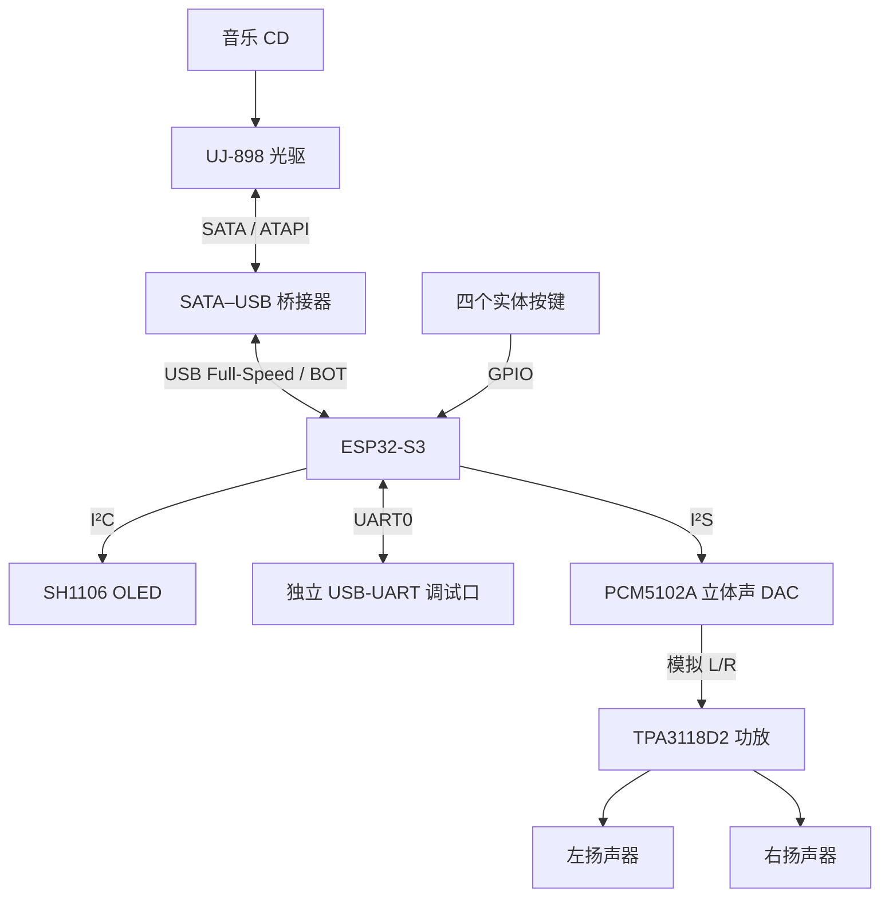
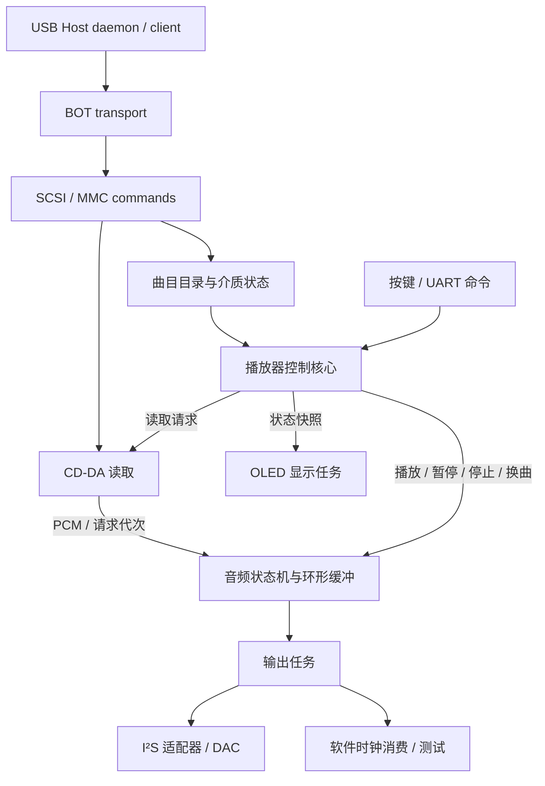

# Discora

**让闲置光驱，重新成为一台独立 CD 播放器。**

[简体中文](README.md) · [English](README.en.md)

Discora 是一个以 **ESP32-S3 为核心的开源 CD 播放器与光驱控制项目**。它将拆机光驱、USB 桥接器、立体声 DAC、功放和实体控制面板组合起来，让音乐 CD 离开电脑也能播放。固件运行于 ESP-IDF / FreeRTOS，设备工作时不依赖 Linux、网络服务或手机。

项目覆盖从光盘读取到扬声器输出的完整链路：USB/SCSI/MMC 通信、CD-DA 音频读取、缓冲与播放控制、I²S 输出、按键与 OLED，以及可编辑的 FreeCAD 外壳设计。目标是用低成本 MCU 和现成模块搭建一台可理解、可修改、可复现实验的播放器，并以此研究独立光驱控制的能力边界。

[功能与交互](#功能与交互) · [硬件架构](#硬件架构) · [软件架构](#软件架构) · [外壳与装配](#外壳与装配) · [快速开始](#快速开始) · [文档导航](#文档导航)

<p align="center">
  <a href="hardware/enclosure/README.md">
    
  </a>
</p>

*外壳 CAD 预览，非实物照片。模型、打印文件和装配图册见[外壳设计](hardware/enclosure/README.md)。实物装配与整机可靠性仍在验证范围内。*

## 为什么做 Discora

许多拆机光驱仍能读取光盘，但通常需要连接电脑才能使用。Discora 希望保留放入光盘、按键选曲、直接聆听的体验，用微控制器承担光驱控制和音频传输，让这些零件组成一台独立设备。

这个项目既面向希望动手搭建 CD 播放器的人，也面向研究 USB Host、光驱协议和嵌入式实时音频的开发者。仓库同时提供固件、硬件资料、接线图、机械模型、主机侧测试和实验记录，便于从一个模块开始理解和改进系统。

工程重点是 **CD-DA 立体声播放**。CD-R／CD-RW 刻录是后续研究方向，尚未实现；是否继续取决于 USB 桥接兼容性、光驱最低写速和实测持续吞吐。DVD 视频解码、联网流媒体和量产硬件不属于首版目标。

## 功能与交互

以下描述已实现的功能与可选配置；不同能力的实测覆盖范围见[验证范围与限制](#验证范围与限制)。

### 光盘读取与立体声输出

- **直接读取音乐 CD**：通过 `READ TOC` 获取曲目与 LBA 边界，通过 `READ CD` 读取每扇区 2352 字节的 CD-DA 音频。播放器选择受支持的双声道音轨，跳过数据轨、四声道轨和过短音轨。
- **双声道 PCM 音频链路**：以 44.1 kHz、16-bit、左右交织 PCM 输入 I²S DAC，再经模拟 L/R 输出接功放或有源音箱。
- **连续播放与选曲**：从所选曲目顺序播放到盘尾；手动上一曲／下一曲可在首尾循环选择。自然播放完毕后回到首条可播放音轨并保持停止，不自动整盘循环。
- **缓冲与重缓冲**：有声 PSRAM 配置使用 2 MiB 软件音频队列、3 秒预填，按 CD-DA 数据率可容纳约 11.89 秒音频；软件欠载时可暂停输出、补足缓冲后继续。轨间切换和重缓冲可能产生静音间隔。
- **可选读取限速**：通过 `SET CD SPEED` 请求 2× 或 4× 读取速度，用于研究机械噪声与读取行为；默认关闭，接受请求不代表已测得相应主轴转速。

### 四键控制与 OLED

| 操作 | 播放器行为 |
| --- | --- |
| 播放／暂停 | 停止时从当前曲开始连续播放；播放时暂停；暂停时从保留的软件位置恢复 |
| 上一曲／下一曲 | 选择相邻可播放音轨；暂停中换曲仍保持暂停，首尾可循环选择 |
| 退碟 | 等待在途命令结束，停止音频输出并使目录失效后执行退碟 |
| 插盘或重新连接 | 重新获取目录，保持停止，等待明确的播放操作 |
| 连续播放到盘尾 | 排空音频、关闭输出，选回首条可播放音轨，等待再次播放 |

按键采用消抖、长按单次触发和上电先释放规则。SH1106 128×64 OLED 显示实际曲号、中文播放状态、单轨时间和进度；进度取自软件消费位置，暂停与重缓冲时不推进。显示任务独立运行，缺屏或 I²C 失败不会阻塞音频播放。曲名解码与滚动尚未实现。

详见[四键控制](docs/playback-controls.md)、[播放器命令](docs/cd-player.md)和 [OLED 显示](docs/oled-display.md)。

### 实验与诊断

- 独立 I²S 测试音模式，用于分开检查音频输出与光驱读取链路。
- 软件时钟消费模式，用真实 CD 数据验证读取、缓冲和控制逻辑，无需接入 DAC。
- UART 控制与状态查询，提供读取耗时、缓冲水位、欠载、I²S 提交及错误信息。
- 可选 USB 分阶段诊断和有界寻道恢复，保留原始失败计数；真实设备失联不被当作普通欠载处理。
- 主机侧协议／状态机测试，以及串口 bench 工具，用于复现整轨、整盘、控制序列与受控故障场景。

这些入口用于分别观察数据正确性、软件状态和真实声音，不将软件计数等同于模拟输出验收。使用方法见[音频诊断](docs/audio-output.md)和 [bench 工具](firmware/tools/README.md)。

## 硬件架构

### 信号与音频链路



ESP32-S3 负责 USB Host、播放控制和数字音频输出；桥接器负责 SATA/ATAPI 与 USB 之间的转换，MCU 不直接连接 SATA。DAC 将 I²S 转成线路级模拟音频，功放驱动无源扬声器，二者职责不同。

| 模块 | 参考选型 | 作用与接口 |
| --- | --- | --- |
| 主控 | ESP32-S3 N16R8 开发板 | 16 MB Flash、8 MB PSRAM；USB Host、I²S、I²C、GPIO 与 UART |
| 光驱 | MATSHITA DVD-R UJ-898 | 吸入式 SATA/ATAPI 光驱，读取音乐 CD |
| USB 桥接 | SATA–USB 适配器 | 实验设备 VID:PID 为 `13fd:0840`；必须验证 BOT 与 MMC 命令透传 |
| DAC | PCM5102A 模块 | I²S 输入、左右声道模拟输出 |
| 功放与扬声器 | TPA3118D2 + 双扬声器 | 模拟 L/R 输入；箱体按 80 × 45 × 42 mm 单元包络设计 |
| 显示 | SH1106 128×64 OLED | I²C，显示曲号、状态、时间和进度 |
| 控制 | 4 个常开轻触按键 | 播放／暂停、上一曲、下一曲、退碟 |

这是参考实验组合，不是通用兼容清单或定型 BOM。具体模块资料与替换前提见[硬件说明](docs/hardware.md)。

### 供电与接口分配

光驱电机、主控、DAC 和功放的供电按负载分别评估，信号保持正确共地。光驱需要足额的 5V 支路，不能由 GPIO 或未经核验的开发板 USB 输出承担电机电流。原生 USB PHY 用于 Host，烧录与日志使用独立 UART0／USB-UART 路径。

便携方案规划采用 3S 电池包，两块固定 5V 降压模块分别给主控和光驱供电；两路输出正极不并联。电池充电、功放供电、DAC 供电归属和 USB 防回灌仍需完成整机验证，不能把该规划视为已闭合的电源设计。详见[供电决策](docs/decisions/0018-dual-5v-buck.md)与[整机接线](docs/wiring.md)。

有声四键与 OLED 配置使用以下 GPIO：

| 接口 | 引脚 |
| --- | --- |
| USB Host D− / D+ | GPIO19 / GPIO20，按开发板原理图核对原生 USB 端口 |
| I²S BCLK / LRCK / DATA | GPIO15 / GPIO16 / GPIO7 |
| 播放／暂停、上一曲、下一曲、退碟 | GPIO1 / GPIO2 / GPIO42 / GPIO41，常开按键接 GND |
| OLED SDA / SCL | GPIO10 / GPIO11，3.3V 供电与上拉 |
| UART0 TX / RX | GPIO43 / GPIO44，独立调试接口 |

**GPIO7 在有声配置中是 DAC DIN，不能同时接退碟键。** 默认查询配置与有声配置的引脚不同，接线前必须核对所选 profile；GPIO41／42 也不能与外部 JTAG 同时使用。

## 软件架构

固件以 C 编写，基于 ESP-IDF / FreeRTOS，使用原生 USB Host、I²S、I²C 和 GPIO API。实现围绕协议、播放器状态和设备 I/O 分层，便于在没有光驱的主机环境中测试纯逻辑。



I²S 与软件时钟是可选输出路径，由构建配置选择。

| 层次 | 主要职责 | 源码入口 |
| --- | --- | --- |
| USB transport | 枚举、接口选择、BOT 传输、超时与断连清理；单一 client 发送设备命令 | [usb_probe.c](firmware/main/usb_probe.c)、[transfer_wait.c](firmware/main/transfer_wait.c) |
| SCSI/MMC 协议 | 构造与解析 CBW/CSW，处理设备身份、sense、TOC 和读取命令 | [probe_protocol.c](firmware/main/probe_protocol.c) |
| CD 播放控制 | 音轨选择、读取请求、暂停／停止、连续播放、盘尾处理及旧请求隔离 | [cd_player_core.c](firmware/main/cd_player_core.c)、[cd_player.c](firmware/main/cd_player.c) |
| 音频流水线 | PCM 环形队列、预填、欠载状态与 I²S 输出 | [audio_core.c](firmware/main/audio_core.c)、[pcm_buffer.c](firmware/main/pcm_buffer.c)、[audio_i2s.c](firmware/main/audio_i2s.c) |
| UI/control | 按键手势、退碟意图、显示状态快照与 SH1106 画面渲染 | [button_core.c](firmware/main/button_core.c)、[eject_button.c](firmware/main/eject_button.c)、[oled_display.c](firmware/main/oled_display.c)、[oled_panel.c](firmware/main/oled_panel.c) |
| 实验与验证 | 连续区间读取、恢复策略、测试音、主机测试与串口场景 | [cdda_bench.c](firmware/main/cdda_bench.c)、[cdda_recovery.c](firmware/main/cdda_recovery.c)、[tests](firmware/tests/)、[tools](firmware/tools/) |

### 从光盘到声音

1. **识别设备与介质**：枚举 BOT 接口，查询光驱身份和就绪状态，读取并校验 TOC；只有完整有效的目录才交给播放器。
2. **规划音频读取**：按所选音轨的 LBA 边界生成请求，以 1–8 扇区为一批读取 CD-DA，不把音乐 CD 当作挂载文件系统中的音频文件。
3. **缓冲与消费**：USB client 将有效 PCM 交给软件队列，输出任务在预填后按音频时钟消费；PSRAM 用作软件缓存，USB 与 I²S DMA 缓冲保留在内部 RAM。
4. **响应控制与故障**：暂停保留软件队列；停止、换曲或介质失效更新请求代次，迟到的旧读取结果不能进入新音轨。只有输出任务操作 I²S，只有 USB client 发送 SCSI/MMC 命令。

CD-DA 的原始数据率为 **176,400 bytes/s**，而 ESP32-S3 原生 USB 为 Full-Speed（理论线速 12 Mb/s）。架构通过缓冲吸收部分读取延迟，但理论带宽不能代替持续吞吐、桥接兼容性和供电实测。设计细节见[系统架构](docs/architecture.md)与[决策记录](docs/decisions/)。

## 外壳与装配

Discora 的机械设计围绕顶部进碟、顶部提手、前斜面操作区和中央双扬声器展开。除按钮及既有操控布局外，外轮廓、侧面造型、格栅与声学结构以机身中心面为基准保持左右对称。

外壳以三个主要 PLA 结构件组织：**前壳、后壳、扬声器／电路板支架**，配合可拆侧孔、键帽、按键支架和 OLED 压框。光驱竖置，电池包络位于底部，屏幕与四键设置在前斜面，方便将机械、电子和控制界面分别调整。

仓库提供可编辑的 FreeCAD 模型、重建宏、打印网格、尺寸与爆炸图，以及几何、拆装路径和切片检查。CAD 与切片检查不等于实物配合、承载、散热或声学验收，机内载板布局仍需完成适配。

[模型与零件说明](hardware/enclosure/README.md) · [尺寸与装配图册](docs/enclosure-drawings.md) · [打印说明](docs/enclosure-printing.md) · [洞洞板布局](docs/perfboard-layout.md)

## 快速开始

### 1. 准备环境与接线

准备 ESP32-S3 开发板、支持所需 MMC 命令的光驱／USB 桥接器、音乐 CD 和独立串口。搭建有声播放器还需 DAC、功放／有源音箱；下面的完整四键与 OLED 配置面向 N16R8 开发板，并启用 PSRAM。

安装并加载 **ESP-IDF v5.4** 环境，按[组装说明](docs/assembly.md)与[接线图](docs/wiring.md)核对供电和信号，再获取源码：

```bash
git clone https://github.com/miclle/discora.git
cd discora/firmware
```

### 2. 选择构建配置

**先验证光驱：默认查询模式。** 查询设备身份、介质状态和 TOC，不播放音乐，也不写盘。默认退碟键为 GPIO7。

```bash
idf.py set-target esp32s3
idf.py build
```

**搭建播放器：四键、OLED 与 I²S 有声模式。** 使用独立配置和构建目录，在 `firmware/` 下执行：

```bash
idf.py -B build-buttons -DSDKCONFIG=sdkconfig.buttons \
  -DSDKCONFIG_DEFAULTS="sdkconfig.defaults;bench/cd-player-i2s.defaults;bench/cd-player-psram.defaults;bench/usb-diagnostics.defaults;bench/cd-player-seek-recovery.defaults;bench/cd-player-buttons.defaults;bench/cd-player-oled.defaults" set-target esp32s3
idf.py -B build-buttons -DSDKCONFIG=sdkconfig.buttons build
```

该组合启用 2 MiB PSRAM 队列、3 秒预填、25% 数字幅度、欠载重缓冲、USB 诊断及每次启动最多一次的有界寻道恢复。启动后保持停止，目录就绪后按播放键开始。2×／4× 限速为另行叠加的实验配置，见[播放器配置](docs/cd-player.md)。

`SDKCONFIG_DEFAULTS` 为新配置提供默认值；已有 `sdkconfig` 可能保留旧设置。切换 profile 时使用独立配置并核对生成结果。`set-target` 可能清理构建目录，日志、固件备份与实验快照应保存在仓库根目录的 `.local/bench/`，不要放进 `build/`。

### 3. 烧录与运行

将 `<DISCORA_UART_PORT>` 替换为实际的 Discora UART 端口。以下命令对应上面的有声四键配置：

```bash
idf.py -B build-buttons -DSDKCONFIG=sdkconfig.buttons \
  -p <DISCORA_UART_PORT> flash monitor
```

默认查询构建使用 `idf.py -p <DISCORA_UART_PORT> flash monitor`。烧录时保持构建目录与配置一致；原生 USB 用于 Host，日志从独立 UART0 读取。首次运行先确认设备身份和 TOC，再验证控制、左右声道与连续播放。详细步骤见[固件说明](firmware/README.md)与[验证手册](docs/validation.md)。

## 验证范围与限制

项目区分 `planned`（计划）、`implemented`（源码或设计已实现）、`bench-tested`（指定条件下有实验或用户反馈）与 `verified`（满足对应完整验收条件）。上述功能描述不代表所有硬件组合均已通过验收。

- **已有台架证据**：USB 查询、TOC／CD-DA 读取、与电脑的音频摘要对照、短时模拟立体声试听、整盘 I²S 提交、四键基本操作及中文 OLED 显示。主要实验组合为 UJ-898／HC10、`13fd:0840` 桥接器和一张 13 轨 CD。
- **仍需验证**：间歇性 USB 失联与寻道故障、整盘全程听感、更多光驱和介质、实体键边界手势，以及电池供电和外壳实物集成。软件欠载重缓冲不等于 USB 失联恢复，暂停和换曲也不保证采样级无损或无缝播放。
- **后续研究**：CD-R／CD-RW 写入、封盘与读回校验尚未实现；最低写速与持续吞吐必须先得到实测支持。

详细证据、部署信息与未完成项集中维护在[工程状态](docs/status.md)、[实验记录](docs/records/README.md)和[路线图](docs/roadmap.md)。

## 文档导航

| 主题 | 入口 |
| --- | --- |
| 项目设计 | [需求与验收](docs/requirements.md) · [系统架构](docs/architecture.md) · [设计决策](docs/decisions/) · [研究资料](docs/research.md) |
| 硬件与装配 | [硬件清单](docs/hardware.md) · [组装说明](docs/assembly.md) · [整机接线](docs/wiring.md) · [洞洞板布局](docs/perfboard-layout.md) |
| 播放与控制 | [固件构建](firmware/README.md) · [播放器](docs/cd-player.md) · [四键](docs/playback-controls.md) · [音频输出](docs/audio-output.md) · [OLED](docs/oled-display.md) |
| 机械设计 | [FreeCAD 与打印文件](hardware/enclosure/README.md) · [图册](docs/enclosure-drawings.md) · [打印与装配](docs/enclosure-printing.md) |
| 测试与进展 | [验证手册](docs/validation.md) · [bench 工具](firmware/tools/README.md) · [工程状态](docs/status.md) · [实验记录](docs/records/README.md) · [路线图](docs/roadmap.md) |

## 开发与贡献

```text
discora/
├── firmware/
│   ├── main/          # USB、协议、播放器、音频和 UI 实现
│   ├── bench/         # 可组合的实验与播放配置
│   ├── tests/         # 主机侧协议、状态机和工具检查
│   └── tools/         # 串口 bench 与验证工具
├── hardware/          # 模块资料、载板与 FreeCAD 外壳
├── docs/
│   ├── decisions/     # 设计取舍与边界
│   ├── records/       # 可追溯的实验记录
│   └── ...            # 需求、架构、接线与操作文档
├── README.md          # 中文介绍
└── README.en.md       # English introduction
```

无需连接硬件即可运行主机侧检查。在仓库根目录执行，需 Python 3 及支持 ASan／UBSan 的 C 编译器：

```bash
python3 firmware/tests/run_host_tests.py
python3 firmware/tests/player_bench_test.py
```

欢迎贡献光驱／桥接器兼容性记录、故障复现、音频和供电测量、固件改进与外壳试装反馈。硬件相关反馈请附开发板和光驱型号、桥接器 VID:PID、供电方式、介质、固件／ESP-IDF 版本与复现日志。编译结果、软件测试和实机结论应分别记录。

开始前请阅读[贡献约定](CONTRIBUTING.md)。不要提交构建输出、设备密钥或受版权保护的 CD 音频转储。

## 许可证

Discora 使用 [Apache License 2.0](LICENSE)。第三方代码、字体、数据手册及其它资料遵循各自的许可或版权要求。
