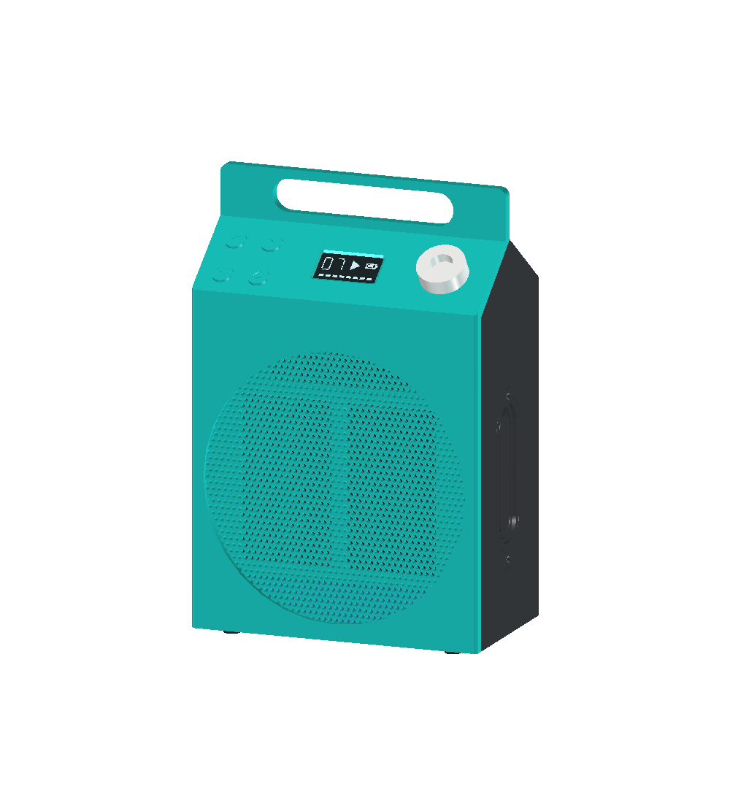

# Discora

**让闲置光驱，重新成为一台 CD 播放器。**

Bring optical discs back to life.

Discora 是一个基于 **ESP32-S3** 的开源独立 CD 播放器项目。它通过 USB 控制光驱，读取音乐 CD，并经 I²S DAC 输出立体声；运行时不需要电脑、Linux 或网络。项目以低成本 MCU 和现成模块为起点，开放固件、接线说明、FreeCAD 外壳模型与实验记录。

[快速开始](#快速开始) · [当前进展](#当前进展) · [硬件与接线](docs/hardware.md) · [外壳设计](hardware/enclosure/README.md) · [文档导航](#文档导航) · [English](#english-summary)

<p align="center">
  <a href="hardware/enclosure/README.md">
    
  </a>
</p>

*V4 外壳 CAD 预览，非实物照片。模型已完成几何与切片检查，实物打印、装配和声学表现尚待验证。查看[模型与打印文件](hardware/enclosure/README.md)或[彩色尺寸与装配图册](docs/enclosure-drawings.md)。*

## 项目概览

- **独立播放**：ESP32-S3 通过原生 USB Host、SCSI/MMC 命令读取 CD-DA，输出 44.1 kHz、16-bit 双声道 PCM。
- **实体操作**：四个按键提供播放／暂停、上一曲、下一曲和退碟；SH1106 OLED 显示曲号、中文播放状态与单轨进度。
- **缓冲与诊断**：可选 2 MiB PSRAM 音频队列、欠载重缓冲及串口诊断，记录读取、输出和故障信息。
- **可自行搭建**：提供模块接线、构建配置、三主体 PLA 外壳设计，以及对应的测试方法和验证记录。

```text
音乐 CD → 光驱 → SATA–USB 桥接器 → ESP32-S3 → I²S DAC → 功放 → 左右扬声器
                                     ↕
                                四键控制 / OLED
```

首版聚焦 CD-DA 播放。**CD-R／CD-RW 刻录尚未实现**，只有在桥接兼容性、最低写速和持续吞吐得到实测支持后才继续研究；DVD 视频、联网流媒体不在首版范围。设计目标与取舍见[需求](docs/requirements.md)和[系统架构](docs/architecture.md)。

## 当前进展

**项目处于原型验证阶段：已有短时立体声试听、整盘 I²S 提交记录和基本操作反馈，整机稳定性仍待验收。** 当前证据主要来自 MATSHITA UJ-898／HC10、`13fd:0840` SATA–USB 桥接器与一张 13 轨音乐 CD，不代表其它硬件或介质的兼容性。

| 能力 | 状态 | 已有结果与边界 |
| --- | --- | --- |
| USB 识别、曲目目录与 CD-DA 读取 | `bench-tested` | 13 轨 TOC 与电脑一致；600 秒音频读取的完整摘要一致 |
| I²S 与模拟立体声 | `bench-tested` | PCM5102A → TPA3118D2 → 双喇叭短时试听获左右清晰反馈；三轮整盘 I²S 提交完成，不替代整盘听感验收 |
| 四键与中文 OLED | `bench-tested` | 五项基本操作、中文显示和进度条已有用户确认；长按、组合键及异常状态待完整覆盖 |
| 读取限速降噪 | `bench-tested` | 2× 请求获接受，用户反馈噪声明显降低、音乐正常；默认关闭，实际转速与整盘稳定性未验证 |
| 外壳设计 | `implemented` | CAD、网格与切片已有检查；实物配合、承载、散热和整机供电集成待验证 |
| CD-R／CD-RW 刻录 | `planned` | 尚未实现，不保证在 ESP32-S3 上可行 |

状态含义：`planned` 为计划，`implemented` 为已实现，`bench-tested` 为指定条件下有实验或用户反馈，`verified` 为满足相应完整验收条件。编译、日志计数和实际听感分别记录。

间歇性 USB 失联与读取／寻道故障仍未关闭；成功实验不能覆盖既有失败记录。**最新源码、部署配置及证据以[工程状态](docs/status.md)为准**，后续工作见[路线图](docs/roadmap.md)，复现条件见[实验记录](docs/records/README.md)。

## 快速开始

### 1. 准备硬件

以下是当前实验组合，并非通用兼容清单或已定型 BOM。

| 部件 | 当前选型／要求 |
| --- | --- |
| 主控 | ESP32-S3；当前有声 PSRAM 配置面向 N16R8 开发板 |
| 光驱与桥接器 | MATSHITA DVD-R UJ-898 + SATA–USB 桥接器，需支持 USB MSC BOT 与所需 MMC 命令透传 |
| 音频输出 | PCM5102A 立体声 DAC + TPA3118D2 功放 + 双扬声器 |
| 操作与显示 | 4 个常开轻触按键、SH1106 128×64 OLED |
| 供电与调试 | 光驱独立、足额的 5V 供电支路；共地；独立 UART0／USB-UART 日志通道 |

先按[硬件说明](docs/hardware.md)、[组装与首次上电](docs/assembly.md)和[接线图](docs/wiring.md)核对电源与信号。光驱电机不能由 GPIO 或开发板的微弱 USB 输出供电；原生 USB 用于 Host 时，不能同时作为电脑日志口。

### 2. 编译默认查询固件

安装并加载 **ESP-IDF v5.4** 环境后，在仓库根目录执行：

```bash
cd firmware
idf.py set-target esp32s3
idf.py build
```

默认配置执行光驱识别、就绪状态、错误信息和曲目目录查询，**不会播放音乐或刻录**；受限 READ CD 实验须显式启用。默认退碟键使用 GPIO7，按下才触发退盘。

已有 `sdkconfig` 会影响配置结果；切换用途时按[固件说明](firmware/README.md)使用独立配置与构建目录。`set-target` 可能清理构建目录，原始日志和烧录前备份应放在仓库根目录的 `.local/bench/`，不要放进 `build/`。

### 3. 选择查询或有声播放配置

| 想要做什么 | 下一步 |
| --- | --- |
| 验证光驱、桥接器与音乐 CD | 使用默认查询固件，按[光驱验证手册](docs/validation.md)记录真实返回值 |
| 播放音乐，使用四键和 OLED | 按[四键配置与构建命令](docs/playback-controls.md)叠加有声、PSRAM、四键及 OLED 配置；接线细节见[音频输出](docs/audio-output.md)和[显示说明](docs/oled-display.md) |
| 复现当前 2× 降噪实验 | 在上述有声组合后追加[读取限速配置](docs/cd-player.md)，对照[限速实验记录](docs/records/2026-11-09-read-speed-probe.md) |

**有声四键配置与默认查询配置的引脚不同**：I²S 使用 GPIO15／16／7，四键使用 GPIO1／2／42／41，OLED 使用 GPIO10／11。此时 GPIO7 是 DAC DIN，不能再接旧查询配置的退碟键。

确认接线与目标串口后，在对应构建配置下烧录。默认查询配置的命令如下，将占位符替换为本机实际的 Discora UART 端口：

```bash
idf.py -p <DISCORA_UART_PORT> flash monitor
```

自定义 profile 烧录时须沿用其 `-B` 和 `-DSDKCONFIG` 参数，避免误刷默认构建。有声四键配置启动后保持停止，目录就绪后按播放键开始。

## 文档导航

| 你想了解 | 入口 |
| --- | --- |
| 当前能做什么、还有什么问题 | [工程状态](docs/status.md) · [路线图](docs/roadmap.md) · [实验记录](docs/records/README.md) |
| 如何选料、接线和上电 | [硬件清单](docs/hardware.md) · [组装说明](docs/assembly.md) · [接线图](docs/wiring.md) · [洞洞板布局](docs/perfboard-layout.md) |
| 如何配置和使用播放器 | [固件](firmware/README.md) · [播放控制](docs/cd-player.md) · [四键](docs/playback-controls.md) · [音频](docs/audio-output.md) · [OLED](docs/oled-display.md) |
| 如何制作外壳 | [FreeCAD 模型](hardware/enclosure/README.md) · [尺寸与装配图册](docs/enclosure-drawings.md) · [打印说明](docs/enclosure-printing.md) |
| 如何理解实现与验证方法 | [需求](docs/requirements.md) · [架构](docs/architecture.md) · [设计决策](docs/decisions/) · [验证手册](docs/validation.md) · [研究资料](docs/research.md) |

## 参与贡献

欢迎提供不同光驱／桥接器的兼容性记录、故障复现、音频与供电测量，以及外壳试装反馈。开始前请阅读[贡献约定](CONTRIBUTING.md)。硬件相关反馈请附开发板与光驱型号、桥接器 VID:PID、供电方式、光盘介质、固件／ESP-IDF 版本和复现日志。

无需连接硬件也可以运行主机侧检查。在仓库根目录执行，需 Python 3 及支持 ASan／UBSan 的 C 编译器：

```bash
python3 firmware/tests/run_host_tests.py
python3 firmware/tests/player_bench_test.py
```

固件位于 `firmware/`，硬件资料和 CAD 位于 `hardware/`，工程文档、实验记录与决策位于 `docs/`。请勿提交构建输出、设备密钥或受版权保护的 CD 音频转储。

## English summary

Discora is an open-source, standalone CD player project built around **ESP32-S3**. It reads CD-DA through a USB-connected optical drive and outputs 44.1 kHz, 16-bit stereo audio through an I²S DAC, without a computer, Linux, or network at runtime. The repository includes firmware, wiring guides, FreeCAD enclosure files, and experiment records.

The project is in **prototype validation**. USB queries, CD-DA reads, short stereo listening, three full-disc I²S submission runs, four-button basic controls, and the Chinese OLED interface have bench evidence. Intermittent USB/seek failures remain unresolved; full-disc listening, overall reliability, and physical enclosure assembly remain unverified. CD-R/CD-RW writing is a later research goal and is **not implemented**.

The default ESP-IDF v5.4 build runs queries only. Follow the [four-button audio profile](docs/playback-controls.md) for playback, and check [current status](docs/status.md) for deployment details and evidence boundaries.

## License

Discora 使用 [Apache License 2.0](LICENSE)。第三方代码、字体、数据手册及其它资料遵循各自的许可或版权要求。
