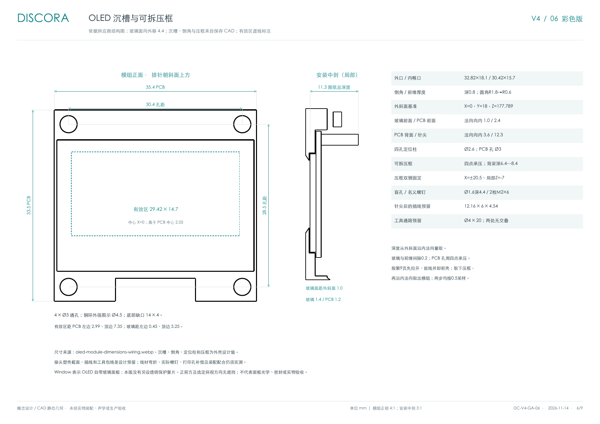
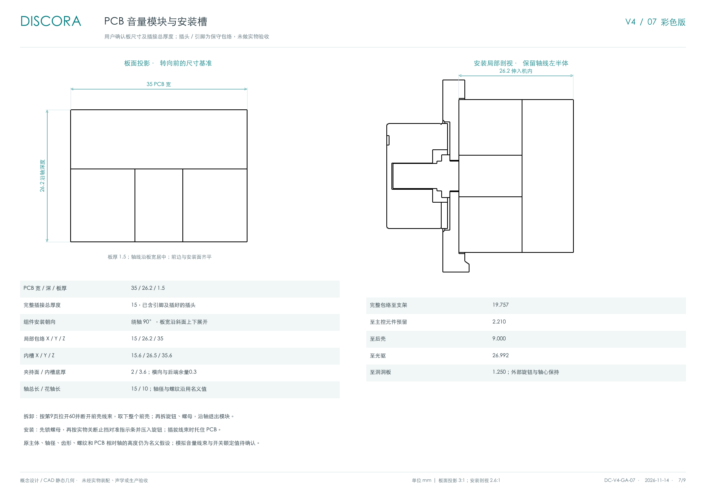
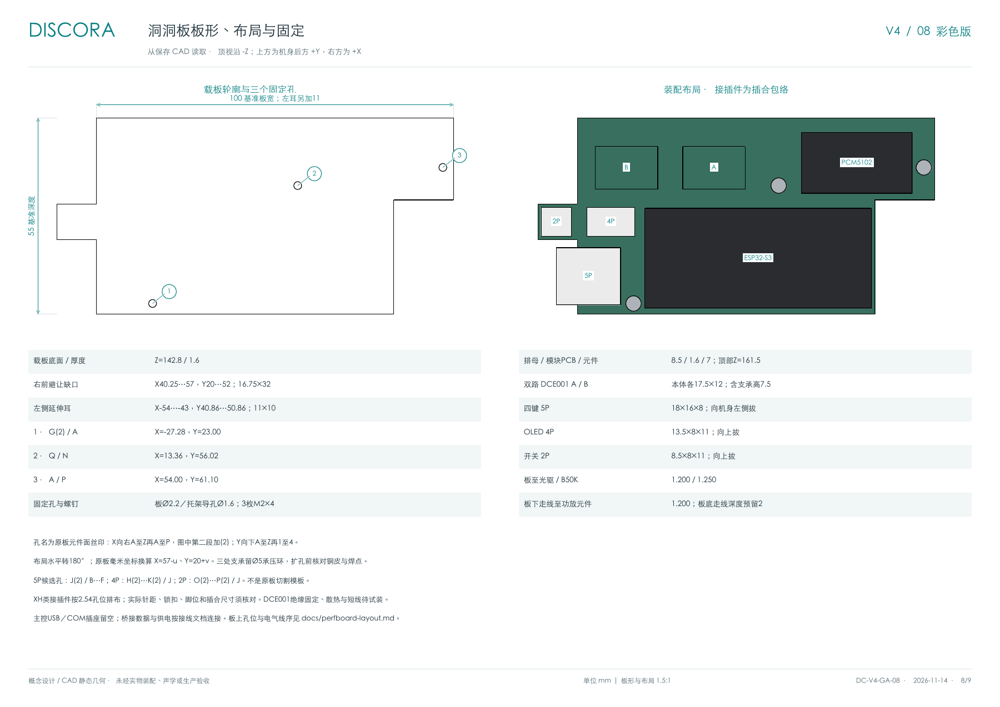
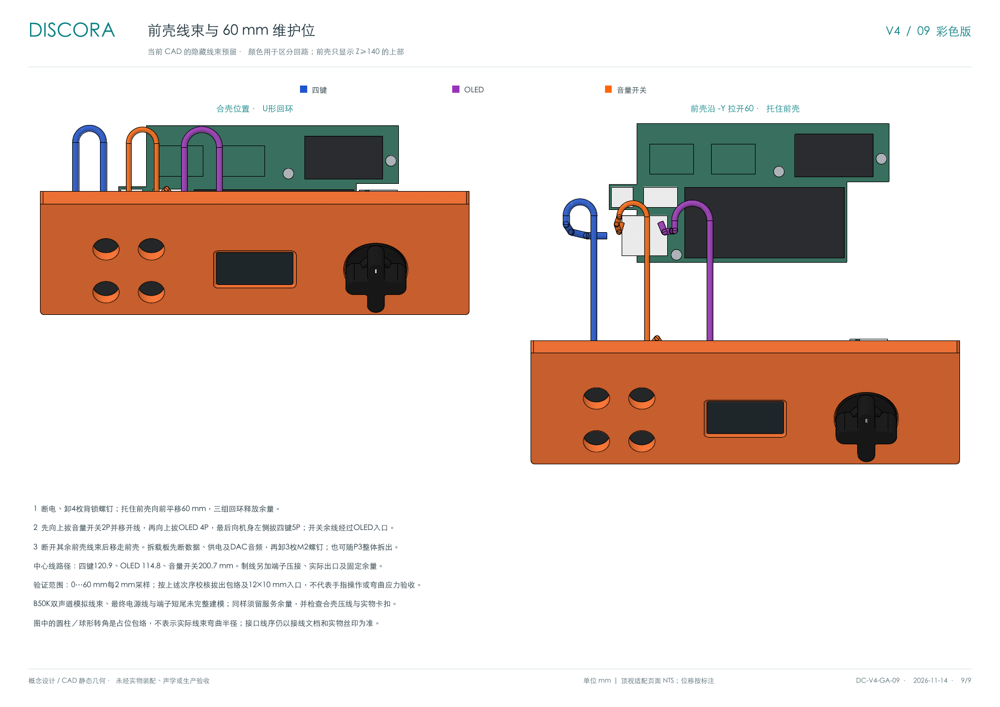

# Discora V4 整机尺寸与装配图册

> 2026-11-14 图册已同步当前洞洞板与前壳线束版 CAD，共九页。新增第 8 页载板板形、固定孔和装配布局，第 9 页合壳／60 mm 维护位线束图；爆炸图、侧剖、44 个对象清单、音量模块净距及切片数据同步更新。设计依据见 [ADR-0037](decisions/0037-perfboard-carrier-and-front-harness.md)和[洞洞板布局](perfboard-layout.md)。

当前保存模型的整机外包络为 **宽 170 × 深 93 × 高 243.263 mm**，包含脚垫和提手；**不含脚垫的总高为 240.263 mm**，仍包含提手。图册汇总外观尺寸、开孔、两层爆炸图、侧剖及模型对象清单，供外形评审与布局核对。

**[打开彩色整机图册 PDF（9 页，A3 横向）](../hardware/enclosure/drawings/Discora-V4-drawing-book-color.pdf)**

彩色版的实体填色沿用 CAD 建模脚本配色，两张爆炸图增加了明暗层次、颜色图例和带白色描边的编号引线。图形轮廓、尺寸线与文字仍为矢量，填色层从同一 CAD 实体的平面轮廓和曲面网格正投影生成，使用逐像素深度检查保留遮挡和孔洞；配色仅帮助辨认，不代表实物材料；第 9 页蓝／紫／橙分别标识四键、OLED 和音量开关回路。

尺寸为 CAD 名义值；当前仍是概念设计，采用 PLA、已做三主体分件与 0.4 mm 喷嘴切片，但未验证完整公差、打印补偿和紧固件配合，不能直接作为生产加工图或实物装配验收依据。已按用户选定的 5600mAh 平排电池商品标称 112 × 70 × 20 mm 更新模型；实物线材、插头、固定方式及外围电源模块仍待核对。

## 图册目录

| 页码 / 图号 | 内容 | 比例 |
| --- | --- | --- |
| 1 / DC-V4-GA-01 | 正面与右侧外观；总宽深高、含 / 不含脚垫高度对照、斜面尺寸、提手、格栅和侧开口 | 正 / 右视 0.9:1 |
| 2 / DC-V4-GA-02 | 顶视、背视、前斜面开孔真形；碟口、屏窗、操控开孔、前壳／支架连接孔及一体侧孔 | 顶视 0.95:1；背视 0.85:1；开孔 1:1 |
| 3 / DC-V4-GA-03 | 外壳与内部两层彩色爆炸图并排；01–08、A–M 编号及组件说明 | NTS |
| 4 / DC-V4-GA-04 | X=−26 左喇叭中心侧剖；主要硬件包络、净距及未验证边界 | 剖视 1:1 |
| 5 / DC-V4-GA-05 | 44 个成品对象、三主体打印姿态、拆装次序及模型摘要 | 清单 |
| 6 / DC-V4-GA-06 | OLED 模组、内侧沉槽、倒角、四孔定位与可拆压框、接头／工具预留 | 模组正视 4:1、安装中剖 3:1 |
| 7 / DC-V4-GA-07 | PCB 音量模块板面、安装局部剖视、转向与避让槽、净距及维护顺序 | 板面 3:1、安装剖视 2.6:1 |
| 8 / DC-V4-GA-08 | 洞洞板板形、三点固定、模块布局、接插件和净距 | 板形／布局 1.5:1 |
| 9 / DC-V4-GA-09 | 合壳回环、前壳拉开 60 mm 的线束维护位、拔插次序与验证边界 | NTS |

NTS 表示不按装配距离比例读取。打印时选择 **A3、实际大小 / 100%**，关闭“适合页面”；打印缩放会改变纸面比例，始终以标注数值为准。各正投影独立标明观察方向，不按视图排列推断第一角或第三角投影法。


## 基准与外观尺寸

单位均为 mm。X 向右、Y 向后、Z 向上；机身中心面 X=0、前表面 Y=0、后表面 Y=93、脚垫底面 Z=−2。外壳轮廓、提手、格栅、左右侧面和声学结构按 X=0 镜像；屏幕与旋钮保留此前上移 15 mm 后的位置，四键改为屏幕左侧 2×2 布局；内部电子件按电池空间重新布置。

| 项目 | 当前名义尺寸 / 坐标 | 读取方式 |
| --- | --- | --- |
| 整机 | X=−85…85，Y=0…93，Z=−2…241.263 | 保存实体的总包络 |
| 前肩外轮廓 | YZ：(0,165) → (44,196.263) | 斜角约 35.39° |
| 提手外轮廓 | Y=44…49，顶面 Z=241.263 | 前后厚 5；顶外角 R4 |
| 后肩外轮廓 | YZ：(49,193.682) → (93,162.419) | 高差 31.263、水平距离 44；斜角约 35.39° |
| 前壳面板厚度 | 竖直面 / 顶部斜面主体为 5；护网为 2.5 | 沿各面法向读取；安装座、盲孔连接柱及提手根部为局部加强区域 |
| 后壳主体厚度 | 后壁、侧壁、底板和后斜顶均为 5 | 斜顶沿法向；饰片仍厚 2，局部功能结构另计 |
| 底部四角 | R4，左右 XZ 圆弧沿深度贯通；Z=1…5 | 与提手顶部共用 R4；前后壳接缝连续 |
| 前壳竖向外棱 | R1.6 | `CowlEdges` 圆角设计 |
| 提手净开口 | 90 × 24；中心 X=0、Z=218.763，端部 R12；上下横梁均为 10.5 | 长圆刀体；并非矩形有效握持空间 |
| 中央格栅 | 正面完整圆孔 Ø130；中心 X=0、Z=76 | 护网底片 Ø136、厚 2.5；1531 个完整孔＋92 个部分孔、孔 Ø1.88、孔距 2.9；正面内凹 2.5，背面 Y=5 |
| 左右侧开口 | Y 向 29、Z 向 74；中心 Y=49、Z=80 | 内凹饰片 12 × 56；导音孔本体包络见清单 |
| 顶部碟口 | 水平投影 124 × 5.5；中心 X=0、Y=79.05 | 沿 Z 贯穿后斜面；斜面上的实际曲线长度不等于水平投影 |
| 四个按键 | 开孔 Ø10.5；键帽 Ø10、外露 1.2，止退沿 Ø12.8 | 中心 X=−59 / −41，Y=9 / 26；列距 18、斜面行距 20.854 |
| OLED | 外口 32.82 × 18.1、R1.8；内喉口 30.42 × 15.7、R0.6 | 倒角深 0.8；玻璃面内退 1.0，中心 X=0 |
| 音量旋钮 | 壳孔 Ø7.2／局部壁厚 2；底盘 Ø24×1.4 下沉 1、十字跨度 24／臂宽 6.8；顶面高出面板 12.9 | 中心 X=48；Ø6.0 基孔／六筋内切 Ø5.6 压配，见 ADR-0032 |
| 屏窗与旋钮基准 | Y=18、Z≈177.79 | 中心 X=0 / 48；四键深度和压板详见 ADR-0023 |
| 一体后壁 | 宽 170、高 161.419、厚 5；Z=1…162.419 | 与侧壁、底架合并，无独立后盖与旧后盖孔 |
| 前壳背锁连接 | 后壁 X=±79.4、Z=33；后斜面 X=±29、Z=179 | Ø4.4 深孔、Ø2.2 通孔、Ø1.6 盲底孔；前表面无螺丝孔 |
| 支架连接 | X=±64、Z=27 / 124 | 四处 Ø2.8 通孔，沉头 Ø4.8；底孔 Ø2.0 |
| 一体侧孔 | 中线 Y=49，短管止于 X=±65.3 | 导音孔和饰片并入 P2；原固定孔取消，至声腔轴向留隙 0.3 |
| 脚垫 | 4 × Ø8 × 3 | 中心 X=±55、Y=11 / 69 |

### 侧面高度：含脚垫与不含脚垫

第 1 页将总高与斜肩坐标并入外观尺寸：总高从 **Z=−2** 的脚垫底面量起，右上方表格列出含脚垫与不含脚垫总高及斜肩 Z 坐标。不含脚垫以 **Z=1** 的外壳底面为基准，避免重复绘制相同的侧视图。以下值均包含提手（如涉及最高点），未计脚垫受压变形。

| 测点 | 含脚垫高度 | 不含脚垫高度 |
| --- | --- | --- |
| A：前竖面与前斜面的交点 | 167 | 164 |
| B：前斜面与提手前侧交点 | 198.263 | 195.263 |
| C：后壳对称顶点，与前壳内斜面相接 | 195.682 | 192.682 |
| D：后斜面与后竖面的交点 | 164.419 | 161.419 |
| 提手顶 / 整机最高点 | 243.263 | 240.263 |
| 外壳底面 | 3 | 0 |

前后斜面均为水平距离 44、高差 31.263、倾角 35.395°，实际斜宽均为 53.976。提手前后厚 5，高于前斜肩 45；以上斜面高差与角度不受底面基准选择影响。后壳侧轮廓从 Y=5 至 93，以 Y=49 为对称轴；侧孔也居中于此。前壳以 5 mm 法向厚度贴合前侧，起点比后壳高 2.581；后壳顶点与接缝直接相接。提手中线仍为 Y=46.5，第 1 页侧视虚线标的是后壳对称轴。数据读自保存模型的 `FoldSection` 截面、外壳和 `Feet` 实体，记录在 [side-profile.json](../hardware/enclosure/drawings/side-profile.json)，不由预览图量取。

外观尺寸主要取自保存实体、开孔刀体与截面草图；圆角、护网孔径等设计值同时核对 [build.FCMacro](../hardware/enclosure/build.FCMacro)。单件包络在第 5 页按装配坐标 X × Y × Z 列出，不能把倾斜件的轴对齐包络当成自身厚度或展开尺寸。

## 爆炸图与零件清单的含义

爆炸图由图册对应 FCStd 的成品实体分组平移，再进行等轴测投影与隐藏线消除，未缩放或重新绘制硬件外形。图中位移仅用于阅读，不表示已验证的拆装方向、次序或工具空间。引线端点位于对应组的投影包络中心；复合件的中心可能落在实体之间。

第 3 页左侧结构层覆盖 44 个成品对象，分成 7 组；右侧展开 P3 支架、光驱压条及 30 个硬件对象，分成 13 组。完整成员及展示位移见 [geometry.json](../hardware/enclosure/drawings/geometry.json)，每层内无重复或遗漏。第 5 页编号可反查两张爆炸图。

P1 前壳合并前斜面、提手、格栅、屏幕座和四键定位座；P2 后壳合并后斜面、碟口导向、侧壁、后壁、底架、电池托盘及光驱中央底托和压条螺柱；P3 合并双声腔、前障板和电子托架。前后壳在两侧以直线接到提手根部，取消短平台与回折，详见 [ADR-0020](decisions/0020-rear-roof-shell-ownership.md)。三个主体均是单一连续实体。光驱采用后壁保护垫、中央底托和两螺钉压条，见 [ADR-0035](decisions/0035-measured-drive-rear-wall-mount.md)。左右导音孔和饰片已并入 P2，短管位于 P3 前向扫掠范围之外；加上四键帽、按键支架、OLED 压框、旋钮及光驱压条，共 11 件刚性 PLA 零件，见 [ADR-0029](decisions/0029-integral-side-ports.md)。对象清单仍不是完整采购 BOM：`Feet` 是四个软脚垫的复合对象，`Window` 是 OLED 自带玻璃，`StatusArt` 是显示示意，`Chip` 为元件高度预留，真实线束、紧固件和外围电源板尚不完整。

前壳正面螺丝孔已取消，改由后壁下方及后斜面各两处深孔锁紧，见 [ADR-0024](decisions/0024-rear-access-front-cover-fasteners.md)。[fastener-checks.json](../hardware/enclosure/fastener-checks.json) 核对正面补实、盲孔及工具通路；下方两孔通道深 78.8 mm，刀杆有效伸入长度需至少约 79 mm；实际批头与刀杆仍需试装。

2026-11-09 圆孔与护网层次调整见 [ADR-0026](decisions/0026-recessed-front-grille.md)：护网背面及内部布局保持，局部厚度从 5 改为 2.5 mm，正面内凹 2.5 mm；Ø136 底片位于 Ø130 圆口下方，孔阵由面板边缘自然遮挡。

第 6 页为 OLED 模组正视、局部安装中剖与参数，模组尺寸来自[结构图](../hardware/OLED-1.3-128x64/oled-module-dimensions-wiring.webp)：PCB 35.4 × 33.5 × 1.2、四孔 Ø3／孔距 30.4 × 28.5、玻璃 34.5 × 23 × 1.4，有效区比 PCB 中心高 2.05。玻璃前面已从内退 5.4 改为 1.0 mm；内侧沉槽、0.8 mm 深窗口倒角及可拆压框见 [ADR-0028](decisions/0028-oled-mechanical-mount.md)。没有独立保护片。



侧饰片已改为四点连接，筋截面 2×3 mm、饰片厚 2 mm；67×22 mm 外口保持，历史加强阶段最窄采样净通流面积约 384.24 mm²；本版声腔加深和短管延长见 ADR-0035，不能直接继承旧版声学判断。现有喇叭资料不足以确定声学调谐尺寸，详见 [ADR-0030](decisions/0030-side-inset-support-and-port-sizing.md)。

第 7 页按图册对应模型绘制带 PCB 的音量模块：板尺寸 35×26.2×1.5、含引脚及插头总厚 15，组件绕轴转 90°。局部安装包络 X/Y/Z=15/26.2/35，避让槽为15.6/26.5/35.6，夹持面厚2。板前边与安装面齐平，轴线沿板宽居中；真实连接器脚位和板上安装孔未建模。按当前实体重读，完整包络至支架19.757、至主控元件2.210、至后壳9、至光驱26.992、至洞洞板1.250。拆卸先按第 9 页拉开前壳并断线，再取下整个前壳、拆旋钮和螺母。



第 8 页从当前板实体读取轮廓，基准 100×55×1.6，右前缺口16.75×32、左耳11×10，整体宽111；载板底Z=142.8，三处名义M2×4固定点与P3托架对应。板至光驱1.2、板下走线至功放1.2、板至B50K1.25。模块与插头包络来自保存模型，孔位和电气线序以[布局文档](perfboard-layout.md)为准。PDF 用 `G(2)`、`J(2)` 等标记丝印第二段字母，对应文档中的 G₂、J₂，避免字体缺失下标。



第 9 页展示合壳U形回环与前壳沿−Y拉开60 mm的维护位。先向上拔音量开关并移开余线，再向上拔OLED，最后向左拔四键；断开其余前壳线束后移走前壳。三组中心线路径约120.9／114.8／200.7 mm，制线须另加端子、实际出口与固定余量。模拟音量线束及最终电源线未完整建模，不能从图中读取最终裁线长度。



## 版本与证据

- 图册来源为当前保存的 [Discora.FCStd](../hardware/enclosure/Discora.FCStd)，图册日期 2026-11-14。
- 模型 SHA-256：`9ef433e8437eef3b3aa45558a329a66d8422e0c9014894b763a873c1162eee05`。
- P1 前壳及四键采用 PLA Lite 橙色 16301（`#FF671F`），旋钮主体采用 PLA Basic 黑色 10101（`#000000`），0.7×2.2 mm 指示条为深 0.6 mm 的白色 PLA 区域，与顶面齐平；白色符号为独立 PLA Lite 实体，深 0.6 mm、与键面齐平。四个键帽沿用既有复合形状；音量适配阶段的其余 28 个成品几何比较见 `volume-checks.json`；此前侧缘调整的其余 29 个成品及双色件面序核对见 `side-seam-checks.json`；此前底角调整见 `bottom-corner-checks.json`；此前后壳加厚的 28 个其余成品、R4 曲面、内壁、净距和双色件面序核对见 `rear-thickness-checks.json`。此前光驱适配的 20 个既有硬件／操控对象及双色件面序比较见 `drive-mount-checks.json`；此前 PCB 模块适配的 31 个不变成品及前壳局部改动范围见 `volume-pcb-checks.json`。配色阶段曾在 FreeCAD 1.1.4 关闭并重开验证各材料面的颜色；光驱适配生成时 GUI 接口不可连接，未完成该版本的交互界面读回，当前几何投影和填色图由保存模型无界面生成。
- [dual-color-key-checks.json](../hardware/enclosure/dual-color-key-checks.json)：四键的橙白网格闭合、材料体积不重叠、合并为连续实体；Bambu Studio 识别四个对象、每个两个材料区域，并以 0.4 mm 喷嘴 / 0.12 mm 层高切片。每键均生成 5 层白色路径；白色遮盖和实际成型未验。其余装配碰撞与历史几何等价性见 `appearance-checks.json`。
- 出图检查核对整机 170/93/243.263、提手净开口 90/24、正面圆孔直径 130、护网内凹 2.5、厚 2.5、碟口水平投影 124/5.5、屏窗外口 32.82/18.1、内喉口 30.42/15.7、电池 112/70/20，以及光驱、碟口坐标和左右侧孔 Y=49 与后壳侧视对称轴对齐；读回壳体截面、外壳底面和脚垫底面核对双基准高度。最终前壳在 Y=0…2.5 保留完整 Ø130 圆口，检查该区域无材料侵入。
- [rear-thickness-checks.json](../hardware/enclosure/rear-thickness-checks.json)：历史 5 mm 加厚阶段的主体壁厚、内壁位置、关键间隙、R4 和侧视对称通过；当时后壳顶点 Z=189.774，前壳接缝无台阶，28 个其它成品保持。历史侧缘比较仍见 `side-seam-checks.json`，加厚决策见 [ADR-0034](decisions/0034-five-mm-rear-shell.md)。
- [drive-mount-checks.json](../hardware/enclosure/drive-mount-checks.json)：光驱适配阶段的最大填充包络、1 mm 后壁保护垫间隙、接头／线缆净空、压条与工具通路通过；20 个既有硬件／操控对象差集为零，四键和旋钮面序保持。光驱适配阶段的侧孔检查见 [drive-side-port-checks.json](../hardware/enclosure/drive-side-port-checks.json)，保存后的 GUI 资源与元数据检查见 [drive-model-metadata-checks.json](../hardware/enclosure/drive-model-metadata-checks.json)；后者不替代 GUI 打开读回。设计与未测边界见 [ADR-0035](decisions/0035-measured-drive-rear-wall-mount.md)。
- [validation.json](../hardware/enclosure/validation.json) 对应当前洞洞板版的三主体、干涉、对称及退碟检查。音量模块和前壳继承的几何见 [volume-pcb-checks.json](../hardware/enclosure/volume-pcb-checks.json)。
- [oled-checks.json](../hardware/enclosure/oled-checks.json)：孔位、玻璃深度、沉槽／倒角、选定正视及斜视方向无遮挡、定位柱与压框、左右对称、接头／插线、工具通路及先卸压框再取屏的两步路径通过；实际模块、线材和螺钉配合待验。
- [assembly-paths.json](../hardware/enclosure/assembly-paths.json)：该报告覆盖断线后的刚性部件路径，前壳按 1 mm 步长检查；带线拉开及拔插次序以 `perfboard-checks.json` 为准；支架和电池用连续保守扫掠，侧孔随后壳保持固定；光驱先前移／抬升进入接头维护位置，拔出接头后前向侧转拆出；平移及接头退出用连续保守扫掠，光驱抬升检查 31 个姿态、转动按 0.5° 步长检查 61 个姿态，均采用填满的最大主体包络。抬升和转动采样不是连续运动证明；以前置拆卸 P3、压条、电池、卸紧固件及断线为条件；详细顺序和限制见[打印与装配说明](enclosure-printing.md)。
- [volume-pcb-print-checks.json](../hardware/enclosure/volume-pcb-print-checks.json)：前壳切片为14h 7m 19s、156.65 g；本次前壳B-rep几何等价，但重导出的STL摘要不同，图册沿用原盘估算，不声称新网格已重新切片。
- [perfboard-print-checks.json](../hardware/enclosure/perfboard-print-checks.json)：当前后壳9h 33m 26s、297.00 g；P3 支架6h 36m 52s、163.85 g。两盘已重新切片，未实物打印。
- [perfboard-checks.json](../hardware/enclosure/perfboard-checks.json)：前壳与操控件保持；载板三点固定、局部走线、60 mm 服务位及按序拔插检查通过。线束0…60 mm每2 mm采样，12×10 mm入口仅为包络检查，未验证真实手指握持、线材应力或卡扣。
- [print-checks.json](../hardware/enclosure/print-checks.json)：历史单色记录，170 mm 光驱适配版四个单色盘均重新切片，新增光驱压条进入小件盘，四键与旋钮分别使用双色记录。十一个闭合包络网格适合用户给定的 256³ 空间，Bambu Studio 使用 P2S / 0.4 mm 配置完成四盘 PLA 切片；未用 0.2 mm 喷嘴切片，未实物打印。
- 图册只保留这一份彩色 PDF，共 9 页 A3 横向，已逐页渲染检查文字、标注及爆炸编号；实体颜色沿用 CAD，线图和填色共享同一模型及投影。颜色、网格精度及输出尺寸见 [color-render.json](../hardware/enclosure/drawings/color-render.json)。临时渲染和切片在被忽略的 `tmp/`，未向打印机发送任务。

四键设计与尺寸假设见 [ADR-0023](decisions/0023-four-button-front-panel.md)，[button-checks.json](../hardware/enclosure/button-checks.json)记录孔径、局部尺寸和键帽活动余量；引脚面照片和直接焊线要求对应的镂空支架见 [ADR-0025](decisions/0025-open-button-wire-retainer.md)；精确脚距、实际行程和支承面配合待实测。

电池当前位置为 X=−56…56、Y=6…76、Z=8…28；此前前壳加厚并将深度增至 80 mm，详见 [ADR-0021](decisions/0021-five-mm-front-panel.md)。此前顶部等斜面与操控上移 15 mm 的决策见 [ADR-0019](decisions/0019-matched-top-shoulders.md)。后斜面及碟口导向现已并入后壳，光驱整件从前方拆装，见 [ADR-0020](decisions/0020-rear-roof-shell-ownership.md)。托盘已并入后壳并增加绑带槽。前障板并入 P3，后盖孔取消，侧孔与饰片并入后壳，取消侧孔安装耳及其固定孔。取舍见 [ADR-0016](decisions/0016-three-part-pla-enclosure.md)，此前电池布局见 [ADR-0015](decisions/0015-flat-battery-enclosure.md)。喇叭安装面／孔位、实物屏幕、桥接连接、电池线材和外围供电模块、密封与热性能、提手强度、打印补偿及螺钉耐久仍待实测。

## 更新图册

生成流程只读取保存的 FCStd，先导出几何，再排版 PDF。本版通过 `perfboard-checks.json` → `volume-pcb-checks.json` → `drive-mount-checks.json` → `rear-thickness-checks.json` → `bottom-corner-checks.json` → `side-seam-checks.json` → `volume-checks.json` → `handle-checks.json` → `side-port-checks.json` 的模型摘要与逐件差集证据复用既有双色键帽的分面颜色和切片；各比较报告须使用对应阶段的调整前模型：`check-drive-mount.py --baseline` 接受光驱适配前模型，恢复方法见[打印说明](enclosure-printing.md#重现)；`check-side-ports.py --baseline` 接受侧孔合并前模型，不能混用。普通复查请输出到 `tmp/`，不要覆盖带基线摘要与不变对象证据的已提交报告。矢量投影保存在 `hardware/enclosure/drawings/*.svg`，尺寸标注在 PDF 中；不要把无标注 SVG 当作完整尺寸图。

1. 准备可导入 `FreeCAD`、`Part`、`TechDraw` 的 FreeCAD Python，运行：
   ```bash
   "$DISCORA_FREECAD_PYTHON" hardware/enclosure/export-drawings.py
   ```
   若安装将模块放在独立库目录，先令 `PYTHONPATH` 包含该目录。脚本默认输出到模型旁的 `drawings/`，也可用 `--output` 导出另一份投影和数据以便对比。此命令不需要 GUI，也不会保存源模型。
2. 彩色版先用安装了 `numpy`、`Pillow` 的 FreeCAD Python 生成填色图：
   ```bash
   "$DISCORA_FREECAD_PYTHON" hardware/enclosure/render-drawing-colors.py
   ```
   该脚本校验同一模型与建模脚本摘要，读取建模脚本的颜色常量，平面保留孔洞边界，曲面以 0.05 mm 网格偏差生成图形，按 12 px/mm 输出透明背景 PNG；未修改或保存源模型。
3. 使用安装了 `reportlab` 和 `svglib` 的普通 Python 排版，指定支持中文的本地 TrueType 字体或 TTC：
   ```bash
   python3 hardware/enclosure/make-drawing-book.py --font "$DISCORA_DRAWING_FONT"
   ```
   脚本核对 FCStd、建模脚本摘要及几何检查结果。尺寸文字、引线和布局按本版人工审阅；模型摘要变化时会拒绝生成，必须复核并更新标注和 `ANNOTATED_MODEL_SHA256`，不能仅替换摘要绕过检查。彩色版输出位于 `hardware/enclosure/drawings/Discora-V4-drawing-book-color.pdf`，生成脚本默认仅输出这一份彩色图册。
4. 渲染并逐页目检，确认没有尺寸漂移、缺字、重叠或被遮挡的爆炸组件：
   ```bash
   mkdir -p tmp/drawings
   pdftoppm -scale-to 1800 -png hardware/enclosure/drawings/Discora-V4-drawing-book-color.pdf tmp/drawings/color-page
   cp tmp/drawings/color-page-1.png hardware/enclosure/drawings/dimensions-color-preview.png
   cp tmp/drawings/color-page-3.png hardware/enclosure/drawings/exploded-color-preview.png
   cp tmp/drawings/color-page-6.png hardware/enclosure/drawings/oled-dimensions-preview.png
   cp tmp/drawings/color-page-7.png hardware/enclosure/drawings/volume-module-preview.png
   cp tmp/drawings/color-page-8.png hardware/enclosure/drawings/perfboard-layout-preview.png
   cp tmp/drawings/color-page-9.png hardware/enclosure/drawings/front-harness-preview.png
   ```
5. 更新本文版本、对应尺寸及验证证据。修改 CAD 时仍须按项目约定运行相关几何与左右对称检查；出图本身不能替代设计验收。
