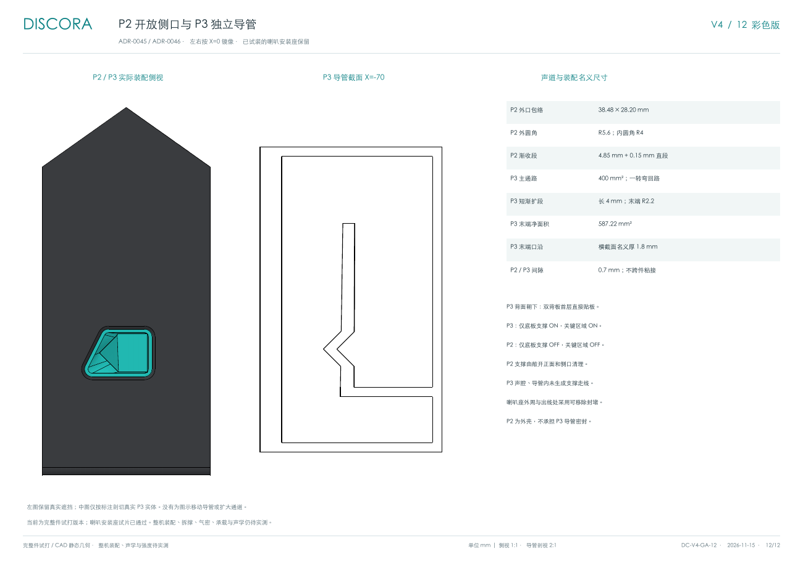
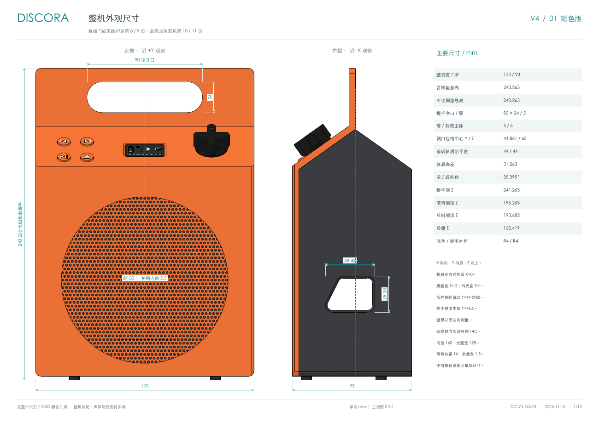
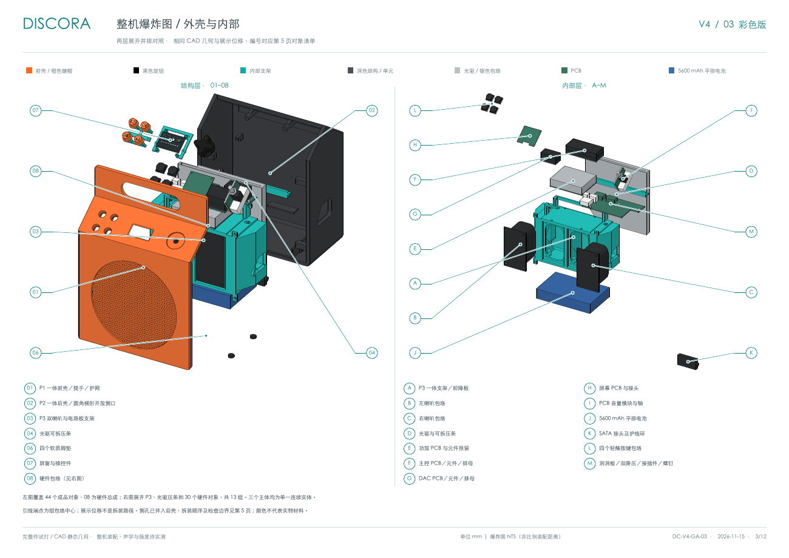

# 外壳尺寸与装配图纸

唯一正式图册为 [Discora 彩色尺寸与装配图册](../hardware/enclosure/drawings/Discora-V4-drawing-book-color.pdf)，共 **12 页 A3 横向**。本轮以当前保存 CAD 重新生成几何投影和彩色图，更新 P2 梯形侧口、P3 独立导管与短渐扩口，替换旧饰片／短管标注。

配套 [11 件打印套件](../hardware/enclosure/print/README.md)。图册与打印文件属于完整件试打版本，喇叭安装座试片已通过，整机实装、强度、拆撑、气密和声学尚待实测。

| 页 | 内容 |
| --- | --- |
| 1 | 整机正、侧视与双基准高度：含脚垫 243.263、不含脚垫 240.263 mm |
| 2 | 顶／后视、斜面操控开孔、连接孔与间隙说明 |
| 3 | 外壳与硬件彩色爆炸图；44 个成品对象 |
| 4 | 穿过左喇叭的实际侧剖与关键包络 |
| 5 | 成品清单、三主体打印包络、当前耗材估算及拆装顺序 |
| 6 | OLED 沉槽、四孔定位与可拆压框 |
| 7 | PCB 音量模块、旋钮、螺母与维护路径 |
| 8 | 洞洞板板形、三点固定、板卡布局；后侧孔为（A，O） |
| 9 | 前壳线束闭合与拉开 60 mm 的维护位 |
| 10 | P2 四处 P3 螺丝座三角加强筋 |
| 11 | 后斜面两个背锁深孔座加强筋与工具通道 |
| 12 | 当前 P2/P3 装配侧视、P3 实体导管剖面、出口尺寸与支撑设置 |



左图保留实际实体遮挡，中图在 X=−70 mm 以 0.1 mm 厚截片显示 P3 回路。没有为图示平移导管或扩大开口。P2 外口包络 38.48×28.20 mm，P3 主通路 400 mm²、末端 4 mm 渐扩至 587.22 mm²，P2/P3 名义间隙 0.7 mm。尺寸来自保存几何，未作声学调谐结论。





## 版本与证据

本次操控布局见 [ADR-0047](decisions/0047-control-spacing-and-knob.md)。旧图册证据经 control-layout-checks.json 衔接，操控投影与线束图从当前模型重读。

CAD SHA-256：`2d704f403a48870832338c8d0ac6c0f71b357f08b3bdcb7c0f777cb0e19f9003`。

- [geometry.json](../hardware/enclosure/drawings/geometry.json) 与 [color-render.json](../hardware/enclosure/drawings/color-render.json) 记录当前模型／建模脚本摘要、尺寸、真实投影、配色和输出分辨率。
- [drawing-baseline-checks.json](../hardware/enclosure/drawing-baseline-checks.json) 保留 ADR-0046 阶段的42件不变证据；本轮变更由 [control-layout-checks.json](../hardware/enclosure/control-layout-checks.json) 衔接。P2/P3 重新测量、剖切、渲染，旧侧孔标注不复用。
- [正式套件清单](../hardware/enclosure/print/manifest.json)提供本次六盘的真实切片估计；[正式包读回](../hardware/enclosure/print-release-checks.json)核对所有导出文件。
- [validation.json](../hardware/enclosure/validation.json)、[assembly-paths.json](../hardware/enclosure/assembly-paths.json)及[current-perfboard-checks.json](../hardware/enclosure/current-perfboard-checks.json)对应当前模型。线束 0…60 mm 每 2 mm 采样；抬升、旋转和前壳离散采样不是连续运动证明。
- 旧 OLED、背锁、音量模块等局部尺寸以历史报告和逐件不变证据衔接；P2 加强筋在当前后壳中重新截取并核对体积与尺寸。历史报告保留其原模型摘要。

图册只保留这一份 PDF。矢量 SVG 是无标注投影，不是完整尺寸图；正式标注位于 PDF。脚垫、玻璃和电子组件为采购件，模型包络不替代实物配合。

## 更新图册

1. 使用可导入 FreeCAD、Part、TechDraw 的 Python，从保存模型导出，再生成彩色图：

   ```sh
   "$DISCORA_FREECAD_PYTHON" hardware/enclosure/export-drawings.py
   "$DISCORA_FREECAD_PYTHON" hardware/enclosure/render-drawing-colors.py
   ```

2. 用安装了 reportlab、svglib 的 Python 排版，指定覆盖中文和图纸符号的 TrueType 字体：

   ```sh
   python3 hardware/enclosure/make-drawing-book.py --font "$DISCORA_DRAWING_FONT"
   ```

3. 用 Poppler 渲染全部 12 页并逐页检查尺寸引线、文字、遮挡和版面：

   ```sh
   mkdir -p tmp/drawings
   pdftoppm -scale-to 1800 -png hardware/enclosure/drawings/Discora-V4-drawing-book-color.pdf tmp/drawings/color-page
   ```

出图脚本校验 FCStd、建模源、几何数据、当前检查和历史衔接。模型变化时必须重新核对标注及 `ANNOTATED_MODEL_SHA256`，不能仅替换摘要绕过检查。check-drawing-baseline.py 用于 ADR-0046 历史模型的图册衔接；复现时应检出该阶段代码和模型，并使用其真实保存基线（SHA-256 `95e0139136c838f9f605c6a08c3a86ba0b29bcd2245afc5258f446aa17f6b51d`）运行 `check-drawing-baseline.py --baseline <文件>`，不要以当前模型替代历史基线。
