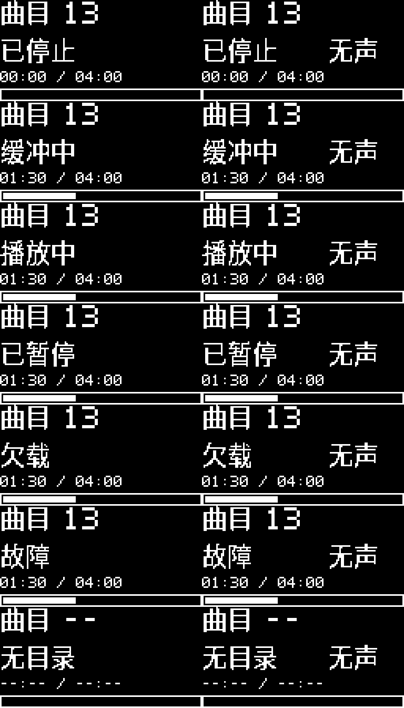

# OLED 曲目与播放状态

最近部署为 **0.12.6-oled-progress**，已在 9063 完成写入校验、启动和 OLED 初始化检查；中文显示和进度条已获用户实屏确认，见[部署记录](records/2026-11-09-oled-progress.md)。

历史 0.12.5 沿用自 `0.12.2-buttons-oled` 启用的四键有声 OLED 配置，最新部署见[工程状态](status.md)。用户确认已按下表连接 SH1106；0x3c 初始化与首帧发送成功，用户确认无介质画面文字清晰完整；后续 0.12.3 的第 13 曲 PLAYING 和盘尾 TRACK 01／STOPPED 画面也获用户确认，见[盘尾验收](records/2026-11-09-disc-rewind-reconnect.md)；其余状态画面待验收。部署与实屏结果见[本轮记录](records/2026-11-08-buttons-oled.md)。此前 `0.12.1-buttons-row` 继承 PSRAM profile 的 `CONFIG_DISCORA_OLED=n`，是接屏后没有显示的软件原因。

历史 `0.10.0-oled`：implemented，已部署；当时初始化超时，实屏未验收。按仓库模块结构图和 SH1106 手册实现，不复制供应商例程或字体。实物如果是 SSD1306，不能直接使用此驱动；I²C ACK 也不能证明芯片型号或画面正确。

历史 2026-11-05 已烧录软件时钟配置并独立校验，三个按键初始化和 UART 状态响应正常；0x3c 探测返回 `ESP_ERR_TIMEOUT`，未出现初始化成功日志。用户随后确认 OLED 尚未接线或未供电，该历史失败随后已有接线后的成功记录，详见 [部署记录](records/2026-11-05-oled-deploy.md)。

## 接线与配置

| ESP32-S3 | OLED |
| --- | --- |
| 3V3 | VCC（先确认模块适用 3.3V） |
| GND | GND |
| GPIO10 | SDA |
| GPIO11 | SCL |

断电后按实物丝印核对 VCC／GND 顺序。模块或外接电阻须将 SDA／SCL 上拉到 **3.3V**；固件不启用内部弱上拉，不接 5V 上拉，不从 DAC A3V3 取电。四针模块须自带上电复位电路。完整供电与连线见 [整机接线](wiring.md)。

- `CONFIG_DISCORA_OLED=y`：CD 播放器模式默认开启；查询、测试音和受限 READ CD bench 不开启。
- `CONFIG_DISCORA_OLED_ADDRESS=0x3c`：默认 7-bit 地址，可在 menuconfig 改为 `0x3d`。不要填写 `0x78`／`0x7a`；地址取决于模块 SA0，不自动扫描或改焊桥。
- 固定 GPIO10／11、100 kHz；I²S 改配到这些引脚时编译报错，需改回音频引脚或关闭 OLED。
- SH1106 132 列显存按 8 页写入，可见区假设为列 2–129。实屏须检查左右裁切、镜像及上下方向。

## 效果预览



固件渲染预览，使用合成状态展示七种画面。左列为 I²S 模式，右列为带“无声”提示的软件时钟模式；这是 128×64 像素画面的 3 倍放大图，不是实屏照片。中文显示和进度条已另获用户实屏确认。

## 画面含义

自 **0.12.6-oled-progress** 起已实现中文布局；已烧录至 9063，OLED 初始化通过；用户已确认中文显示和进度条正常；其它异常状态与长时并行仍按下方清单验收。移除固定 `DISCORA` 和 `I2S OUTPUT`，128×64 布局如下：

- 顶行：`曲目 01`，轨号来自实际 TOC，不是数组序号；无目录显示 `曲目 --`。
- 中间：中文播放状态。软件时钟配置同时显示 `无声`，避免误认为正在输出音频。
- 时间：`01:30 / 04:00`，左侧已消费时长，右侧本轨时长；无目录显示 `--:-- / --:--`。
- 底行：本轨进度条；无目录时为空框。

| 文字 | 含义 |
| --- | --- |
| 已停止 | 已停止；连续盘尾结束回首条可播放音轨，手动停止及诊断单轨 EOF 保留所选轨号 |
| 缓冲中 | 正在预填音频缓冲 |
| 播放中 | 播放器正在消费 PCM |
| 已暂停 | 已暂停，进度不继续计时 |
| 欠载 | 软件缓冲欠载；当前 PSRAM profile 自动重缓冲，补足后继续 |
| 故障 | 播放器故障；按已有 stop／play 流程处理 |
| 无目录 | 无可用播放目录，包括启动、目录失效、退盘或断连；不据此诊断光驱内一定没有光盘 |

总时长按 TOC 的本轨起止 LBA 差／75 计算；进度按当前轨 `dequeued_bytes / 2352` 计算，截断到整扇区后按 75 扇区／秒显示。它表示**交给输出适配器的 PCM 位置**，不是已读取／预取位置，也不是 DAC 实际发声测量；I²S DMA 与暂停丢弃的数据可能带来小幅偏差。暂停、预填和欠载期间不推进；手动停止、换轨和连续盘尾复位后归零，诊断单轨 EOF 保留满进度；fault 遵循核心清空计数的行为。介质失效清除旧时间，位置不超过本轨长度。

中文使用 Noto Sans CJK SC 2.004 派生的 16×16 固定界面字形子集，按 SIL OFL 1.1 保留许可与来源，见[字形说明](../firmware/fonts/README.md)。这不是任意中文曲名字库。当前源码 0.12.7 已增加默认关闭的 CD-Text 只读探测（`CONFIG_DISCORA_CDTEXT_PROBE`），当前 13 曲盘实测返回空头部、零文字包；**曲名解码或滚动显示尚未实现**，保留曲号显示，不猜测歌曲名称。探测若报告介质未就绪／变化，或发生通信失败，将拒绝旧目录；不会把这些故障当作普通“无曲名”。本次空结果仅说明当前盘／光驱／桥接器组合没有返回可用曲名，详见[CD-Text 实测](records/2026-11-09-cdtext-probe.md)。换用明确含有 CD-Text 的光盘取得有效包后，再接入字符解码和滚动显示。

每 200 ms 采样和渲染一次，仅像素变化时刷屏（例如状态切换、时间跳秒或进度条增加一格）；短于采样周期的瞬态可能不显示。取快照后释放播放器锁，再进行 I²C，音频任务不等待显示。缺屏、NACK、超时或初始化失败只关闭显示任务，播放／按键／USB 继续。失败会记录 `display disabled until reboot`，尝试一次灭屏；若总线已断，旧画面可能残留，须以日志为准。修复接线后重启，不在运行中无限重试。

## 当前四键有声构建

在 I²S、PSRAM、四键 profile 后叠加显示配置：

```bash
idf.py -C firmware -B build-buttons-oled -DSDKCONFIG=sdkconfig.buttons-oled \
  -DSDKCONFIG_DEFAULTS="sdkconfig.defaults;bench/cd-player-i2s.defaults;bench/cd-player-psram.defaults;bench/cd-player-buttons.defaults;bench/cd-player-oled.defaults" set-target esp32s3
idf.py -C firmware -B build-buttons-oled -DSDKCONFIG=sdkconfig.buttons-oled build
```

上述命令仅构建显示组合；复现最近部署所含的 USB 诊断和单次寻道恢复时，使用[四键控制](playback-controls.md)中的完整命令。显示中文曲号、播放器状态、时间和进度；尚未显示歌曲名称、CD-Text 或音量。

## 历史软件时钟构建

加载 ESP-IDF v5.4 后，从仓库根目录执行；使用独立配置，保留已有 sdkconfig 和实验产物：

```bash
mkdir -p .local/bench/oled
idf.py -C firmware -B "$PWD/.local/bench/oled/build" \
  -DSDKCONFIG="$PWD/.local/bench/oled/sdkconfig" \
  -DSDKCONFIG_DEFAULTS="sdkconfig.defaults;bench/cd-player-clock.defaults" \
  set-target esp32s3
idf.py -C firmware -B "$PWD/.local/bench/oled/build" \
  -DSDKCONFIG="$PWD/.local/bench/oled/sdkconfig" build
```

该配置上电 stopped，保留 GPIO7 退盘、GPIO8／GPIO9 换轨，状态行显示“无声”。真实 I²S 模式将 defaults 后半部分改为 `bench/cd-player-i2s.defaults` 并使用另一套独立构建目录／sdkconfig。修改地址或关闭 OLED 时，使用同一 `-B` 和 `-DSDKCONFIG` 参数运行 `menuconfig`，再 build。以上命令不烧录。

## 实屏验收

1. 记录屏幕型号／控制器、SA0 地址、供电与上拉电压、ESP-IDF 和固件版本；光驱实验同时记录型号、桥接器 VID:PID 和光盘介质。
2. 核对目标设备并部署播放器配置后，启动日志应包含 GPIO10／11 和地址。检查全部文字清晰、无偏移、裁切或镜像；无有效 TOC 时不残留旧轨号。
3. 有效 TOC 发布后显示首个可播轨号和“已停止”；使用 UART `play`、`pause`、`play`、`stop`，比对日志和画面。用 `next`／`prev` 及实体换轨键检查轨号、盘首／盘尾循环选曲、换轨后播放状态。
4. 检查暂停／缓冲不推进进度，恢复后继续；换轨／手动停止归零，单轨 EOF 满条，连续盘尾回首曲零进度；退盘和断连清除轨号及时间，重新插盘保持停止；短暂“缓冲中”可因采样未出现，持续缓冲应显示。
5. 使用已有故障注入配置时核对“欠载”／“故障”；注入属于软件证据，不代表真实 USB 故障。另在屏幕不连接时冷启动，确认日志报告显示禁用且播放器仍可操作。
6. 正常接屏连续播放，对照欠载、读取错误、I²S 写入错误和供数事件，确认刷新没有引入音频回归。构建／离线渲染通过不代替该项实测。

初版软件证据见[历史验证记录](records/2026-11-04-oled.md)；新版中文与进度验证见[本次记录](records/2026-11-09-oled-progress.md)。
