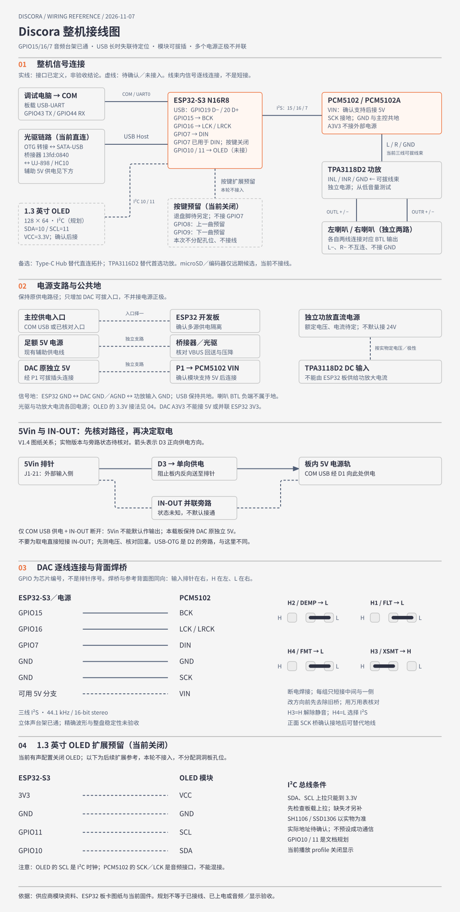

# Discora 整机接线说明

更新：2026-11-09。整机图采用当前 GPIO15/16/7 音频接法，并附 120 × 80 mm 可拔插洞洞板布局与逐孔接线；不是 PCB 原理图或整机装配验收报告。实线表示接口已有定义，不代表已经接线或实测通过；虚线表示规格、接法或固件尚待确认，不能直接按虚线接电。

**新增机内载板候选：**将 ESP32、DAC 与两块 DCE001 安排在约 **100 × 55 mm** 的可裁剪载板上，USB 朝右、DAC 左前、两路降压右前。见[新版布局图](diagrams/discora-wiring.html#enclosure-layout)和[尺寸／CAD 复核](perfboard-layout.md)。当前机壳与托架仍有碰撞，尚不能裁板定孔；下文原 120 × 80 mm 台架孔位不适用于新候选。

当前台架音频接法为 **GPIO15→BCK、GPIO16→LCK、GPIO7→DIN**，本页总览、洞洞板图和导线表已统一；仓库无叠加配置时仍默认 GPIO4/5/6，不能混用。GPIO7 作 DIN，原 GPIO7 退盘键必须断开；原有声 profile 关闭按键和 OLED，独立四键 overlay 使用 GPIO1 播放／暂停、GPIO41 退碟、GPIO2／42 换轨，见[四键接线](playback-controls.md)。实测接法见[音频说明](audio-output.md#已通过的接法与默认配置差异)。历史 USB 失联与后续整盘测试分别保留证据，见[当前状态](status.md)；本次载板方案不改变 USB／供电拓扑，也不表示整板已装入机壳。

[打开可缩放 SVG](diagrams/discora-wiring.svg) · [打开完整 HTML 图稿](diagrams/discora-wiring.html) · [洞洞板逐孔接线](diagrams/discora-wiring.html#perfboard) · [新版孔位总图](diagrams/discora-wiring.html#perfboard-layout)

## 图中范围与状态

| 元器件 | 图中用途与现状 |
| --- | --- |
| ESP32-S3 N16R8 开发板 | 主控；COM 接电脑调试，原生 USB 接光驱；[板卡资料](../hardware/ESP32-S3-N16R8/README.md) |
| USB-C 公／USB-A 母 OTG 转接、SATA-USB 桥接器、UJ-898 | 按最近直连实验路径绘制；桥接器 VID:PID 为 `13fd:0840`，具体芯片未知；光驱固件 HC10 |
| PCM5102 模块 | 已到货；PCM5102A 按上述实验接法短时试听通过，当前 GPIO15/16/7 接法已有台架实测，洞洞板实体装配未验收 |
| TPA3118D2 功放、左右无源喇叭 | 当前首选；喇叭单只标称 4 Ω、10 W、峰值 18 W，见[单元资料](../hardware/Speaker-80x45-4ohm-10W/README.md)；上述台架组合短时试听通过，额定功率、热与整机匹配未验收，独立功放电源不可省略 |
| 四键扩展 | GPIO1 播放／暂停、GPIO41 退碟、GPIO2／42 上一曲／下一曲，常开到 GND；独立 profile 已实现，实体接线／验收待完成；GPIO7 只作 DIN |
| 1.3 英寸 OLED | GPIO10 SDA、GPIO11 SCL、3.3V VCC、GND；0.12.2 有声配置已启用 SH1106；用户确认接线和无介质画面正常，不分配洞洞板孔位，动态播放显示待验收 |
| 5V 电源／充电宝、功放电源、调试电脑 | 各支路按下文核对；不把多个电源输出直接并联 |
| Type-C Hub、TPA3116D2 | 已有备选；Hub 不在当前直连路径中，TPA3116D2 不与首选功放同时连接 |
| microSD／编码器 | 仅远期候选，当前未定型、不分配引脚、不接线；不属于当前播放接线必需件 |

框内的多个信号名称代表线束，不是短接；按下表逐线连接。整机总览不是板卡排针的物理位置图；洞洞板的具体位置见下方专节及 HTML 详情。

**2026-11-10 音量元件：**已选定 [B50K 双联 8 脚带开关电位器](../hardware/Potentiometer-B50K-Switch/README.md)，本次完成机械适配；图中尚不指定其引脚接法。两组三端与开关触点需万用表核对，功放原电位器替换关系仍未知；补充特性表标注开关 1 A / DC 12 V，但表中总阻值为 10K，与所选 B50K 对应未确认，不能据外观将开关直接串入电池主电源。

## 当前音频接口与扩展预留

| 起点 | 终点 | 接线要求 |
| --- | --- | --- |
| ESP32 GPIO15（J1-8） | PCM5102 BCK | 位时钟，3.3V 逻辑 |
| ESP32 GPIO16（J1-9） | PCM5102 LCK／LRCK | 左右字时钟 |
| ESP32 GPIO7（J1-7） | PCM5102 DIN | 数字音频；不接退盘键 |
| ESP32 GND（J2-1） | PCM5102 GND | 公共信号地 |
| PCM5102 SCK | PCM5102 GND | 无外部 MCLK；不能接 BCK |
| 原 DAC 独立 5V 电源 | 经 P1 接 DAC VIN／GND | 保持原电源来源；不接主控 5Vin |

四键方案改用右排连续 J2-4～7：GPIO1 播放／暂停、GPIO2 上一曲、GPIO42 下一曲、GPIO41 退碟。2026-11-09 用户已确认四键基本操作正常，GPIO7 保留给 DAC；新版孔位总图已标出按键引出孔，接线按[四键说明](playback-controls.md)，不能照历史退碟图把 GPIO7 接到按键。

DAC 背面保持已验证的 **H1→L、H2→L、H3→H、H4→L**。说明见 [PCM5102 焊桥资料](../hardware/PCM5102-DAC/README.md#背面焊桥1-l2-l3-h4-l)。本次装配不改变焊桥，也不改变 USB-OTG／IN-OUT 状态。

## 120 × 80 mm 可拔插洞洞板布局与逐孔接线

本节保留原台架方案；新增双路降压的机内候选另见[布局说明](perfboard-layout.md)，新旧孔位不能混用。新版按左上原点、X 向右／Y 向下的丝印孔号见[孔位总图](diagrams/discora-wiring.html#perfboard-layout)。

[逐孔接线图](diagrams/discora-wiring.html#perfboard) · [历史台架排母与接口布局](diagrams/discora-wiring.html#bench-perfboard-layout) · [导线端点表](diagrams/discora-wiring.html#perfboard-wire-list)。观察方向为元件面、ESP32 天线朝上、USB 朝下；DAC 输入排针朝右、音频口朝左。

- X 从右向左：`4、3、2、1、Z、Y……A`，30 列。
- Y 从上向下：`A……Z`，再 `A……P`，42 行；图中第二段用 `A₂……P₂` 区分。
- 本次所有排母、P1 与 W1～W7 端点都在 **Y 的第一段**。孔号不是 GPIO 编号，短边实心长焊盘不计入圆孔行列，也不默认作为公共电源轨。

| 部件 | X 列 | Y 行（第一段） | 形式 |
| --- | --- | --- | --- |
| ESP32 右排母 J2 | 1 | D～Y | 1×22、2.54 mm 排母 |
| ESP32 左排母 J1 | Q | D～Y | 1×22、2.54 mm 排母 |
| PCM5102 输入排母 | N | G～L | 1×6、2.54 mm 排母 |
| P1：DAC 电源入口 | N | S、T | 1×2、2.54 mm 排针＋配套双孔插头 |

原三条排母位置不变：主控两排中心距 25.40 mm，DAC 输入排母与主控左排母中心距 7.62 mm。供应商 V1.4 原理图及参考照片对应 J1-7=GPIO7、J1-8=GPIO15、J1-9=GPIO16；从首针 Y=D 推导为 **Q/J、Q/K、Q/L**。这是图纸孔位推导，焊接前仍以当前模块丝印试插定位，不硬掰针脚。

| 导线 | 一端 | 另一端 |
| --- | --- | --- |
| W1 · BCK | GPIO15 / J1-8：X=Q / Y=K | DAC BCK：X=N / Y=K |
| W2 · LCK | GPIO16 / J1-9：X=Q / Y=L | DAC LCK：X=N / Y=I |
| W3 · DIN | GPIO7 / J1-7：X=Q / Y=J | DAC DIN：X=N / Y=J |
| W4 · GND | GND / J2-1：X=1 / Y=D | DAC GND：X=N / Y=H |
| W5 · SCK 接地 | DAC SCK：X=N / Y=L | DAC GND：X=N / Y=H |
| W6 · +5V | P1-1：X=N / Y=S | DAC VIN：X=N / Y=G |
| W7 · 电源回流 | P1-2：X=N / Y=T | DAC GND：X=N / Y=H |

P1-1/2 是本载板定义，不是任意接头的默认编号。原独立 DAC 5V 电源通过双孔插头接 P1，两半标明 **+5V / GND**；有防反插外壳时以成套接头的实际方向为准。P1 只服务 DAC，不作为多电源汇流点。外壳及插拔空间预留 X=K～P、Y=Q～V；若配套外壳超出范围，改用板外可拔接头，不挤占 USB 通道。

W4、W5、W7 汇入同一 DAC GND，在排母焊脚或附近用绝缘线可靠分接。A3V3 留空。信号线尽量短，主要走载板背面；交叉处保持绝缘，经过的空孔不焊接。

### 音频输出可拆线束 P2

DAC 输出焊盘接短引线，再经三芯成套可拔接头连接原功放输入。P2 位于板外线束，不分配洞洞板孔位；模块拆下时先拔 P2，再把 DAC 从六针排母中拔出，短引线随 DAC 一起移动。

| 导线 | DAC 端 | P2 配对后到功放 |
| --- | --- | --- |
| W8 · 左声道 | LROUT / L | P2-1 → INL |
| W9 · 输入信号地 | AGND | P2-2 → 输入 GND |
| W10 · 右声道 | ROUT / R | P2-3 → INR |

P2 两半按 `1=L、2=AGND、3=R` 配对标记，这是新线束定义，不能当作 DAC 原九孔的排列顺序。线束作应力固定；不拉扯 DAC 焊盘，不与 3.5 mm 同时并接。

### 模块插拔与 USB／供电留空

1. ESP32 与 DAC **焊排母、插模块**，不把模块排针焊死在载板上。DAC 加绝缘支撑，位置按实物确定；保留焊桥操作空间。
2. 主控下方一直到载板底边保留 USB 插头和弯线通道；COM 与原生 USB 都可单独拔插。D+/D− 仍走现有 USB 接口和线缆，不引到洞洞板散线。
3. BOOT／RST 上方不跨线束。光驱、功放及其电源继续在板外，电流不经载板细信号地线回流。
4. 左下区域暂留空，不新增稳压、供电合并或按键／OLED 接线。保持现有 COM 供电、光驱辅助供电、DAC 独立供电与功放电源路径。
5. 全部断电后检查新焊点 W1～W10 的端点导通与邻针无短路；这是迁移到载板后的装配检查，不是重做此前全部无声排查。

背面焊接时左右翻板、顶部仍朝上，原 X=4 列在左侧。保留元件面孔身份，不按背面印字重新编号；两面先标记同一个 X=4 / Y=A 孔。

**本布局用于原台架载板，不表示能直接装入当前机壳。** 本节 120 × 80 mm 整板未纳入新版 100 × 55 mm 候选的 CAD 包络试算；排母高度、P1 外壳、支撑、焊点与实际线缆仍未完成整机装配验收。顶部三行空孔也不代表天线射频净空。入壳及最终安装孔须另核对，见[机壳说明](../hardware/enclosure/README.md)。

## DAC、功放与喇叭

本载板沿用已验证的三线输入，经上述 P2 可拔线束连接。3.5 mm 只作替代接口，本次不与三线同时连接：

| DAC | 功放输入 |
| --- | --- |
| L／LROUT | INL |
| R／ROUT | INR |
| AGND／音频 GND | 输入 GND |

[功放正面参考图](../hardware/TPA3118D2/amplifier-front-connections.jpg)在音量旋钮朝左时，三针接口旁由上至下标 INR、GND、INL；只能用于核对信号名，实物方向和版本必须再次确认。DAC 正面 G/R/G/L 与背面 LROUT/AGND/ROUT/AGND 为不同观察面，不能照抄左右位置。

| 功放输出 | 喇叭 |
| --- | --- |
| OUTL+ | 左喇叭 + |
| OUTL− | 左喇叭 − |
| OUTR+ | 右喇叭 + |
| OUTR− | 右喇叭 − |

两路均为 BTL：**L−、R− 不能互连，不能接 GND；喇叭负端不是模拟输入信号地。**2026-11-05 已记录喇叭单只标称 4 Ω、10 W、峰值 18 W；实际功率承受能力、目标音量与匹配仍待确认，不能用功放商品“2 × 45 W”作为持续输出或喇叭匹配依据。商品线束图存在重复负极标注，实际针序及左右极性须核对，见[资料说明](../hardware/Speaker-80x45-4ohm-10W/README.md)。DAC 只输出线路电平，不能直接接无源喇叭。

## 电源和公共地

图中供电虚线表达预期支路，接线前必须落实来源、规格和极性。

| 支路 | 连接方案 | 尚需确认 |
| --- | --- | --- |
| 主控 | 从已确认的 COM USB 或板卡供电入口供电，避免未经隔离的多源并联 | 具体入口、USB-OTG／IN-OUT 焊盘状态、回灌路径 |
| 光驱／桥接器 | 足额 5V 经现有光驱辅助供电线进入 | VBUS 与辅助供电是否连通、是否回送到 ESP32／电脑、启动带载电压电流 |
| DAC | 在所购模块明确支持后，稳定 5V → VIN，负端 → GND；板上 5Vin 需按下文核对 | 板载稳压器及 VIN 额定值；先测 A3V3／AGND 约 3.3V，不把该一项当作全部电源轨合格 |
| 功放 | 使用独立、足额直流电源支路接功放 DC 输入 | 实物板级额定范围、插头尺寸／极性、电流及散热；不默认选 24V，不从 ESP32 板取功放电流 |
| OLED | 确认模块适用后，ESP32 3V3 → VCC、GND → GND | 核对板上 3.3V 供电余量及实物引脚；SDA／SCL 上拉必须为 3.3V，不能接 5V 上拉 |

主控、DAC 和 USB 链路需要公共信号地；功放模拟输入 GND 与 DAC AGND 连接。若信号地与功放电源负端的板内关系未知，先核对实物电路，不把喇叭 BTL 端子当作接地点。光驱和功放大电流回路直接返回各自电源，避免经过主控或 DAC 的细信号地线。

DAC 的 A3V3 留空，仅作电压核对点，不接外部 5V，也不并联 ESP32 的 3V3。同类紫色 DAC 板常见 VIN=5V 接法是板型参考，不是 TI 手册给模块规定的输入电压。完整前提见 [DAC 供电说明](../hardware/PCM5102-DAC/README.md#vin-供电与首次上电)。

### 电池双路 5V 降压规划（planned）

2026-11-07 用户选定 **2 块 DCE001 固定 5V 模块**：同一电池保护输出经总开关分至两块输入，A 输出供主控 5Vin／GND，B 输出经独立线束供光驱／桥接器辅助 5V／GND。数量已确认，采购、安装及带载验收未确认；供应商参数与检查步骤见[模块资料](../hardware/DCE001-5V/README.md)，决策见 [ADR-0018](decisions/0018-dual-5v-buck.md)。本节为后续电池接入规划，不改变当前台架接线；两块模块的机内位置已纳入[新增布局图](diagrams/discora-wiring.html#enclosure-layout)。

模块标称 3A，但不加散热要求在 2A 内，光驱启动／进退碟及长期读盘能力尚未验证。两路共地、正极不并联；接入前须断电核对光驱辅助 5V 与 USB VBUS 的连通性，以及主控 USB-OTG、IN-OUT 和 COM 电源路径，避免经 USB 将两路输出并联。若互通，先确定防回灌／隔离接法并保留有效 VBUS，不能直接沿用现有双头线接入。光驱电流不经主控板，DAC 最终电池支路仍待确认。

2026-11-10 新增 [USB 直连 GPIO19／20 与双路 5V 接线图](diagrams/discora-wiring.html#usb-gpio-dual-5v)：A 供主控 5Vin，B 供光驱／桥接器 USB VBUS，D−／D+／GND 直连主控；不把 B 的 VBUS 接到主控 5V。图中列明辅助电源移除、两入口同源供电条件、目标焊桥状态及电池播放／COM 烧录的切换步骤。该图是 `planned` 改接方案，区别于本文前述台架 USB 线缆布局；尚未修改实物或完成回灌、带载及读盘验证。 USB 固定引脚与布线原则另见[乐鑫硬件设计说明](https://docs.espressif.com/projects/esp-hardware-design-guidelines/en/latest/esp32s3/schematic-checklist.html#usb)。

### 开发板取电：3V3、5Vin 与 IN-OUT

OLED 可从开发板 **3V3 → VCC、GND → GND** 取电，前提是屏幕适用 3.3V、板上稳压器及输入电源有余量。DAC 则使用确认可用的 **5V → VIN、GND → GND**；两个模块无需各自配一个独立电源，但不能从普通 GPIO 取电。功放和光驱仍使用足额支路，不让大电流经过主控板。

根据 [ESP32-S3-COREBOARD V1.4 原理图](../hardware/ESP32-S3-N16R8/ESP32-S3-SCH-V1.4.pdf)，排针 J1-21（5Vin）经 D3 向板内 5V 供电，`IN-OUT` 是与 D3 并联的旁路；COM USB 则经 D1 接板内 5V。这是图纸结论，实物版本和焊桥通断尚未确认。

| 供电／焊桥条件 | 5Vin 的含义与限制 |
| --- | --- |
| 仅 COM USB 供电，IN-OUT 断开 | D3 阻止板内 5V 反向送至排针，不能默认从 5Vin 给 DAC 供电；空载偶见电压也不证明可带载 |
| IN-OUT 接通 | 5Vin 与板内 5V 直接连通；它不是升压、稳压或限流功能，改变了 D3 的隔离路径，需核对所有电源及回灌风险 |
| 外部稳压 5V 从 5Vin 输入 | 按板卡规定供电；D3 有正向压降，仍需核对板内电压和整体电源路径，不据此自动并接 COM／OTG 等电源 |

**不要为了从 5Vin 取电而直接短接 IN-OUT。**先断电核对 D3、旁路实际状态和相关连通性，再在现有主控供电方式下用电压档测 3V3—GND、5Vin—GND。若 5Vin 没有可用输出，DAC 可从同一个已确认的稳压 5V 电源另分一支并共地；不把两个独立 5V 输出直接并联。不要用通断档测带电电路。

`USB-OTG` 旁路的是 USB2 VBUS 的 D2，`IN-OUT` 旁路的是 5Vin 的 D3，二者不同；不能用 USB-OTG 焊桥代替对 5Vin 输出路径的核对。两块模块连接后，再测负载下电压并观察主控是否复位、稳压器是否异常发热。当前没有实测电流或热裕量，不给开发板标注已验证的外设供电能力。

## USB 与调试

当前记录的光驱路径为：ESP32 原生 USB → OTG 转接 → SATA-USB 桥接器 → UJ-898，光驱辅助供电保持独立。USB GPIO19=D−、GPIO20=D+ 使用板载接口和合规 USB 线，不用长杜邦线代替差分布线。Hub 是替代拓扑中的可选设备，不必重新插入当前直连链路；[直连实测](records/2026-11-01-m2-otg-after-pc.md)并未证明寻道失败已修复。

电脑连接板载 COM，经 USB-UART 接 GPIO43 TX／GPIO44 RX，115200 8N1。只有使用外接 3.3V USB-UART 时才手动交叉接 TX/RX，细节见 [组装说明](assembly.md)。电脑仅作调试，不是独立播放依赖，也不能同时成为光驱数据链路的第二个 Host。

## 1.3 英寸 OLED 四线接线（implemented，实屏待验收）

2026-11-04 补充显示屏接线规划，对应图中 04 区。依据供应商四针 IIC 模块资料，使用 3.3V 供电方案；接线前仍需核对所购 SKU 和实物丝印。SH1106 驱动已实现，尚无实物通信或显示证据。

| ESP32-S3 | OLED 模块 | 状态／要求 |
| --- | --- | --- |
| 3V3 | VCC | 确认模块支持 3.3V、开发板电流余量后接入；不从 DAC A3V3 取电 |
| GND | GND | 共地 |
| GPIO11 | SCL | 已实现的 I²C 时钟 |
| GPIO10 | SDA | 已实现的 I²C 数据 |

GPIO10／11 在供应商 ESP32 板卡图纸中已引出，OLED 驱动已使用，与当前 GPIO15／16／7 音频、GPIO19／20 USB 和 GPIO43／44 UART 分开。PSRAM profile 本身关闭 OLED；当前 0.12.2 在其后叠加 `cd-player-oled.defaults` 开启。0x3c 初始化成功，用户确认无介质画面正常，动态显示待验收。驱动 7-bit 地址默认 0x3c、可配置 0x3d。构建、状态含义与测试见 [OLED 显示说明](oled-display.md)。ESP-IDF 的 I²C SDA/SCL 引脚可以由软件配置，见 [ESP-IDF v5.4 I²C 文档](https://docs.espressif.com/projects/esp-idf/en/v5.4/esp32s3/api-reference/peripherals/i2c.html)。

SDA、SCL 需要上拉到 3.3V；先确认模块是否已有板载上拉及其连接电源，不盲目重复加电阻，不接 5V 上拉。屏幕控制器（SH1106／SSD1306）、地址及初始化序列仍需按实物确认；模块未接入前不改地址焊桥。屏幕 SCL 与 DAC 的 SCK／LCK 属于不同接口，不可相连。参考资料与差异说明见 [OLED 硬件说明](../hardware/OLED-1.3-128x64/README.md)。

## 首次音频验证

1. 断电确认模块版本、VIN 规格、功放电源极性、喇叭参数和每个焊桥。焊接后检查短路及目标连接。
2. 单独给 DAC 供电，检查电源轨；断电后接 MCU 信号与模拟输入。功放从低音量开始。
3. 显式部署测试音配置，先验证 `left`、`right`、`stereo`、`silence`、`stop`。测试音模式不启动光驱任务。
4. 左右声音通过后，再进入真实 CD I²S 配置；记录电源、实际焊桥、时钟、音频、光驱动作时干扰及温升。

当前部署为 0.12.2 四键加 OLED 有声配置，GPIO15/16/7、2 MiB PSRAM、25% 数字幅度，上电 stopped。具体部署及 USB 长时失联边界见[当前状态](status.md)。OLED 四线接法由用户确认；通信和无介质画面通过，洞洞板装配及动态播放显示仍待验收。

## 图稿维护

`diagrams/discora-wiring.html` 为自包含图稿（内联 SVG、无外部图片或脚本），`discora-wiring.svg` 仅保留供 Markdown 展示的整机总览，与 HTML 的第一个 SVG 保持一致。HTML 另含双路降压机内总览、新版候选孔位总图、原台架逐孔接线与历史排母孔位四个 SVG。默认“孔位总图”指向新版 X/Y 丝印坐标候选，旧图默认折叠。机内候选尺寸与 `hardware/perfboard/layout.json`、[布局说明](perfboard-layout.md)同步；原台架图与本页 W1～W10 及 P1／P2 定义同步，不能跨方案套用孔号。焊桥方框不按物理尺寸，机内候选的模块本体按标称比例画；两者都不替代实测。不用样例值填补实物未知参数。

## 四键连续排针与洞洞板线束

`0.12.1-buttons-row` 四键 profile 使用主控右排连续 J2-4～7；这取代本轮初版 GPIO4／5／8／9 分散接法。J2-1 提供公共地，五芯线束在板外通过 P3 可拔连接；不接 3.3V 或 5V。

| P3 自定义芯号 | 功能 | 主控 GPIO／排针 | 新版候选洞洞板（X，Y） |
| --- | --- | --- | --- |
| 1 | 公共地 | GND／J2-1 | （J，A） |
| 2 | 播放／暂停 | GPIO1／J2-4 | （M，A） |
| 3 | 上一曲 | GPIO2／J2-5 | （N，A） |
| 4 | 下一曲 | GPIO42／J2-6 | （O，A） |
| 5 | 退碟 | GPIO41／J2-7 | （P，A） |

以上孔位仅用于新版元件面 X 向右 A～Z 再 A～P、Y 向下 A～Z 再 1～4 的布局；原台架 Q／1 列孔位不能混用。模块占用排母顶面，线束从排母底部焊脚引出并绝缘，按[孔位总图及放大](diagrams/discora-wiring.html#button-harness)装配。五芯接头在板外，不新增孔位或改变载板尺寸，实际接头壳体与线束弯曲空间待确认。GPIO41／42 不与外部 JTAG 共用；COM、USB Host、音频、OLED 分配保持原状。

装配顺序：断电 → 按丝印核对 J2 与五个孔 → 引出四根信号和地线 → 两侧标记 P3 芯号并通断核对 → 各常开键另一端接公共地 → 线束应力固定 → 检查相邻针无短路。上电、烧录及实体按键验收按用户安排留待后续，不把图纸引脚映射当作已接线证据。
