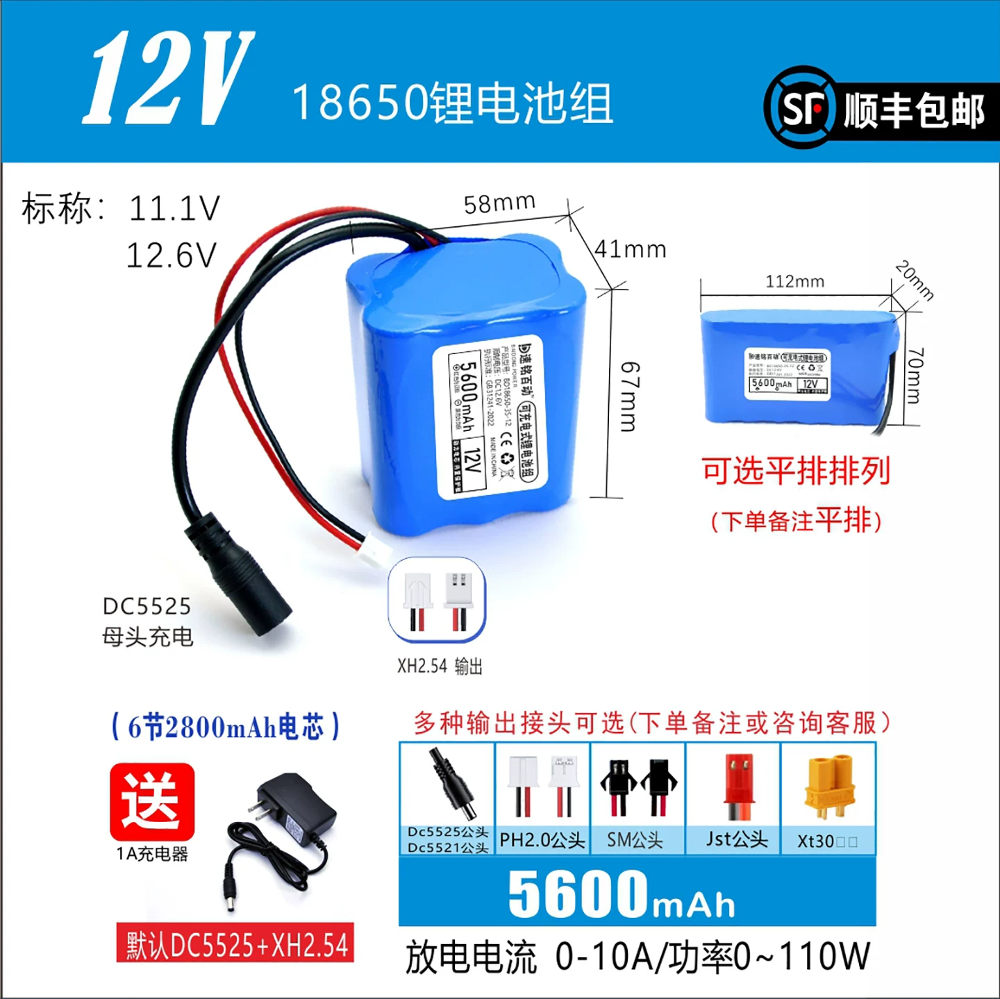

# 5600mAh 三串两并成品电池包

记录日期：2026-11-05。用户已选定[淘宝商品 733234510026，SKU 5651022295757](https://item.taobao.com/item.htm?id=733234510026&skuId=5651022295757)，提供报价 **¥59.22**。参数依据本次对话中的商品截图与用户说明，未独立读取在线 SKU；未确认下单、数量、实付或到货。电池接入为 `planned`，未完成电气、续航或装配验收。

## 商品资料

图片由用户添加到项目，文件名整理为 `5600mah-pack-dimensions.webp`；图示参数为供应商标称，未经过实物测量。

| 项目 | 图示参数／说明 |
| --- | --- |
| 类型 | 已点焊、绝缘封装、引出线的 18650 锂电池组；保护板具体功能待确认 |
| 组成 | 6 节 2800mAh 电芯；由标称电压及整包容量推定为 3S2P（三串两并），电芯品牌型号待确认 |
| 整包容量 | 标称 5600mAh；不是六节容量相加 |
| 电压 | 标称 11.1V，充满 12.6V；同系列说明图标示输出 9–12.6V，所选 SKU 的实际截止阈值待核对 |
| 标称能量 | 按 11.1V × 5.6Ah 计算为 62.16Wh，非实测可用能量 |
| 输出能力 | 所选容量图宣传 0–10A、0–110W；未明确持续／峰值及条件，不视为持续能力验收 |
| 块状尺寸 | 58 × 41 × 67mm，商家图示，未含已确认的线材及插头包络 |
| 已选平排尺寸 | 112 × 70 × 20mm；用户已明确选用平排，商品图要求下单备注平排；未包含已核实的线材与插头包络 |
| 默认接口 | DC5525 母头充电、XH2.54 输出；针序和极性需实测 |
| 可选输出接口 | 图示包括 XT30；推荐询价／备注 XT30，尚未确认所选 SKU 已包含此变更 |
| 配套充电器 | 5600mAh 图示赠送 1A 充电器；对应三串充满电压 12.6V，实物及套餐待确认 |

## 供电规划与装配边界

- 用户接受自行处理外围 Type-C 充电及升降压，电芯和保护板采用已组装成品。
- 电池保护输出分别供给：12V 升降压支路 → TPA3118D2；两路独立 5V 降压 → 主控、光驱／桥接器。2026-11-07 用户选定 [DCE001 固定 5V 模块](../DCE001-5V/README.md) **2 块**，接入为 `planned`；光驱支路电流余量及 USB VBUS 防回灌接法待验证，两路输出正极不得并联。DAC 最终电池支路仍待确认，当前独立供电见[整机接线说明](../../docs/wiring.md)。
- Type-C 输入需接适配三串锂电、充满 12.6V 的充电管理模块；仅换插头或使用 PD 诱骗板不能替代锂电充电管理。充电模块型号、电流、保护板同口／分口接法均待确定。
- 充电口与输出口同时存在不证明支持边充边播；电源路径、充电终止、反向电流及插拔时供电连续性尚未验证，当前不将带载充电列为已支持功能。
- [V4 模型](../enclosure/README.md)已按平排 112 × 70 × 20mm 名义包络适配：底部居中平放，X=−56…56、Y=4…74、Z=8…28；整机深度调整为 78mm，宽 142mm、含脚垫高 202mm 不变。前后内壁各留 1mm、左右托盘内壁各留 1mm、距声腔底部 3.5mm。托盘现已并入一体后壳，并预留四处绑带槽；静态检查覆盖电池包络及托盘，拆除绑带和线缆后向前取出的路径检查通过；线材、插头、最终固定方式和未定型外围电源板不在本次通过范围内。

## 续航估算与待确认项

目标为日常音量播放 3–4 小时。仅按标称 62.16Wh、85% 可用能量估算：整机平均 12W 时约 4.4 小时，15W 时约 3.5 小时。平均功耗、容量、转换效率和实际续航均未实测。

采购核对：电芯型号及容量口径、平排成品尺寸（已选排列方式）、至少 5A 持续放电能力（包括保护板／线材／接头）、过充／过放／过流／短路保护、三串均衡、充电电流限制、端口极性及同口／分口拓扑。

到货后先核对铭牌、端口和电压，再对稳压输出做带载检查，记录光驱启动／进退碟与播放同时进行时的 5V、12V 压降、重启及温升；最后测量目标音量下的续航。不得用报价、容量标签或软件构建结果替代这些验收。
