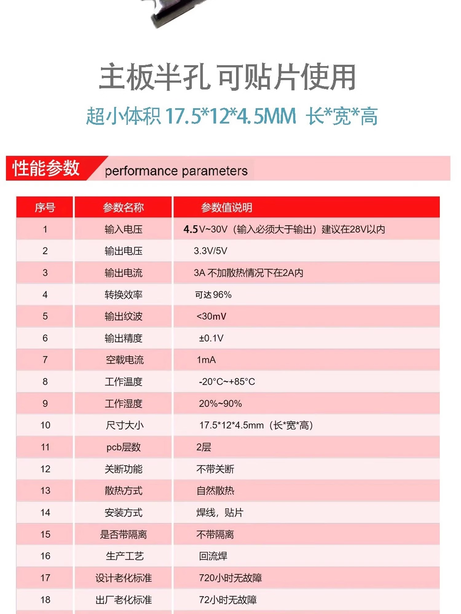

# DCE001 迷你 DC-DC 降压模块（固定 5V）

记录日期：2026-11-07。用户选定 **2 块固定输出 5V 的 DCE001 模块**，分别用于 ESP32-S3 主控和光驱／桥接器。状态为 `planned`：数量与选型已确认，下单、到货、实物接线及带载验收未确认。

## 来源与商品参数

- 商品：[京东 10228520023322](https://item.jd.com/10228520023322.html)。本次已读取商品页，所选规格为“Mini降压模块输入5.5V-30V 固定输出5V”；不选同系列 3.3V 或 12V 款。
- 参数图：用户提供的商品截图，原图保存为 [supplier-parameters.png](supplier-parameters.png)。这是供应商标称资料，不是芯片数据手册或本项目测量报告。
- 实付价格未提供；页面促销价格不作为采购实付记录。芯片型号、实物版本及保护功能待核对。

| 项目 | 供应商标称及采用口径 |
| --- | --- |
| 输入电压 | 所选 5V SKU 为 5.5–30V；系列参数图为 4.5–30V、建议 28V 内，且输入须高于输出；本项目按所选 SKU 下限 5.5V 核对 |
| 输出电压 | 固定 5V；系列参数图同时列出 3.3V／5V，不表示该 SKU 可切换 |
| 输出电流 | 标称 3A；图片注明“不加散热情况下在 2A 内”，不按自然散热持续 3A 使用；封闭机壳内可用电流仍待实测 |
| 转换效率 | 可达 96%；输入、输出及负载条件未提供，不能当作 12V → 5V 全负载效率 |
| 输出纹波／精度 | <30mV／±0.1V；测试条件未提供，需实测 |
| 空载电流 | 标称 1mA；带载与待机功耗未测 |
| 尺寸 | 长 × 宽 × 高 = 17.5 × 12 × 4.5mm，未含线材、焊点、绝缘和散热空间 |
| 工作温度／湿度 | −20～+85°C／20%～90%；不据此认定满载热能力 |
| PCB／安装 | 2 层，半孔，可焊线或贴片；回流焊工艺 |
| 隔离／关断／散热 | 不带隔离、不带关断、自然散热；整机关机需在输入侧切断供电 |
| 老化宣传 | 设计 720 小时、出厂 72 小时无故障；无随货报告，不视为项目验收 |

## 两路供电规划

同一块[三串电池包](../Battery-3S2P-5600mAh/README.md)的保护输出，经总开关分至两块模块输入。电池商品标称约 9–12.6V，处于所选模块输入范围内；电池实际截止阈值及带载电压仍需核对。

| 模块 | 规划输出连接 | 边界 |
| --- | --- | --- |
| A：主控支路 | OUT+ → ESP32-S3 开发板 5Vin；OUT− → GND | 不接 3V3 或 GPIO；按实物板版核对 D3、IN-OUT 及 COM USB 供电路径 |
| B：光驱支路 | OUT+／OUT− → 光驱／桥接器辅助供电线的已确认 5V／GND | 独立配线，电机电流不经主控板或洞洞板细信号线；启动、寻道和进退碟电流未测，尚不能认定本模块足够 |

两块模块非隔离，负端及 USB 信号地按实际电路共地，光驱大电流回路直接返回电源。**两路 OUT+ 不直接并联，也不能经 USB VBUS 隐式并联。**独立降压支路不代表电气隔离，仍共享电池及输入回路。

接入前断电检查光驱辅助 5V 与数据口 VBUS 是否内部连通，以及主控 `USB-OTG`（D2 旁路）、`IN-OUT`（D3 旁路）和 COM USB 路径。若存在两路输出互通，须先确定防回灌／电源隔离接法；不能原样接入两块模块。也不能仅切断 VBUS 后默认 USB Host 仍可工作，必须保留有效的 VBUS 供电与检测条件。此处仅确定分支用途，USB 电源路径尚未定型，详见[接线说明](../../docs/wiring.md#电池双路-5v-降压规划planned)。

DAC 目前的独立 5V 台架供电保持原记录；以后是否并入主控支路，需核对模块规格、总负载和音频噪声。本次不确定 DAC 的最终电池接法，也不改变功放和充电支路。

## 接入与验收

1. 核对两块实物确为固定 5V 款、输入输出丝印和极性，检查焊接与绝缘。分别空载上电测输出；按标称精度应为 4.9–5.1V。12V 电池不得直接接主控 5Vin 或光驱 5V。
2. 断电核对上述 VBUS、辅助供电及电脑 COM 的连通性，形成不会并联两路输出的具体接线后再联机。
3. 在电池高、低电量条件下分别测试主控启动与运行、光驱启动／寻道／进退碟及持续读盘。记录模块输入电压、输出与负载端最低电压、持续／峰值电流、温升、线材和测试时长；瞬态压降不能仅凭万用表静态读数排除。
4. 两路同时运行，检查主控复位、USB 掉线和音频干扰；在最终安装散热条件下复测。若光驱支路掉压、限流或过热，换足额模块，不将两块输出并联凑电流。两路供电不能预先视为已解决现有 USB 失联。

本次只记录选型及验收条件，没有新增设备测量、固件部署或 CAD 安装验证。设计决定见 [ADR-0018](../../docs/decisions/0018-dual-5v-buck.md)。

后续布局（2026-11-07）：两块模块已纳入[100 × 55 mm 机内载板候选](../../docs/perfboard-layout.md)，右前方并排，各预留 25 × 22 mm 支撑／短引线区。已做名义包络试算，当前机壳及电子托架仍有碰撞；实物半孔针序、接头、散热和安装尚未验收，不按候选图直接裁板或接电。
