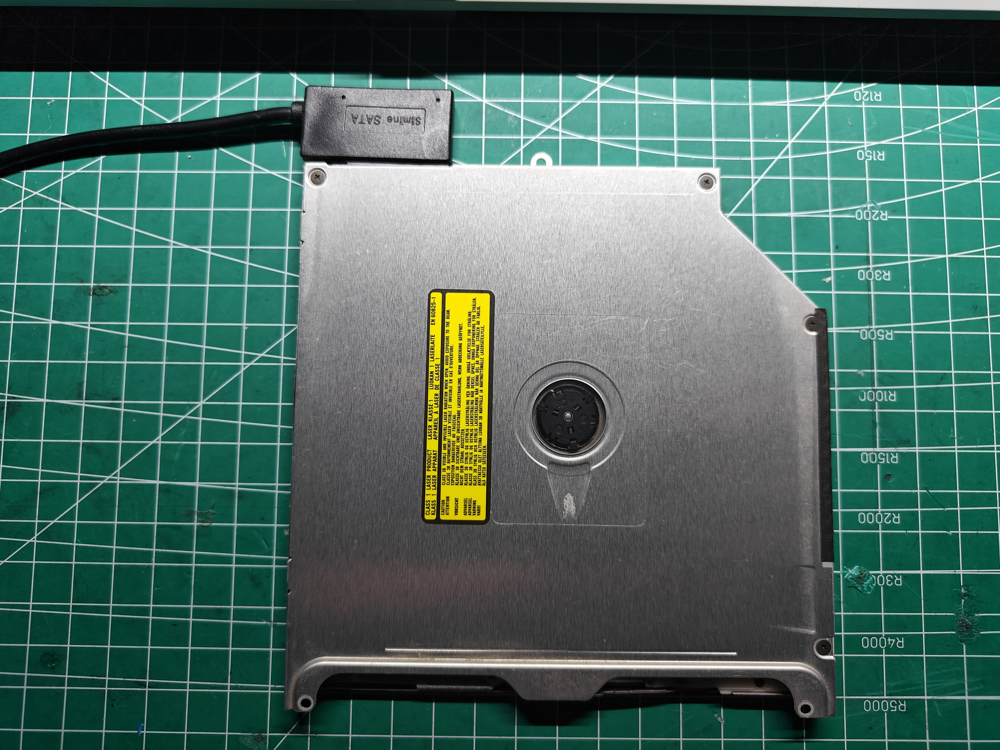
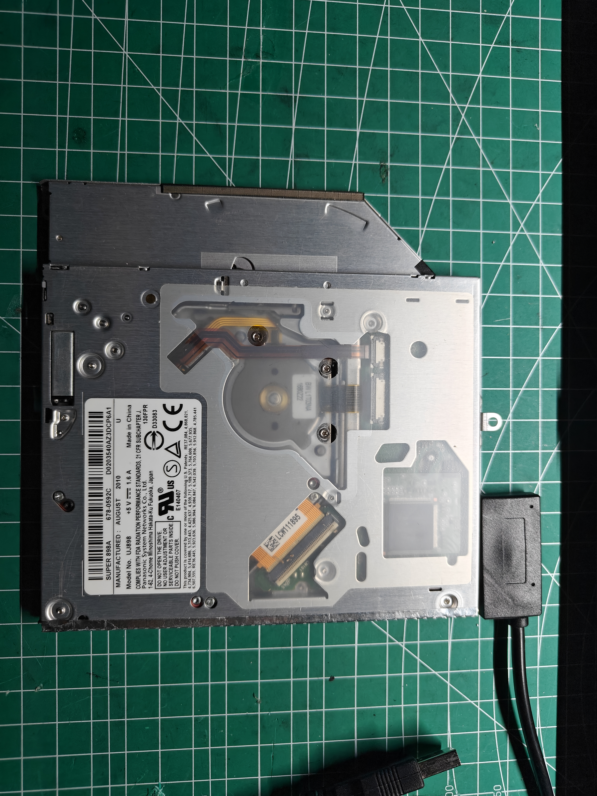

# MATSHITA UJ-898 光驱实物与机械尺寸

记录日期：2026-11-11。来源为用户对当前光驱的实物测量、随后补充的测量方式说明及两张实物照片。单位均为 **mm**；量具型号、测量精度与重复测量次数未提供，不把小数位数作为公差保证。本记录保存用户实测反馈，尚未独立复测或完成外壳装配验收。

照片铭牌可见 `Model No. UJ898`；项目既有 USB 查询身份为 `MATSHITA DVD-R UJ-898`／`HC10`，见[查询记录](../../docs/records/2026-10-31-m1-optical-probe.md)。本次仅归档机械资料，没有新增通电、USB 或播放测试。

## 测量朝向与基准

- 光驱平放，**碟口朝向测量者；光盘数据面朝下、封面朝上**。
- 前边为碟口端，后边为接口端；左、右以此测量姿态为准。宽度为左右方向，深度为前后方向，厚度为上下方向。
- F 的上下沿高度均从**底盖较低的那块平面**量起。底盖不是完整平面，不能将悬空区表面或桌面自动作为同一基准。
- 照片保留拍摄时的旋转及翻面状态；照片画面中的左右不能直接替代上述测量左右。未用照片透视比例反算尺寸。
- 这些是光驱平放时的局部方向，不直接等同于机箱竖装 CAD 的 X／Y／Z。

## A–F 实测数据

| 编号 | 测量位置 | 用户实测值 |
| --- | --- | --- |
| A 前 | 靠近碟口处，两侧主体外壁之间 | 128 |
| A 中 | 主体中部，两侧外壁之间 | 128 |
| A 后 | 后端主体宽度 | 103 |
| B 左 | 左侧前端主体外沿至后端主体外沿 | 130 |
| B 右 | 右侧前端主体外沿至后端主体外沿 | 95 |
| C 左前／右前 | 前方左右两处总厚度 | 10.8／10.8 |
| C 左后／右后 | 后方左右两处总厚度 | 9.5／9.5 |
| C 最大 | 最大总厚度 | 10.8 |
| D 左／右 | 碟口左右端至对应主体侧边 | 3.8／2 |
| E 宽／高 | 碟口开口宽度／高度 | 121.6／4.5 |
| F 下沿／上沿 | 底盖较低平面至碟口下沿／上沿 | 5.9／10 |

后续建模核对时，用户按照片确认 **B 左 130、B 右 95，斜边位于右后角，SATA 位于左后端**，更正最初「左 95、右 130」的左右次序。其余尺寸保持原始反馈。

用户最初给出 C 为「10.8 / 10.8 / 9.5；10.8」，随后明确：前方左右均为 10.8、后方左右均为 9.5；前方 10.8 指碟口端的整体高度，不是 E 的开口净高。仅有前后厚度值，不能据此断言整个上盖或底盖沿深度线性倾斜；前端加厚区域的长度未测。

### 误差保留

- `F 上沿 − F 下沿 = 10 − 5.9 = 4.1`，与 E 高 4.5 相差 0.4。用户确认 F 的共同基准，并表示误差可以忽略；保留全部原始读数，不改写成完全闭合的一组数，也不将 0.4 当作制造公差。
- `D 左 + E 宽 + D 右 = 3.8 + 121.6 + 2 = 127.4`，与 A 前 128 相差 0.6；保留差值，不自行把误差分配给左右边距。
- 后续如需确定导向口位置、接触面或配合公差，应明确采用哪组读数和设计余量；本记录不替代该设计判断。

## 斜边、底部台阶与接口

| 项目 | 用户说明与尺寸 | 记录边界 |
| --- | --- | --- |
| 后部外形缺口 | 缺口为斜边，不是直角台阶 | A／B 按用户对照片的后续确认保存；斜边两端的精确坐标、端部短直边和圆角未测，不从总长宽拼出未经确认的精确轮廓 |
| 底部悬空起点 | 从左侧边起 102.8 后悬空 | 以测量姿态的左侧为基准 |
| 底部悬空区域宽度 | 靠右侧宽 25.2；102.8 + 25.2 = 128 | 这是底部高度变化，不能等同于俯视轮廓少了这条宽度 |
| 底部悬空高度 | 4.5 | 相对底盖较低平面的高度差；沿前后方向的范围及过渡细节未完整测量 |
| 凸起与安装耳 | 用户报告「无凸起和安装耳」 | 保留原话；照片可见局部带孔金属边片及冲压起伏，其是否包含在总包络、是否参与安装未单独量化，不视为底面完全平整或已有安装孔数据 |
| SATA 接口位置 | 左侧底部 | 以用户文字定位为准；照片显示已接适配头状态 |
| SATA 突出量 | 向光驱后端突出 20.4 | 已插接状态的后向占位 |
| SATA 接头宽度／最大厚度 | 37.7／7 | 用户补充：厚度没有高过光驱；在后端 9.5 mm 厚度范围内的具体上下偏置未测 |
| SATA 接头右侧边 | 距光驱左侧边 36.8 | 按光驱平放、数据面朝下的测量方向 |
| SATA 接头左侧边 | 超出光驱左侧边 2 | 与右侧边读数合计横向跨度 38.8，比接头宽 37.7 大 1.1；保留原值，几何预留取覆盖两端的范围 |
| 线缆根部圆环 | 突出高 3.0、直径 6.5 | 不把圆环直径当作已测线径 |
| SATA 线缆方向与侧向占位 | 线缆在左侧；自然弯回后最外侧超出光驱侧边 14.5 | 线径、完整三维弯曲轨迹与弯曲半径未测；14.5 是用户实测侧向占位 |

## 原始照片

两张附件按原始字节保存，仅重命名，未旋转、裁剪、压缩或重编码。原文件名、字节数和 SHA-256 见 [readback.json](readback.json)。

### 金属盖面与后端适配头

### 底面、铭牌与接口

## 与当前外壳 CAD 的关系

2026-11-12 已将实测数据用于[外壳 CAD](../enclosure/README.md)，设计决策见 [ADR-0035](../../docs/decisions/0035-measured-drive-rear-wall-mount.md)。光驱竖装、碟口向上，带铭牌底面朝后壁，留 1 mm 保护垫空间；中央底托配两螺钉可拆压条。机箱外宽按用户最终选择取 170，保持光驱及碟口居中，覆盖线缆自然外伸 14.5，侧壁余量 1.5；外深 93。

主体采用 128×10.8×130 最大包络，前后厚度差、斜边圆角和底部台阶的未测范围保留为近似；完整长方体包络另做净空检查。接头显示按实测 37.7×7×20.4，定位跨度冲突取 38.8 的净空，未测上下偏置按完整后端 9.5 厚度覆盖。机械适配为 `implemented`，几何及本地切片证据不等于 `bench-tested` 或 `verified`；实际安装、夹持、线材弯曲和进退碟仍待试装。
