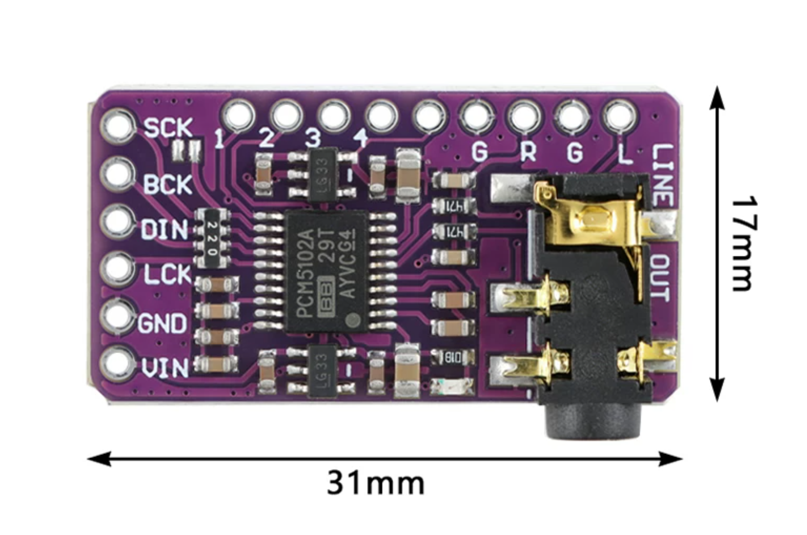
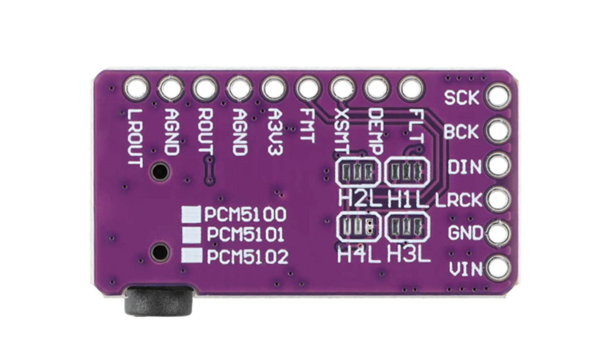

# PCM5102 DAC 资料

整理日期：2026-11-03。用户采购记录为 [PCM5102 DAC 解码板](https://item.taobao.com/item.htm?id=967516294822)，用户已确认模块到货，并提供下列正反面参考图片；图片与到货实物的一致性、实物芯片丝印仍待核对。

## 保留文件

| 文件 | 用途与边界 |
| --- | --- |
| [PCM510xA 系列数据手册](PCM510xA-SLAS859C-2015.pdf) | 用户导入的 TI 芯片手册，文档号 SLAS859C，2015 年 5 月修订；正文覆盖 PCM5100A、PCM5101A、PCM5102A 及相应 Q1 型号 |
| [正面及尺寸参考图](PCM5102-module-front-dimensions.png) | 用户提供的原始 PNG，标注板尺寸 31 × 17 mm |
| [背面参考图](PCM5102-module-back.png) | 用户提供的原始 PNG，展示背面引脚与焊桥丝印 |
| [原件校验与整理记录](readback.json) | 原始名称、当前名称、字节数及 SHA-256；本次图片另列于 `user_supplied_images` |

原文件名为 `PCM5102 Specification.pdf`，按正文改名为 `PCM510xA-SLAS859C-2015.pdf`，内容未修改。此文件不是无 A 后缀 PCM5102 的专用手册，也不是采购模块的板级说明；不能据此确认实物为 PCM5102A。

仍需核对实物芯片、模块 VIN、稳压设计、I²S 引脚、电平、SCK／FMT／XSMT 跳线及模拟输出接口。芯片手册不能直接确定模块供电接法，实际接线与声音均未验收。项目候选 GPIO、测试音和验收步骤见 [音频输出准备](../../docs/audio-output.md)。

整理前原件保存在仓库外归档 `discora-hardware-2026-11-03`，具体位置见本次交付记录。原始字节及权利声明保留，不改变第三方资料许可。

## 模块参考图片

正面及尺寸标注（31 × 17 mm）：



背面引脚与焊桥丝印：



## 图片标注尺寸与结构边界

2026-11-03 保存用户提供的两张参考图片，未裁剪、缩放或修改原图。以下为图片标注与外观观察，不是到货实物测量或机械验收。

| 项目 | 图片信息 | 使用边界 |
| --- | --- | --- |
| PCB 长度 | 31 mm（正面图横向标注） | 标称尺寸，公差未提供 |
| PCB 宽度 | 17 mm（正面图纵向标注） | 标称尺寸，公差未提供 |
| 音频插座突出量 | 插座超出 PCB 边缘，未标数值 | 31 × 17 mm 不作为含插座的完整装配包络 |
| PCB 厚度、整板高度 | 未标注 | 需实测，含底部焊点及焊接后的排针 |
| 孔径、孔距、安装孔位置 | 未标注 | 不从图片比例推算，不据此确定固定孔位 |

正面图芯片可见 `PCM5102A` 字样，背面为 PCM5100／PCM5101／PCM5102 共用丝印；这些只能说明参考图片内容，不能独立确认到货芯片型号或真伪。图示输入排针为 SCK、BCK、DIN、LCK（背面 LRCK）、GND、VIN；背面可见 FMT、XSMT、DEMP、FLT 及 H1–H4 焊桥标记。图片未提供 VIN 额定电压或完整电路；下文记录手册支持的目标电平和按图识别的焊桥配置，模块电源及实物连通性仍需确认。

外壳设计可先以 31 × 17 mm 作为 PCB 标称平面参考；最终固定方式、插头插拔空间、插座突出量和高度应以实物测量为准。

## 接入 Discora：三线 I²S

状态：模块已到货；以下为依据参考图片、芯片手册及当前固件的接线方案（`planned`），尚未完成实物接线、焊桥连通性、电压或声音验收。整机元器件、供电支路和接线图见 [整机接线说明](../../docs/wiring.md)。

| 本模块引脚 | Discora 连接 | 说明 |
| --- | --- | --- |
| BCK | ESP32-S3 GPIO4 | 3.3V 逻辑位时钟 |
| LCK（背面 LRCK） | ESP32-S3 GPIO5 | 左右字时钟 |
| DIN | ESP32-S3 GPIO6 | MCU 向 DAC 发送音频数据 |
| GND | ESP32-S3 GND | 公共信号地 |
| SCK | GND | 三线 I²S，使用 BCK PLL，不接外部 MCLK；不要与 BCK 短接 |
| VIN | 确认模块支持后接稳定 5V | 板载稳压器输入；这不是芯片电源脚可接 5V 的结论 |
| A3V3 | 留空，可作测量点 | 不接 5V，不与 ESP32 的 3V3 并联供电 |
| FLT / DEMP / XSMT / FMT 排针 | 焊桥正确设置后留空 | 不需要再接 MCU GPIO |

固件使用 Philips I²S、44.1 kHz、16-bit 双声道、16-bit slot，目标 BCK 1.4112 MHz；这不是已测时钟。引脚来源为 `firmware/main/Kconfig.projbuild` 和 [测试音配置](../../firmware/bench/i2s-tone.defaults)。GPIO 编号不是排针序号。

## 背面焊桥：1-L、2-L、3-H、4-L

朝向与上方背面图一致：输入排针在右边，H2L／H1L／H4L／H3L 文字正向可读。每组左侧为 H，中间为对应控制信号，右侧为 L。H 为板内逻辑高电平（约 3.3V），不是 VIN 的 5V；L 为 GND。

| 图片位置 | 标记 | 对应信号 | 目标设置 | 具体焊法 |
| --- | --- | --- | --- | --- |
| 右上 | H1L | FLT | L，普通延迟滤波 | 中间与右侧焊盘连接 |
| 左上 | H2L | DEMP | L，关闭去加重 | 中间与右侧焊盘连接 |
| 右下 | H3L | XSMT | H，解除静音 | 左侧与中间焊盘连接 |
| 左下 | H4L | FMT | L，Philips I²S | 中间与右侧焊盘连接 |

```text
背面，与参考图同向；── 表示焊锡连接

H2： H ○   ○──○ L       H1： H ○   ○──○ L
H4： H ○   ○──○ L       H3： H ○──○   ○ L
```

- 断开所有电源再焊接；若已有相反方向焊桥，先吸除旧锡，再接目标侧。每组只连接两块焊盘，不能将三块全部连通，否则会短接电源与地。
- 用万用表确认中间焊盘与对应控制排针连通，并核对 L 侧对 GND 的连接。不要单靠照片反光认定出厂已经焊好，也不要在 XSMT 仍被短接到 L 时另加一根 3.3V 线。
- H3 选 L 会保持静音；H4 选 H 会变为 Left-justified，与当前固件不匹配。DEMP 不因采样率为 44.1 kHz 就开启；首测普通测试音保持 L，带预加重的 CD 需另行识别和处理。
- 正面 SCK 附近的两焊盘可能用于 SCK 接地。断电确认一侧连接 SCK、另一侧连接 GND 后才可焊连；也可直接将 SCK 排针接 GND。两种方法选其一即可。

## VIN 供电与首次上电

图片中可见两颗 `LG33` 五脚器件，外观符合常见双 3.3V 稳压模块；[同类模块的实际装配记录](https://www.hiramine.com/physicalcomputing/bluetooth_audio_receiver/01_hardware_assembly.html)使用 5V → VIN，并采用上述焊桥配置。这是板型推断与外部参考，不是本模块原理图或本项目实测。

1. 核对卖家对所购模块 VIN 的额定输入，确认支持 5V；仅凭 PCM510xA 芯片手册不能直接给 VIN 定额。不要把功放的 12V／24V 电源接到 DAC。
2. 使用稳定 5V 支路。开发板 `5Vin` 不是无条件的 5V 输出：V1.4 图纸中，D3 只允许排针向板内供电，`IN-OUT` 为 D3 的并联旁路；仅 COM USB 供电且旁路断开时，不能默认从该排针取电。先核对实物焊桥、测量输出及供电余量，不为取电直接短接 IN-OUT。若排针无可用输出，从同一个已确认的稳压 5V 电源另分一支给 DAC 并共地，详见 [5Vin 与 IN-OUT 说明](../../docs/wiring.md#开发板取电3v35vin-与-in-out)。不要把两个独立 5V 输出直接并联，也不默认把 3.3V 接到带稳压器的 VIN 能满足芯片电压要求。
3. 断电检查焊桥和电源极性，排除持续的电源对地短路。首次先不连接 ESP32 信号线和功放，单独给 DAC 供电，测 A3V3 对 AGND 应约为 3.3V；可接触的数字供电／焊桥 H 端也应核对，A3V3 一项不能代表所有电源轨均通过。
4. 电压正确后断电，接好 GND、SCK、BCK、LRCK、DIN，再一起上电。所有 GPIO 信号为 3.3V 逻辑。

## 模拟输出与测试

优先使用 3.5mm 立体声音频线：模块 LINE OUT → TPA3118D2 的 3.5mm 音频输入。也可使用 L／R／AGND 三线接功放 INL／INR／GND；按信号名逐项连接，正反面视图不可直接照搬左右顺序。两种输入方式选其一，DAC 不能直接驱动无源喇叭。

功放供电与 BTL 喇叭连接见 [整机说明](../../docs/wiring.md)。首次低音量测试：测试音配置启动 stopped，串口 115200，依次发送 `left`（左 441 Hz）、`right`（右 882 Hz）、`stereo`、`silence`、`stop`。独立测试音模式不启动 USB 光驱任务；通过后再切换真实 CD I²S 模式。最后部署记录仍是 `0.9.1-track-buttons` 软件时钟播放器，接线本身不会让它输出 I²S。完整步骤见 [音频验收](../../docs/audio-output.md)。

## 接线依据

- [本地 PCM510xA SLAS859C 手册](PCM510xA-SLAS859C-2015.pdf)：第 5 页引脚功能；第 6 页工作电压；第 16 页 §9.3.3 静音；第 25 页 §9.3.5.3 三线 PLL；第 26 页 Figure 33 典型电路。手册支持芯片级电平与时钟要求，不定义模块 VIN 或 H1–H4 编号。
- 上述两张用户提供的参考图片：模块丝印、焊盘位置和 31 × 17 mm 标称尺寸；不替代实物连通性检查。
- 同类模块装配记录：用于交叉核对 H1=FLT、H2=DEMP、H3=XSMT、H4=FMT 和常见 VIN=5V 接法；仍需核对实物版本。
