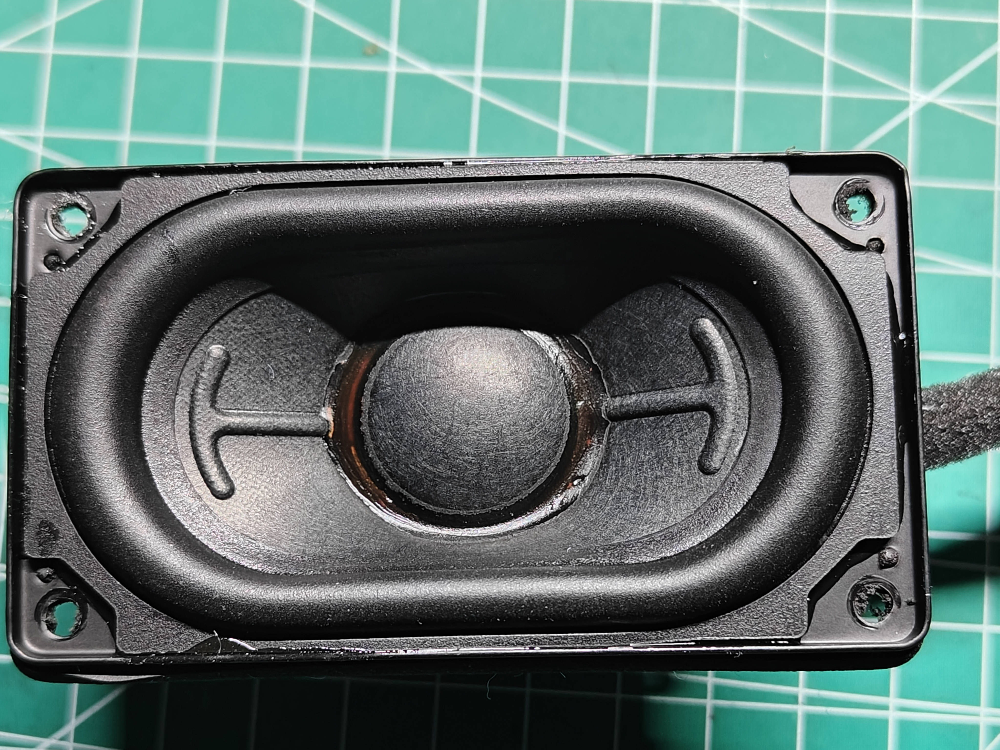
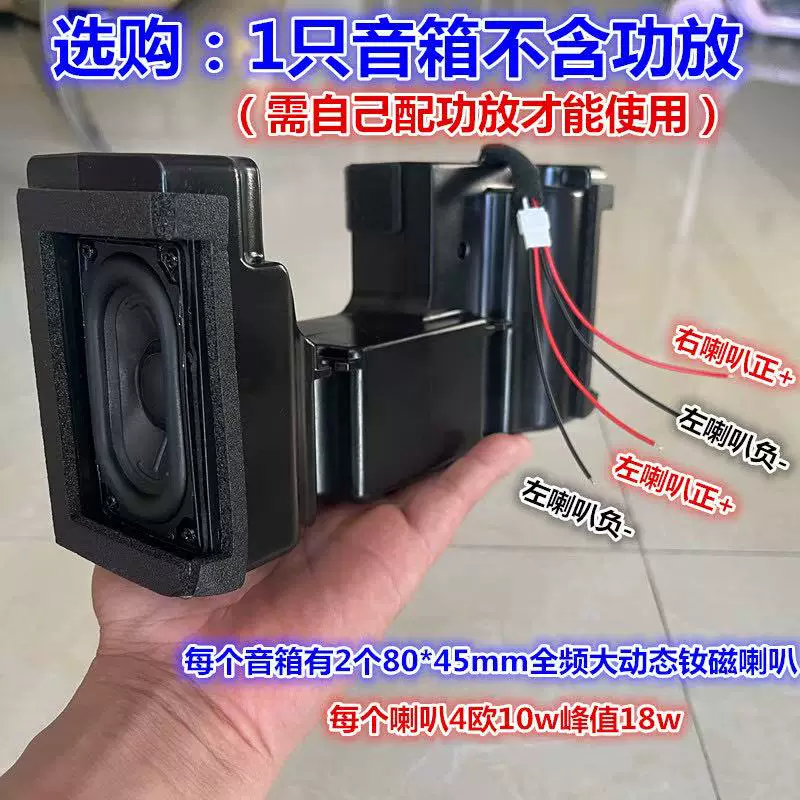
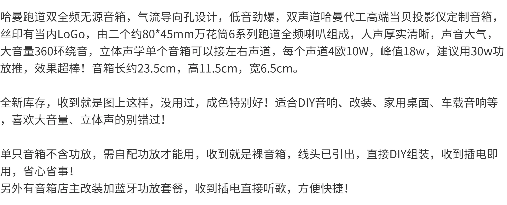

# 80 × 45 mm 全频大动态钕磁喇叭

记录日期：2026-11-05。商品链接：[淘宝商品（1021101388923）](https://item.taobao.com/item.htm?id=1021101388923)。信息依据用户说明及随附商品截图，未独立核实在线商品页；下单数量、价格、到货状态及确切型号未提供。接入 Discora 与箱体重设计为 `planned`，未完成实物、电气或声学验收。

## 单只喇叭参数

| 项目 | 记录值 | 来源与边界 |
| --- | --- | --- |
| 类型 | 全频大动态钕磁喇叭，跑道形单元 | 用户说明及商品标称；具体型号、磁体材质与频响未独立核实 |
| 长 | 80 mm | 用户提供；商品截图同样标注约 80 mm |
| 宽 | 45 mm | 用户提供；商品截图同样标注约 45 mm |
| 总高度／前后深度 | 42 mm | 用户明确为从最前面的振膜到最后面的磁铁的总高度；不是仅磁铁厚度，也不是从安装面算起的入箱深度 |
| 标称阻抗 | 4 Ω | 每只单元的商品标称，未测量 |
| 标称功率 | 10 W | 每只单元；未提供测试标准、持续时间或失真条件，不直接认定为已验证的连续／RMS 功率 |
| 标称峰值功率 | 18 W | 每只单元；峰值定义及持续时间未提供，不能作为持续工作目标 |

80 × 45 × 42 mm 为早期布局输入。下列读数用于 P3 试装版，实际盆架轮廓、端子及导线突出量仍待核对。

## 2026-11-14 安装实测

| 项目 | 用户读数 / mm |
| --- | --- |
| 盆架穿过安装面的最大长 × 宽 | 70.5 × 38.3 |
| 四角孔径、中心距 | Ø3.3；长向 A–B 约 70，短向 A–D 约 36 |
| 孔中心到金属长边 | 约 4 |
| 通孔靠外边缘到同端金属短边 | 左右两端复量均约 2.8～3.0；替代首次 4.5 的读数 |
| 贴合面到前端 / 到后端 | 2 / 39，合计约 41 |
| 螺丝 | 螺纹外径 Ø2.8，螺纹长 9.5，头高 1.9 |

用户说明读数存在测量误差。按长向孔距、孔径与两端边距计算的外框长约 78.9～79.3 mm，与原 80 mm 名义外长相近。螺丝头径、牙型及固定耳实际厚度尚未提供。P3 试装取值见 [ADR-0038](../../docs/decisions/0038-measured-speaker-trial-mount.md)。

用户已打印 P3 喇叭试装片并确认装配无问题，验收范围为单只安装座。随后确认：端子在喇叭背面的短边，上下可以互换；双芯排线单根外径 1.8 mm。当前设计将两只端子均朝上，顶部出线及封堵见 [ADR-0041](../../docs/decisions/0041-p3-speaker-sealing-and-wire-exits.md)。端子和焊点突出量、线材最小弯曲半径仍未测量，完整件走线与气密尚未验收。

## 原商品音箱与 Discora 箱体

随附商品资料称一只无源音箱内有 **2 个 80 × 45 mm 单元**，可分别接左右声道；每声道标称 4 Ω、10 W、峰值 18 W。原箱体标称约 **长 235 × 高 115 × 宽 65 mm**，不含功放。两单元数量指商品内部配置，不代表用户购买数量。

原箱体较大，Discora 采用新箱体。[V4 模型](../enclosure/README.md)将双声腔、喇叭座、前障板及电子托架合并为一个 PLA 主体，侧孔与饰片并入后壳。左右声学结构按机身中心镜像；当前 P3 已按上表实测值设置试装开口与螺柱。实际贴合、振膜活动空间、端子及走线待试装确认。

2026-11-10 用户确认没有更多单元参数；本轮按实际 CAD 测得单侧最窄采样通流面积约 3.84 cm²，保留开口轮廓，未把它认定为经过调谐的倒相孔。分析与加强取舍见 [ADR-0030](../../docs/decisions/0030-side-inset-support-and-port-sizing.md)。

箱体定型前仍需确认单元安装尺寸、声学参数（如 Fs、Qts、Vas）或取得相应实测依据，再验证新箱体的实际声音与共振。原商品的低音、环绕音效、品牌／代工归属等宣传不作为本项目性能结论；商品文案的“建议用 30 W 功放”也不是 Discora 的功放输出设定。

## 2026-11-14 原箱导音通道补充测量

用户测得原箱导音开口约 20 × 20 mm，并描述折返路径中有两段各约 50 mm、其中一处转向约 90°。未测得全程截面、转角中心线长度或原箱净腔容积，因此不能认定整管恒为 400 mm²，或把 100 mm 当作声学有效管长。用户要求结合 Discora 的实际结构与声学布局取舍，不照搬原箱，也不以最少支撑作为唯一目标；不追加试片打印。当前模型与独立导管候选的空间、装配和切片比较见[声道布局研究](../../docs/records/2026-11-14-p3-channel-layout-study.md)。

## 接线资料边界

按项目既定方案，由 TPA3118D2 左右声道各驱动一只单元，接线定义见 [整机接线说明](../../docs/wiring.md#dac功放与喇叭)。商品图的四根线标注存在重复“左喇叭负”字样，不能据此确定连接器针序；实际线序、极性及左右对应仍需核对。

## 参考图片与原件

三张图片按用户提供的原始文件保存，未裁剪、缩放或改写；商品截图保留原有文字与权利标识。文件字节数及 SHA-256 见 [原件校验记录](readback.json)。图片和商品标称不替代实物验收。

单元正面参考：

原商品箱体、线束及参数标注：

商品说明截图：

