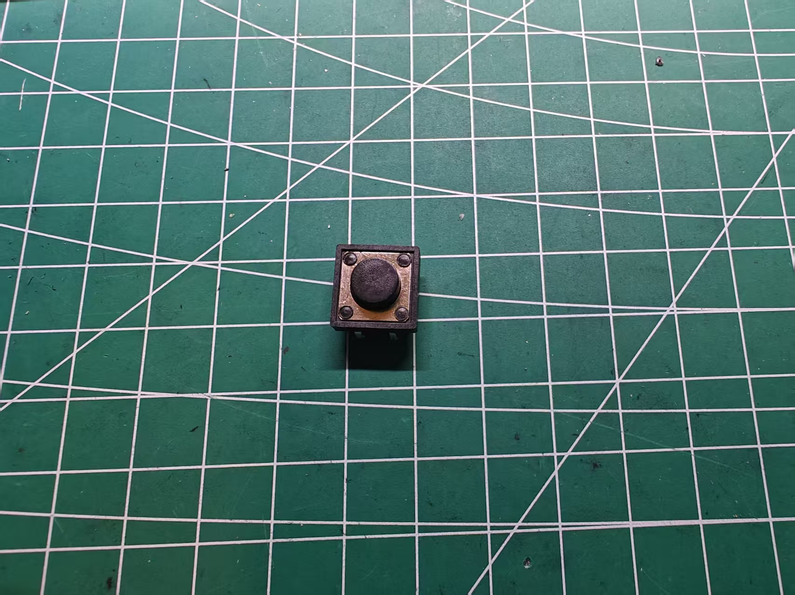

# 12 × 12 mm 轻触按键

记录日期：2026-11-08。来源为用户提供的实物照片和文字尺寸，用于前壳四键布局与安装设计；未提供厂商型号或尺寸图，尚未独立测量或完成装配验收。

## 功能与数量

前壳需要 **4 个按键**，功能分别为：

| 功能 | 数量 |
| --- | --- |
| 播放／暂停 | 1 |
| 上一曲 | 1 |
| 下一曲 | 1 |
| 退碟 | 1 |

以上为功能清单，不规定面板上的左右顺序、排布或键距。数量为设计需求，不作为采购或到货数量记录。控制语义、接线和固件验收状态见[播放器说明](../../docs/cd-player.md)、[换轨按键说明](../../docs/track-buttons.md)和[退碟按键说明](../../docs/eject-button.md)。

## 用户提供的尺寸

单位：mm。保留用户给出的尺寸名称，不将照片比例作为测量值。

| 项目 | 尺寸 | 当前证据 |
| --- | --- | --- |
| 长 × 宽 | 12 × 12 | 用户文字提供 |
| 整体厚度 | 6 | 用户确认包含 2.8 mm 凸起 |
| 按键凸起高度 | 2.8 | 用户文字提供 |
| 引脚长度 | 3.7 | 用户文字提供 |

用户已确认 6 mm 包含 2.8 mm 凸起，因此本体厚度按 3.2 mm 建模。引脚的尺寸基准与是否另计尚未明确，CAD 暂按本体背面另预留 3.7 mm；这不是焊接后的总高测量，也不能直接推算面板露出高度。

## 实物照片

[原始照片](switch-user-photo.jpg)按原始字节保存，仅重命名。照片显示方形本体、金属顶盖与圆形按压部；不据此认定具体型号、按压部直径或引脚电气关系。

## 前壳设计依据与待确认项

- [当前 CAD](../enclosure/README.md) 已改为四键：屏幕左侧 2×2 排布，前排播放／暂停与退碟，后排上一曲与下一曲；列距 18 mm、斜面内行距 20.854 mm。具体设计见 [ADR-0023](../../docs/decisions/0023-four-button-front-panel.md)。
- 5 mm 前壳配独立 Ø10 键帽，孔 Ø10.5、外露 1.2 mm；内部四个定位座与前壳一体，一件可拆压板固定开关。开关本体 3.2 mm、凸起 2.8 mm；圆头仅用 Ø12 保守包络，未作为测量值。
- 引脚暂按从本体背面另伸出 3.7 mm 预留；压板中央支点是否避开真实引脚、焊点与导线须实物核对。未建模虚构的引脚孔位。
- 待确认圆形按压部直径、按下行程、引脚间距和截面、端子通断关系、实际承压面、焊点与导线空间；0.8 mm 键帽活动余量的 CAD 检查不能替代实物行程验收。

这些机械资料不改变既有固件或接线状态，也不代表按键已接入、功能已实测或前壳已通过实物装配。
