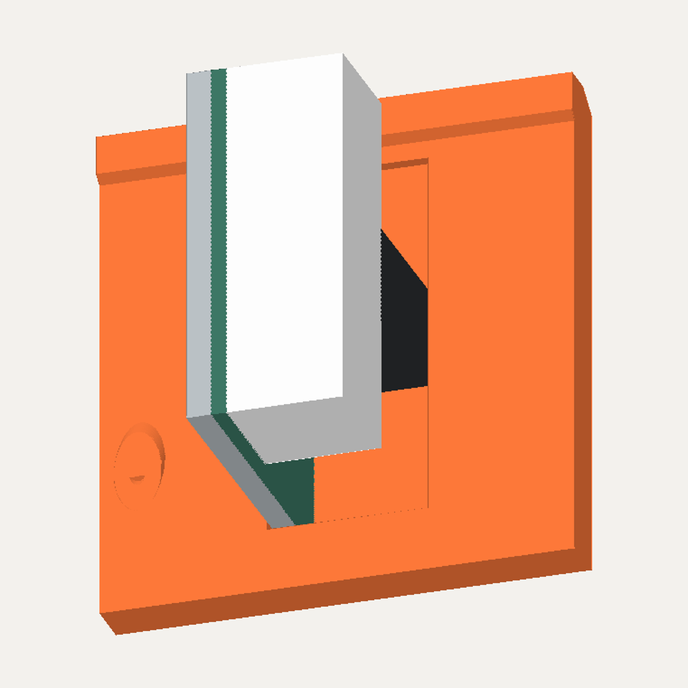
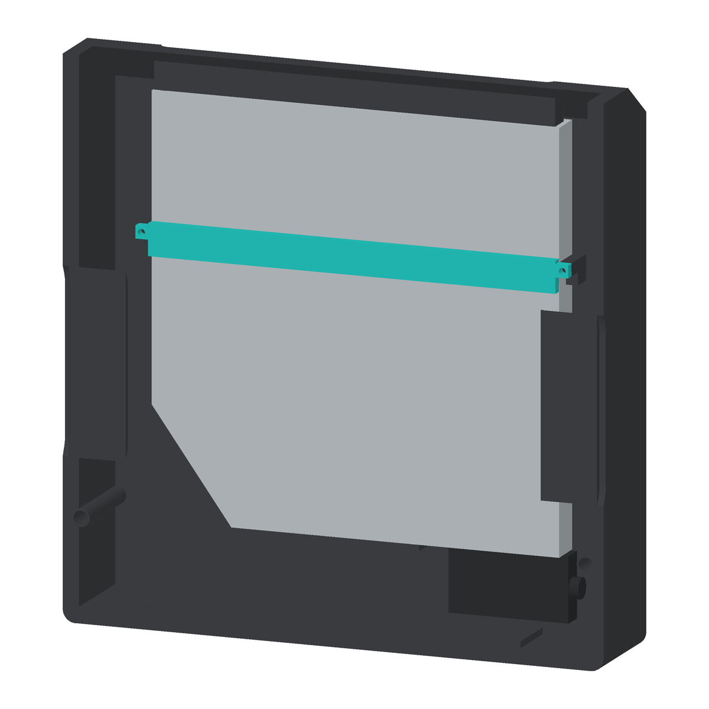

# Discora V4 · 三主体 PLA 外壳

整机宽 **170 × 深 93 × 高 243.263 mm**（含脚垫和提手），不含脚垫为 **240.263 mm**。5600 mAh 电池按用户选定的平排 **112 × 70 × 20 mm** 商品标称包络放在底部；保留顶部进碟、前斜面操控、中央双喇叭和左右对称的外轮廓。

打开 [Discora.FCStd](Discora.FCStd) 查看模型；唯一的[彩色尺寸与装配图册（11 页 A3）](drawings/Discora-V4-drawing-book-color.pdf)包含双基准高度、侧面斜肩尺寸、彩色爆炸图、侧剖、对象清单、OLED、PCB 音量模块、洞洞板及前壳线束维护详图。分件取舍见 [ADR-0016](../../docs/decisions/0016-three-part-pla-enclosure.md)，打印姿态、切片与拆装检查见[打印与装配说明](../../docs/enclosure-printing.md)。P3 喇叭试片已通过实物试装，完整壳体的打印、装配和声学验收仍待完成。

**2026-11-14 P3 螺丝座加强：**P2 左右侧壁各有上下两座，每座背面增加一条与侧壁一体的三角筋，沿 X、Y 各外露 8 mm，Z 向厚 4 mm，以 X=0 镜像。拆下 P1、断线并卸掉四颗固定螺钉后，P3 总成沿 −Y 前移 140 mm 的连续保守扫掠通过；四条筋距 P3 扫掠包络最近约 7.16 mm。几何、对称与净距见 [加强筋检查](p3-seat-rib-checks.json)，后壳已重新切片。彩色图册第 10 页标出四条筋的位置和尺寸。

**2026-11-14 上方背锁加强：**后斜面上的两个前壳深孔座各增加一条 4 mm 宽的短三角筋，左右镜像，接入后斜面内侧。Ø4 mm 刀杆通路及前壳向前抽出 140 mm 检查通过；下方深孔座沿两侧壁一体成形。彩色图册第 11 页标出两条筋、刀杆通路和前壳抽出净空。 [背锁设计](../../docs/decisions/0024-rear-access-front-cover-fasteners.md) · [检查](backlock-rib-checks.json)

**2026-11-14 PCB 音量模块：**采用用户确认的 PCB 35×26.2×1.5、含插头／引脚总厚 15 mm 的 B50K 模块，板前边与安装面齐平。保持旋钮轴心、轴和十字旋钮，组件绕轴转 90° 避开主控元件预留。前壳内侧改为完整包络避让槽，横向各留 0.3 mm，螺母夹持面仍厚 2 mm。该适配阶段其余 31 个成品几何保持。阶段结果见 [ADR-0036](../../docs/decisions/0036-pcb-volume-module.md)和 [PCB 模块检查](volume-pcb-checks.json)；旧 `volume-checks.json` 保留裸电位器阶段证据。总览外观仍适用；图册第 7 页给出 PCB 模块安装详图并重读净距；旧 `volume-mount.png` 保留裸电位器阶段。

**2026-11-12 光驱实测适配：**按用户选择采用 170 mm 外宽，主体壁厚 5 mm，光驱和碟口居中。光驱带铭牌底面靠后壁，留 1 mm 保护垫，以中央底托和两螺钉可拆压条固定。SATA 接头位于光驱下端，线缆按实测自然外伸 14.5 留位，侧壁再余 1.5。深度 93，覆盖接头未测上下偏置；下方背锁移至 X=±79.4、Z=33。具体测量取舍、近似边界和维护顺序见 [ADR-0035](../../docs/decisions/0035-measured-drive-rear-wall-mount.md)及[光驱安装检查](drive-mount-checks.json)。当前为 CAD 实现，尚未实物试装。

以下有日期的旧版记录保留历史尺寸，当前参数以本节及下方尺寸表为准。

**2026-11-11 后壳 5 mm：**后壁、侧壁、底板与后斜顶统一为 5 mm。按用户确认向外扩展，内壁 X=±68、Y=77、底板内面 Z=6 及电子零件位置保持；外壳底 Z=1、脚垫底 Z=−2。电池前后各 1 mm、DAC 侧隙 1 mm，光驱至后斜顶 1.659 mm。光驱侧转时的同步前移量改为 17.75 mm，四条拆装路径通过；下方背锁有效刀杆需至少约 68 mm。见 [ADR-0034](../../docs/decisions/0034-five-mm-rear-shell.md) 与[厚度检查](rear-thickness-checks.json)。

**2026-11-14 洞洞板与前壳线束：**ESP32-S3、PCM5102 和两块 DCE001 的整板转 180°，由 P3 上层三点托架固定。右前角避让 B50K，左侧延伸板边装 2 芯座。载板上的 5 芯、4 芯及 2 芯 XH2.54 接插件和随前壳拉开 60 mm 的线束预留见[洞洞板布局](../../docs/perfboard-layout.md)及[检查报告](perfboard-checks.json)。

**2026-11-08 主体尺寸调整：**前壳竖直面板、顶部斜面主体及格栅统一为 5 mm，与提手一致。按用户确认将深度从 78 增至 80 mm，电池和内部安装结构沿 Y 后移 2 mm，保留电池前后各 1 mm 间隙。前后斜面仍等角、等宽，侧面保留直线接缝。后斜面、碟口与导向框归 P2，提手归 P1；仍为三主体。详见 [ADR-0021](../../docs/decisions/0021-five-mm-front-panel.md)。此前等斜面和分件决策见 [ADR-0019](../../docs/decisions/0019-matched-top-shoulders.md)、[ADR-0020](../../docs/decisions/0020-rear-roof-shell-ownership.md)。

**2026-11-11 底部圆角：**前后左右四个底角采用与提手顶部相同的 R4。左右 XZ 轮廓沿机身深度贯通，前后壳共用同一裁切包络，接缝连续；仅改变 X=±67…±71、Z=3…7 的底边区域。整机尺寸、脚垫、电池托盘及其它 30 个成品保持，后壳侧视对称保留。检查见 [bottom-corner-checks.json](bottom-corner-checks.json)，外观见[底角近景](bottom-corners.png)。实物打印与配合仍待验证。

**2026-11-11 对称后壳与等厚前壳：**后壳侧视以 Y=42.5 对称，前后斜肩起点同为 Z=162.419、顶点 Z=189.064。前壳以 5 mm 法向厚度贴合前侧，其外斜面起点 Z=165，比后壳高 2.581；后壳顶点与接缝终点相接，取消顶部台阶。侧孔与 P3 对应通道向后移 2.5，居中于后壳轮廓。三个主体之外的 29 个成品几何不变。见 [ADR-0033](../../docs/decisions/0033-uniform-front-side-seam.md)、[检查报告](side-seam-checks.json)与[前后对比](side-seam-comparison.png)。

**2026-11-09 正面圆孔：**按参考图将中央开口改为 Ø130 的完整圆口，护网正面从 Y=0 退至 Y=2.5，背面仍为 Y=5，厚度为 2.5 mm；前壳其余竖直面与顶部斜面仍厚 5 mm。Ø136 护网底片在 Ø130 面板圆口下方每侧延伸 3 mm，连接环完全藏在面板内。孔阵越过圆口边界，面板自然遮住外围孔，形成 1531 个完整可见孔和 92 个边缘部分孔，取消孔口内的连续实心边。见 [ADR-0026](../../docs/decisions/0026-recessed-front-grille.md)。

**2026-11-10 OLED 适配：**已按供应商结构图替换旧占位，保持有效区左右居中。PCB、四孔、玻璃和底部缺口均按图建模，玻璃前面从深度 5.4 移至 1.0，内侧沉槽配四孔定位柱和可拆压框；外口 32.82 × 18.1 倒角收至 30.42 × 15.7 喉口。正前方与选定斜视方向、接头、插线与工具空间经过 CAD 检查，实物配合仍待验收。详见 [ADR-0028](../../docs/decisions/0028-oled-mechanical-mount.md)和图册第 6 页。

**2026-11-10 提手加高：**提手高出斜肩从 25 增至 45 mm，居中净开口最终采用 90×24，厚度仍为 5；根据用户对上横梁偏薄的反馈，从初版 90×36 收口，使上下横梁最薄处从 4.5 增至 10.5。其余 31 个成品几何保持，详见 [ADR-0031](../../docs/decisions/0031-taller-handle.md)及 [handle-checks.json](handle-checks.json)。实际握持与承载仍待实测。

**2026-11-10 前壳配色：**P1 一体前壳（正面板、内凹护网、前斜面和提手）采用[用户指定耗材](https://item.jd.com/10161064876888.html)的拓竹 PLA Lite 橙色 16301，CAD 色值为 `#FF671F`（RGB 255/103/31），来自 Bambu Studio 的 `filaments_color_codes.json`。屏幕颜色仅为参考，实际耗材受照明与打印表面影响。四个独立键帽与前壳同用 PLA Lite 橙色；音量旋钮采用用户已有的拓竹 PLA Basic 黑色 10101（`#000000`）。

**2026-11-10 音量适配：**按用户选定的 [B50K 双联带开关电位器](../Potentiometer-B50K-Switch/README.md)调整前壳：Ø7.2 孔、偏心内槽及 2 mm 夹持面；外侧增加底径 Ø24.8、深 1.6 的凹位。六角螺母对边 9.8、厚 1.9。按后续反馈将十字臂宽从 9 收至 6.8、跨度改为与底盘直径一致的 24；Ø24×1.4 底盘下沉 1，顶面高出面板 12.9。取消侧螺钉，采用六条筋尖内切直径 5.6 的压配筋咬合 Ø5.8 花轴，实际松紧和耐久需试片确认。详见 [ADR-0032](../../docs/decisions/0032-b50k-cross-knob.md)、[检查报告](volume-checks.json)及[局部预览](volume-detail.png)。

**2026-11-11 旋钮白色标记：**保留 0.7×2.2 mm 指示条，改为深 0.6 mm、与顶面齐平的白色实体。`export-dual-color-knob.py` 生成一个旋钮、两个材料区域的 3MF：材料 1 为 PLA Basic 黑色，材料 2 为 PLA Lite 白色。`slice-dual-color-knob.py` 使用本机 P2S 0.4 mm／0.12 mm 配置完成验证，标记有 5 层白色路径；整盘预估 48 分 42 秒，含支撑和换色消耗约 9.50 g。见 [双色旋钮检查](dual-color-knob-checks.json)；实际遮盖、粘结和压配仍待打印确认。

**白色功能标记：**四个键帽均为橙色键体加白色符号的双色打印件。白色符号深 0.6 mm、与键面齐平，最细笔画约 0.8 mm；每键保留两个材料区域，白色区域含 2 或 3 个连通分量，与橙色共同打印，无需另装小嵌件。`export-dual-color-keys.py` 输出四键一盘的双色 3MF（材料 1：PLA Lite 橙色，材料 2：PLA Lite 白色），保持符号面朝上、止退沿贴板。普通 STL 只能导出单色包络，不能保留双色分配。

本机 Bambu Studio 02.09.01.70 使用 P2S 0.4 mm / 0.12 mm 配置完成双色切片：每键均有 5 层白色路径，共 60 层；整盘预估 34 分 20 秒，橙色 4.93 g、白色 2.49 g（含换色与擦拭塔消耗）。这是本地切片证据，未发送打印；白色遮盖、粘结和按压配合仍需实物确认。详见 [dual-color-key-checks.json](dual-color-key-checks.json)。

前次双色键帽调整仅将四个键帽变为多材料复合体，其余 88 个形状资源在该阶段与原验收版本逐字节一致，键帽外包络和安装位置不变；四键对其余装配件无超过 0.001 mm³ 的碰撞。配色阶段曾关闭并重新打开验证橙白分面颜色，详见 `appearance-checks.json`。整机、正面、侧面、操控区、退碟、内部布局及旧侧剖预览记录此前光驱／音量模块适配版本。图册第 8 / 9 页为载板与前壳线束维护图，详见[布局说明](../../docs/perfboard-layout.md)。其它局部图为历史细节图；尺寸以当前模型和图册为准。光驱适配生成时 FreeCAD GUI 接口不可连接；该版保留其它 GUI 材质资源，为光驱压条和接头补全显示资源，核对双色键帽及旋钮面序，未完成交互界面读回。

**FCStd 配色保存：**无界面保存后补回 GUI 数据时，材质资源必须按 `GuiDocument.xml` 的引用顺序写入；不能用集合的无序遍历写入压缩包，否则 FreeCAD 会跳过颜色资源。`repair-gui-order.py 输入.FCStd 输出.FCStd` 可修复顺序，并逐项核对包内数据完全一致。修复后须在 FreeCAD GUI 读回颜色、关闭并重新打开核对；外部渲染图不能代替此项验证。历史配色读回见 [appearance-checks.json](appearance-checks.json)；当前保存资源检查见 [drive-model-metadata-checks.json](drive-model-metadata-checks.json)，当前版本的 GUI 读回仍未完成。

**背面锁紧：**正面四个螺丝孔已取消；后壁下方两孔、后斜面两孔锁紧前壳，名义螺钉 2×8 mm。下方通道深 78.8 mm，需细长螺丝刀。结构和工具边界见 [ADR-0024](../../docs/decisions/0024-rear-access-front-cover-fasteners.md) 与 [fastener-checks.json](fastener-checks.json)。

**2026-11-10 侧孔一体打印：**左右导音孔与内凹饰片已并入 P2，取消外侧固定耳、螺钉孔和装配缝；短管与声腔保持 0.3 mm 轴向名义间隙，使 P3 仍可从前方抽出。`LPort` / `RPort` 仅作为隐藏构造源保留，不再单独打印。当时共 10 件刚性 PLA 零件（本版新增光驱压条，共 11 件），见 [ADR-0029](../../docs/decisions/0029-integral-side-ports.md)。

**侧饰片连接加强：**饰片改为上、下及中部左右共四点连接，连接筋截面由 1×2 增至 2×3 mm，饰片向内加厚至 2 mm，表面仍内凹 1.5 mm。[连接加强历史特写](side-port-detail.png)由保存模型无界面渲染。历史加强阶段单侧最窄采样净通流面积约 384.24 mm²，较当时前版减少 6.59%；67×22 mm 开口轮廓保留。现有喇叭缺少 T/S 参数，无法据外形尺寸认定需要继续缩孔；容积和声学边界见 [ADR-0030](../../docs/decisions/0030-side-inset-support-and-port-sizing.md)。

## 分件

**四键已加入 CAD：**[12 × 12 mm 轻触按键](../Tactile-Switch-12x12/README.md)采用屏幕左侧 2×2 排布，独立键帽、P1 内侧定位座和可拆压板。前排为播放／暂停、退碟，后排为上一曲、下一曲。开关本体按 3.2 mm、凸起 2.8 mm 建模；圆头直径及精确脚距尚未测得；按引脚面照片与直接焊线要求，改为两侧敞开的焊线支架，每键两个小支承面避开中央凹凸，见 [ADR-0025](../../docs/decisions/0025-open-button-wire-retainer.md)，详见 [ADR-0023](../../docs/decisions/0023-four-button-front-panel.md)。

| 成品 ID | 合并的功能 | 数量 |
| --- | --- | --- |
| `FrontShell` / P1 | 前壳、前斜面、提手、面板下隐藏连接环、内凹通孔护网、屏幕安装座、四键定位座和压板螺柱 | 1 |
| `RearShell` / P2 | 后斜面与碟口导向、左右侧壁及导音孔／饰片、后壁、底架、电池托盘、光驱中央底托／压条螺柱和壳体连接柱 | 1 |
| `SpeakerCarrier` / P3 | 双声腔、喇叭试装座、前障板、功放托板、洞洞板三点固定托架 | 1 |
| `PlayPauseKey` / `EjectKey` / `PrevKey` / `NextKey` | 四个带凹刻图标的独立键帽 | 4 |
| `ButtonRetainer` / `Knob` | 四键焊线支架、音量旋钮 | 2 |
| `DisplayRetainer` | OLED 可拆压框，四点承压、两侧锁紧 | 1 |
| `DriveRetainer` | 光驱可拆压条，两枚名义 M2×10 | 1 |

**3 个主要结构件，11 件刚性 PLA 零件**。两个喇叭与电路板作为采购件装到 P3，不与打印件融为材料实体。脚垫另用软质件，OLED 自带玻璃、电子板、紧固件、绑带和导线不计入 11 件。前障板功能保留在 P3 中。喇叭从正面装入，每只采用四处盲底孔，设计依据见 [ADR-0038](../../docs/decisions/0038-measured-speaker-trial-mount.md)。

左右侧孔的侧视竖直中心线位于后壳侧轮廓对称轴 Y=49；提手厚度中线为 Y=46.5。开口、声腔接口和饰片同步调整，左右保持镜像。

侧孔与饰片和 P2 一体打印，无单独安装步骤。短管末端位于 X=±65.3，声腔外壁位于 X=±65，保留 0.3 mm 轴向名义间隙；导音管不再伸入 P3 的前向拆装扫掠范围。气密、声学和打印补偿仍需实物验证。光驱维护先拆下 P3、压条和电池，进入维护位置拆接头，再从正面侧转抽出；详见 ADR-0035。

## 尺寸和布局

**实测来源：**[UJ-898 照片与 A–F／SATA 测量记录](../MATSHITA-UJ-898/README.md)。本版已采用实测最大包络与接口占位；斜边及底部台阶的精确范围尚未测全，净空检查使用完整最大包络。

单位 mm；X 向右、Y 向后、Z 向上，机身中心面 X=0。除既有操控布局外，外壳、提手、格栅和声学结构保持左右对称。SATA 接头、线缆与洞洞板属于内部电子布局。

| 对象 | 当前名义尺寸或位置 |
| --- | --- |
| 前斜肩 / 后斜肩 | YZ：(0,165)→(44,196.263) / (49,193.682)→(93,162.419)；均为 35.395°，水平宽 44、实际斜宽 53.976 |
| 前壳面板 | 竖直面、顶部斜面主体与两侧斜面边带法向厚 5；安装座、盲孔连接柱和提手根部为局部加强区域 |
| 后壳主体 | 后壁、左右侧壁、底板与后斜顶均厚 5；饰片厚 2，局部功能结构另计 |
| 提手 | 净开口 90 × 24；上下横梁 10.5；顶面 Z=241.263、后表面 Y=49；厚 5 |
| 碟口 | 水平投影 124 × 5.5，中心 Y=79.05；竖直退碟 |
| 中央格栅 | 正面圆孔 Ø130，护网底片 Ø136、内凹 2.5、厚 2.5；圆口内 1531 个完整孔＋92 个部分孔，孔径 Ø1.88、孔距 2.9；中心 X=0、Z=76 |
| 喇叭 | 每只试装包络 X/Y/Z=45/41/80，中心 X=±26、Z=76，贴合面 Y=10；实测前深 2、后深 39 |
| 喇叭试装座 | 开口 71.5 × 39.3（Z × X）、R12.5；每只四孔距 70 × 36；Ø2.3 盲底孔深 10.5，配用户 Ø2.8 螺钉 |
| 后腔 | 每侧 65 × 57.5 × 89，Z=31.5…120.5；喇叭后包络距内壁 11 |
| 侧开口 | 外侧可见导音口高 67 × 宽 22，中心 Y=49、Z=80；一体外环 74.6 × 29.6 覆盖旧 74 × 29 构造开口与装配缝，饰片 12 × 56；无固定耳凹槽 |
| UJ-898 | 128 × 10.8 × 130 最大包络，Y=76.2…87、Z=29.5…159.5；后壁保护垫预留 1 |
| SATA 接头 | 外壳 37.7 × 7、后伸 20.4；X=28.3…66、Y=78.75…85.75、Z=9.1…29.5；上下居中仅示意，独立净空覆盖 38.8×9.5×20.4 |
| SATA 线缆 | 机箱 +X 侧外伸 14.5，至侧内壁余 1.5；三维弯折待试装 |
| 功放 | PCB 66 × 53 × 1.6，Y=6…59、Z=123…124.6；元件高度预留 15 |
| 洞洞板 | 基准 100 × 55 × 1.6，底面 Z=142.8，右前 16.75 × 32 缺口，左侧 11 × 10 延伸；三枚名义 M2×4 |
| 主控／DAC／DCE001 | 安装到同一载板；模块位置、排母、插头和线束预留见[洞洞板布局](../../docs/perfboard-layout.md) |
| 四键 | X=−59 / −41，Y=9 / 26；孔 Ø10.5、键帽 Ø10，法向外露 1.2；列距 18、斜面行距 20.854 |
| 按键安装 | 12.4 方孔容纳 12×12×3.2 本体；凸起高 2.8；镂空支架／双点支承，两侧开口供直接焊线；支承及焊线配合待测 |
| OLED | PCB 35.4 × 33.5 × 1.2；玻璃 34.5 × 23 × 1.4；有效区 29.42 × 14.7；外口 32.82 × 18.1、内喉口 30.42 × 15.7，倒角深 0.8 |
| OLED 安装 | 有效区基准 X=0、Y=18、Z≈177.789；玻璃内退 1.0；四孔 Ø3、孔距 30.4 × 28.5；Ø2.6 定位柱与可拆压框，2 枚名义 M2×6 |
| 音量组件 | PCB 35×26.2×1.5；含插头／引脚总厚15；绕轴90°，板宽沿斜面上下展开；壳孔 Ø7.2、夹持面厚2；旋钮 Ø24、下沉1、顶面距面板12.9；原主体／轴截面沿用名义值 |
| 电池 | 112 × 70 × 20，X=−56…56、Y=6…76、Z=8…28；前后壁分别 1 / 12、托盘侧隙各 1、距声腔底 3.5 |
| 电池绑带槽 | 四处，X=−61…−58 / 58…61，Y=24…32 / 44…52；绑带未建模 |
| 前壳连接孔 | 正面无螺丝孔；后壁 X=±79.4、Z=33，后斜面 X=±29、Z=179；Ø4.4 深孔／Ø2.2 通孔／前柱 Ø1.6 盲孔 |
| 支架连接孔 | 4 处，X=±64、Z=27 / 124，沿 Y；Ø2.8，沉头 Ø4.8，后壳底孔 Ø2.0 |
| 侧孔接口 | 与后壳一体；旧四处固定孔已补实，短管对声腔轴向留隙 0.3 |

沉头及底孔是名义连接设计，按约 Ø2.5 / Ø2 螺杆预留；螺钉具体牙型、长度和 PLA 底孔配合须用试片选定。没有建模热熔嵌件。壳体接触面按名义贴合，需实测打印补偿和密封垫厚度；0.3 mm 侧隙也不是对任意打印设置的保证。

商品电池尺寸来源见[电池资料及原图](../Battery-3S2P-5600mAh/README.md)；喇叭安装尺寸见[实测记录](../Speaker-80x45-4ohm-10W/README.md#2026-11-14-安装实测)。用户已确认喇叭装入试片无问题；完整 P3 的端子走线、螺钉咬合和合壳间隙待验收。见 [试片结果](../../docs/decisions/0038-measured-speaker-trial-mount.md#2026-11-14-试片结果)。

## 验证依据

- [drive-mount-checks.json](drive-mount-checks.json)：当前实测光驱、压条、保护垫间隙、接头及线缆净空，20 个既有硬件／操控对象差集为零。
- [rear-thickness-checks.json](rear-thickness-checks.json)：历史 5 mm 加厚阶段的内壁、净距、底角与侧视对称；当时 28 个其它成品保持。下列历史专项比较通过摘要和不变对象关联到本版，不作为本版所有结构不变的证明。

- [port-reinforcement-checks.json](port-reinforcement-checks.json)：四点连接、饰片厚度、局部新增材料无干涉和开口面积检查；仅为几何结果，不代替强度与声学实测。
- [drive-side-port-checks.json](drive-side-port-checks.json)：当前一体后壳有效且仅含一个实体；侧孔归属、壁面补实、0.3 mm 轴向间隙和镜像检查通过。`side-port-checks.json` 保留首次侧孔一体化的历史比较。
- [handle-checks.json](handle-checks.json)：提手加高的改动边界、31 个成品不变、提手镜像及键帽面序检查。
- [volume-pcb-checks.json](volume-pcb-checks.json)：当前 PCB 完整包络、净距、夹持面、旋钮扫掠与轴向拆卸；31 个其它成品几何不变。
- [volume-checks.json](volume-checks.json)：历史裸电位器阶段，音量元件尺寸、螺母／工具／焊线预留、旋钮整圈包络与拆卸检查，28 个其它成品几何保持。
- [validation.json](validation.json)：当前结构检查，涵盖盆架包络正向插入、两侧各四处盲孔、工具空间及前后净距；保存后重新打开，44 个成品对象有效，三主体各为一个连续实体，除报告单列的六条压配筋／花轴包络名义过盈外，两两交叠不超过 0.001 mm³；退碟、侧向空气通路、接头设计预留、关键净距及提手检查通过。
- 左右导音孔与侧壳开口读回为 Y=49，后壳侧视轮廓以此为对称轴；提手中线为 Y=46.5。8 项镜像差集为零，4 组原生右件镜像关系有效。前壳仅排除操控开孔（含电位器内侧沉槽）、四键定位座及其镜像区域；当前后壳直接检查镜像（旧 DAC 支撑已取消）；支架检查声学下半部至 Z=120.5。[grille-change-checks.json](grille-change-checks.json)保留此前护网调整的历史比较，不能当作当前 OLED 版的摘要；OLED 阶段曾改变五个既有成品对象并新增压框；侧孔一体化阶段的几何比较见 `side-port-checks.json`，此前侧轮廓调整见 `side-seam-checks.json`，本次光驱适配见 `drive-mount-checks.json`。四键替换旧单键，历史单键差集不再适用。
- [oled-checks.json](oled-checks.json)：四孔、玻璃深度、沉槽／倒角、指定方向无遮挡、定位座原生镜像及压框、接头／插线预留及螺钉头／工具通路通过；前壳卸下后的压框、模组两步取出路径分别按 0.5 mm 检查 51 个姿态。接头截面、线材、螺钉与打印配合仍待实测。
- [button-checks.json](button-checks.json)：核对四键孔径、键帽／开关局部包络及 0…0.8 mm 的五个键帽姿态。新增八个引脚侧连续开口、中央避让与双点支承检查；开口与实体、DAC 输出接头预留无交叠。真实圆头直径、行程、脚距和底面承压配合未验收。
- [assembly-paths.json](assembly-paths.json)：支架、电池采用连续保守扫掠，侧孔保持为后壳固定部分；光驱从前方侧转拆出，其平移段连续保守扫掠、抬升和转动段使用填满的最大主体包络，转动按 0.5° 步长检查 B-rep；前壳卸背面螺钉后向前退出，按 1 mm 步长检查。均以前壳按顺序拆除、紧固件和绑带卸下、导线断开为前提。
- [speaker-scope-checks.json](speaker-scope-checks.json)：与洞洞板版逐件比较，几何变化限于 P3 及双喇叭占位，P3 在 Z=120.5 以上几何等价。
- [speaker-print-checks.json](speaker-print-checks.json)：当前 P3 闭合 STL 与 0.4 mm 喷嘴切片。
- [print-checks.json](print-checks.json)：170 mm 光驱适配版单色切片记录，四键与旋钮分别使用独立双色记录。十一个闭合包络网格均能在 256³ 空间内放置并留 5 mm brim，Bambu Studio 的 P2S / 0.4 mm 配置完成四盘 PLA 切片。切片不等于实际成型或承载试验。

功放左右各保留 15 mm 接线，载板接插件及前壳服务线束检查见 [perfboard-checks.json](perfboard-checks.json)；OLED 另检查图纸 11.3 mm 深度和针尖后 6 mm 插线预留，并检查一体支架是否侵入；不涵盖尚未测量的桥接转接线、电池引线、充电稳压板和实际弯折半径。声腔连通不等于声学调谐或气密验证。提手层间强度、支撑清理、螺钉反复拆装寿命及 PLA 热变形需试样验证。

## 编辑和出图

在 FreeCAD 执行 [build.FCMacro](build.FCMacro) 重建。隐藏的 `Construction` 组保留草图、布尔源件和原生镜像；三个成品实体记录 `ConstructionObjects`，由脚本融合生成。**修改隐藏源件后应重新运行建模脚本**；三主体不是会随源件自动更新的实时融合特征。`RPort`、`RDriver`、`RChamber`、`RDriverFrame` 和 `DisplayMountRight` 保留原生镜像。

PCB 音量适配的前后对照使用 [check-volume.py](check-volume.py) `--baseline <PCB替换前.FCStd>`，默认输出 `volume-pcb-checks.json`；实测之前用 5.5／5.6／5.7 压配筋试片确认松紧；名义过盈不等同于保持力实测。

提手调整的前后对照使用 [check-handle.py](check-handle.py) `--baseline <调整前.FCStd>`；基准文件应在修改前保存到忽略目录。

底角调整前后可运行 [check-bottom-corners.py](check-bottom-corners.py) `--baseline <调整前.FCStd>`，核对 R4 曲面、修改区域、前后壳接缝、左右／侧视对称和其余成品不变。

侧缘调整前后可运行 [check-side-seam.py](check-side-seam.py) `--baseline <调整前.FCStd>`；基准保存到忽略目录。该检查核对后壳侧视对称、侧缘法向厚度、侧孔平移及其余 29 个成品几何不变。

光驱适配的日常复查使用 [check-drive-mount.py](check-drive-mount.py) `--output tmp/drive-mount-current-checks.json`，先创建 `tmp/`。完整前后对照须加 `--baseline <光驱适配前.FCStd>`；从 Git 恢复本版基准及保护图册追溯报告的方法见[打印说明](../../docs/enclosure-printing.md#重现)。本轮交付范围、验证边界和接收端复核入口见[交接记录](../../docs/current-work-handoff.md)。

后壳厚度调整可运行 [check-rear-thickness.py](check-rear-thickness.py) `--baseline <调整前.FCStd>`。

执行 [validate.FCMacro](validate.FCMacro) 重新读回检查，再运行 [check-side-ports.py](check-side-ports.py)（日常复查用 `--output tmp/side-port-current-checks.json`，保留已提交的基准比较证据）、[check-oled.py](check-oled.py)、[check-fasteners.py](check-fasteners.py)、[check-buttons.py](check-buttons.py)、[check-assembly.py](check-assembly.py)、[export-print-parts.py](export-print-parts.py) 与 [slice-print-parts.py](slice-print-parts.py)。OLED 版已经改变屏幕几何，不应再传入旧屏幕模型运行历史“操控不变”或 Z 上移比较；`check-oled.py --baseline` 接受本次适配前模型，核对其余 28 个成品对象不变。双色键帽另外运行 [export-dual-color-keys.py](export-dual-color-keys.py)；旋钮另外运行 [export-dual-color-knob.py](export-dual-color-knob.py) 与 [slice-dual-color-knob.py](slice-dual-color-knob.py)；常规单色切片脚本排除四个键帽和旋钮，避免丢失材料分配。临时 STL、3MF、配置和 G-code 放在被忽略的 `tmp/`，仅保存检查摘要；切片脚本不连接或发送到打印机。

[render.FCMacro](render.FCMacro) 从保存模型生成[整机](preview.png)、[正面](front.png)、[护网细节](grille-detail.png)、[侧面](side.png)、[操控区](controls.png)、[后上方碟口](topload.png)、[光盘退出示意](disc-path.png)、[移开前壳的内部](layout.png)、[OLED 安装座内侧](oled-mount.png)、[正前方 OLED 细节](oled-front-detail.png)和[真实侧剖](section.png)。光盘参考对象默认隐藏，不代表实际退出行程。彩色图册更新步骤见[图册说明](../../docs/enclosure-drawings.md)。
